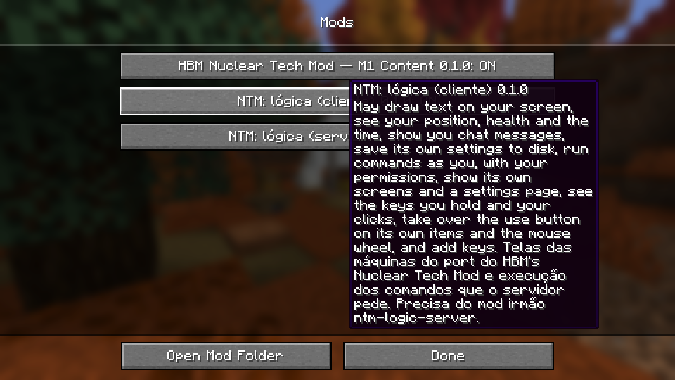

# Como instalar o NTM (Marco 1) no seu Horizon

Este pacote leva uma parte do HBM's Nuclear Tech Mod para o Horizon:

- minérios novos no mundo;
- lingotes, placas e fios;
- gerador a lenha, cabo, bateria, fornalha elétrica, prensa a combustível e
  prensa elétrica;
- radiação de itens.

Funciona **só em um mundo de um jogador (single player)**.

## 1. Os arquivos

Na pasta `dist/` deste projeto há três arquivos. Você precisa dos três:

| Arquivo | O que é |
| --- | --- |
| `ntm.hmod` | Blocos, itens, texturas, receitas e minérios |
| `ntmlogic-server.hmod` | A lógica das máquinas, da energia e da radiação |
| `ntmlogic-client.hmod` | As telas das máquinas e o contador Geiger |

Para conferir se os arquivos vieram inteiros (`sha256sum dist/*.hmod`):

```
5af4367ff389605148be0bb1901079a0086c8741700a35c8f640db81ca61eca5  ntm.hmod
19cb75c41fab67853a47c54b8c7c3fd5492755e7a828311dc471cd0629e9fcd2  ntmlogic-client.hmod
a3f2d298907c0701baa44542c7b90379800cc72ee366a4349c326e9cffe790e2  ntmlogic-server.hmod
```

## 2. Onde copiar

O seu Horizon roda da pasta `/home/sacer/Games/horizon`: o atalho
`horizon` (em `~/.local/bin/horizon`) entra nela antes de abrir o jogo. O jogo
procura os mods numa pasta chamada `horizon-mods`, **ao lado do `options.txt`**
dessa pasta. Então:

1. Crie a pasta, se ela ainda não existir:
   `/home/sacer/Games/horizon/horizon-mods`
2. Copie os três arquivos `.hmod` para dentro dela.

Se você abrir o jogo com `cargo run --release -p horizon-client` de dentro de
`/home/sacer/Games/horizon`, a pasta é a mesma.

## 3. Ligar os mods

1. Abra o jogo e vá em **Opções > Mods**.
2. Clique em **"HBM Nuclear Tech Mod — M1 Content"** até ficar **ON**.
3. Clique **uma vez** em **"NTM: lógica (cliente)"**. As duas linhas "NTM:
   lógica" ficam **ON** juntas, porque são um mod só, dividido em duas partes.
   Se você clicar de novo, as duas desligam.
4. Clique em **Done** e **feche o jogo e abra de novo**. Os blocos e itens novos
   só aparecem depois de reiniciar.



## 4. O mundo

- Crie um **mundo novo**. Os minérios do NTM só aparecem em terreno gerado
  depois que o mod foi ligado.
- O mundo precisa de **comandos ligados**: "Permitir comandos" (cheats) na
  criação, ou depois em **Abrir para LAN > Permitir comandos**. As máquinas usam
  comandos do jogo para pegar e entregar itens. Sem comandos, o mod avisa no
  chat e as máquinas ficam paradas.
- Pode jogar em **Sobrevivência** normalmente.

## 5. Como usar as máquinas

- **Abrir uma máquina:** olhe para ela e aperte **R**, ou clique com o botão
  direito com a **mão vazia**. Com um bloco na mão (tora, minério), o botão
  direito coloca o bloco, então prefira o R. A tecla pode ser trocada em Opções
  > Mods, na página do mod.
- **Pôr um item:** segure o item e clique em **"Pôr item da mão (1)"**. Entra um
  por clique. Se a tela já estiver aberta, troque o item da mão e clique de novo.
- **Tirar o que a máquina fez:** **"Retirar a saída"**. Os itens vão para o seu
  inventário.
- **Moldes da prensa:** **"Retirar o molde"** devolve o molde com o desgaste
  marcado; quando ele volta para a prensa, o desgaste continua.
- **Quebrar uma máquina** solta o que estava dentro dela.

### Energia

- O **gerador a lenha** só se liga pela **traseira**, o lado oposto ao que olha
  para você quando ele foi colocado. Ponha o **cabo** ali.
- A **bateria** liga pelos quatro lados, mas não por cima nem por baixo, e não
  passa energia de um lado para o outro. Ela recebe de um lado e entrega para os
  outros.
- A **fornalha elétrica** e a **prensa elétrica** ligam por todos os lados.

Exemplo que funcionou no teste:

```
gerador (olhando para você) → cabo → cabo → bateria → fornalha elétrica (de um lado)
                                                    → prensa elétrica (do outro)
```

### Radiação

O canto superior esquerdo mostra o **Geiger**, com a taxa (RAD/s) e a dose. Itens
de urânio e tório no inventário aumentam a dose. Com dose alta vêm náusea,
fraqueza, envenenamento e, no fim, a morte. A dose fica salva no mundo.

## 6. Limites conhecidos

- **Só single player.** Num servidor dedicado ou para convidados de LAN, as
  telas não funcionam.
- **Comandos ligados** são obrigatórios.
- As telas são simples: texto e botões, sem a interface gráfica do NTM.
- Depois de um **crash** do jogo, o mundo volta ao último salvamento automático,
  e o mod desfaz nas máquinas o que o mundo esqueceu. Uma exceção: o combustível
  já queimado nesse intervalo não volta.
- A pasta de dados do mod (`horizon-mods/.horizon-mod-data/ntmlogic`) tem espaço
  para umas 50 cópias de mundos com máquinas. Para apagar os dados de um mundo
  que você não usa mais, digite no chat `/ntmlogic status` para ver o id do mundo
  e `/ntmlogic forget <id>`.
- Comandos úteis no chat:
  - `/ntmlogic status`: estado do mundo, das máquinas e das redes;
  - `/ntm status`: estado do lado do cliente.

## 7. Desinstalar

Desligue os mods em Opções > Mods e apague os três `.hmod` de `horizon-mods`.
Para apagar também os dados das máquinas, apague a pasta
`horizon-mods/.horizon-mod-data/ntmlogic`.

Não foi testado o que acontece ao abrir um mundo com blocos do NTM depois de
tirar o mod. Para não arriscar, faça uma cópia do mundo (pasta `saves/`) antes
de abrir.
