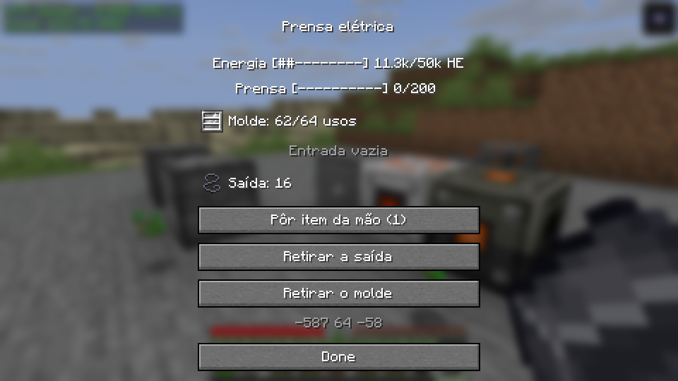
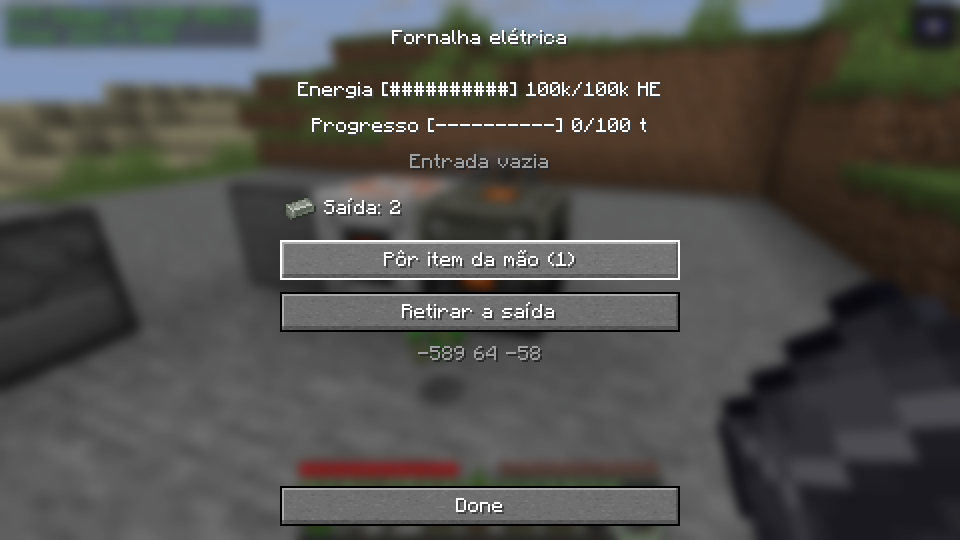
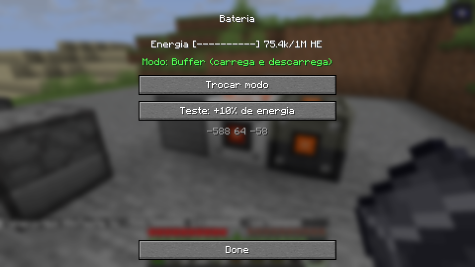
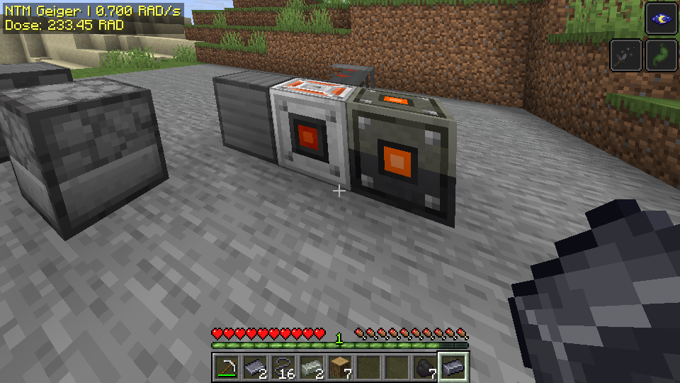

# Teste de aceitação do Marco 1

Data: 2026-10-28. Horizon `release`, jogo mudo (`options.txt` e PipeWire).

## Como foi montado

- **Instalação como a do usuário.** Usei uma pasta de jogo temporária,
  `target/test-game/accept`, com `horizon-mods/` e os três `.hmod` de `dist/`.
  O script foi `tools/test-game/run-installed.sh`, sem `--dev-mod`. Nada foi
  instalado em `/home/sacer/Games/horizon` nem em `~/.minecraft`.
- **Mods.** Liguei os mods pela tela **Opções > Mods**. O arquivo
  `horizon-mods.txt` ficou com `mod.ntm:true` e `mod.ntmlogic:true`. Depois
  reiniciei o jogo.
- **Mundo.** Criei um mundo novo com comandos ligados e joguei em
  **sobrevivência**.

**Por comando só vieram:**

- a picareta;
- o carvão;
- os blocos das máquinas e o cabo, que não têm receita no M1;
- os moldes da prensa.

Os minérios foram minerados no mundo gerado, e todo o resto saiu das máquinas.

## Resultado

| Passo | Resultado | Screenshot |
| --- | --- | --- |
| Minérios gerados | Chumbo, titânio, urânio, tungstênio e alumínio perto do spawn. Minerei 5 minérios de chumbo e 2 de urânio | `01-minerio-chumbo` |
| Fundir | Fornalha vanilla: 5 minérios de chumbo → 5 lingotes | `03-fornalha-vanilla` |
| Prensa a combustível | Carvão e molde de placa: lingotes de chumbo → 2 placas | `04-prensa-combustivel` |
| Queimador a lenha | 8 toras postas uma a uma, 1 queimando e 7 na fila | `05-queimador` |
| Cabo e bateria | Queimador → cabo → cabo → bateria. A bateria carregou e repassou energia | `12-bateria` |
| Fornalha elétrica | Ligada a um lado da bateria: 2 minérios de urânio → 2 lingotes, com 100k/100k HE | `08-fornalha-eletrica-pronta` |
| Prensa elétrica | Ligada ao outro lado: molde de fio e lingotes de chumbo → 16 fios. O molde ficou em 62/64 usos | `07-prensa-eletrica` |
| Radiação | 2 lingotes de urânio no inventário: 0,700 RAD/s (0,35 cada), com dose de 199,15 RAD. Acima de 200 RAD aparecem os ícones de fraqueza e náusea | `11-radiacao-b`, `15-hud-dose-persistida` |
| Sair e voltar | Mesmo id de mundo, 5 máquinas, 2 cabos e inventário intactos. A bateria ficou com 75,4k HE. Logo na volta o Geiger ainda não aparece; depois da primeira amostra a dose segue de onde estava (233 RAD) | `14-hud-depois`, `12-bateria`, `15-hud-dose-persistida` |
| Tecla R | Com uma tora na mão, o R abriu o queimador sem colocar a tora, e ela entrou (7 → 6) | `16-tecla-r` |
| Botão de teste da bateria | Depois do teste, o "Teste: +10% de energia" passou a aparecer só no criativo. Conferido no mesmo mundo com os `.hmod` finais: em sobrevivência a tela tem só "Trocar modo"; com `gamemode creative` o botão aparece; voltando, some | `17-bateria-sobrevivencia` |
| Tela de mods | Os três mods aparecem, e um clique numa linha "NTM: lógica" liga as duas | `mods` |

## O que o teste mostrou

- **Os mods de lógica são um só.** O cliente e o servidor têm o mesmo id
  (`ntmlogic`), então um clique liga ou desliga os dois. Um terceiro clique, por
  engano, desligou os dois. Isso está escrito no `INSTALAR.md`.
- **O conteúdo pede reinício.** Os blocos e itens novos só aparecem depois de
  reiniciar o jogo.
- **O botão direito colocava blocos.** Com uma tora na mão, ele colocava a tora
  em vez de abrir a máquina. Por isso entrou a tecla **R**, que pode ser trocada
  em Opções > Mods.
- **O painel do Geiger demora a aparecer.** Logo depois de entrar no mundo ele
  ainda não aparece: há uma carência até a primeira amostra.

## O que não foi verificado

- Servidor dedicado ou convidados de LAN.
- Uma explosão real.
- Abrir um mundo com blocos do NTM depois de tirar o mod.
- Crash durante este teste. O crash real (`kill -9`) foi verificado numa rodada
  anterior, veja `fundacao.md`.
