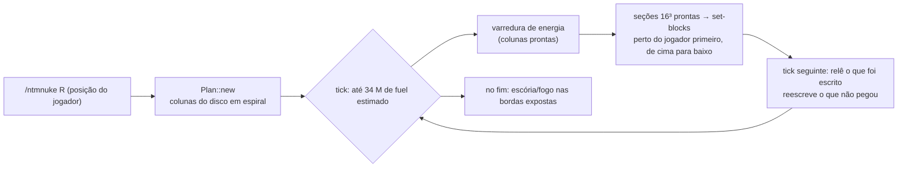

# Explosões nucleares rápidas no port (spike S7)

2026-10-28. Horizon `56f968e11` (código-fonte não alterado), NTM 1.7.10 `master` em `/home/sacer/Workspace/ntm-src`. Tudo em Rust/WASM: um server mod (API 0.3, capabilities `world`, `players`, `storage`) com o comando `/ntmnuke <raio> [orcamento]`. Código, medições e scripts: `spikes/s7/`.

**Resultado:** no servidor dedicado, uma cratera de **raio 100 fica completa em 3,2 s (63 ticks) com o TPS ≥ 19,84**. Raio 150 leva 11,6 s com o TPS ≥ 19,89. A forma reproduz o algoritmo de raios do NTM: a mesma profundidade no centro, volume removido entre −0,2% e +3,7% e Jaccard de 0,82 a 0,94 contra uma reimplementação fiel do `ExplosionNukeRayBatched` no mesmo terreno. Nenhum bloco se perdeu: zero blocos reescritos na conferência em todas as rodadas.

| Raio | Cratera completa (verificado) | Ticks | Pior tick (p99 mspt) | TPS mínimo | Blocos removidos | Efeitos secundários |
|---:|---:|---:|---:|---:|---:|---:|
| 25 | 0,21 s | 3 | 16 ms | 20,0 | 8.036 | 1.633 |
| 50 | 0,82 s | 15 | 52 ms | 19,81 | 60.892 | 7.193 |
| 100 | **3,20 s** | 63 | 46 ms | **19,84** | 158.961 | 16.763 |
| 150 | 11,6 s | 231 | 45 ms | 19,89 | 541.924 | 53.304 |

Fonte: `spikes/s7/results-stage3c.json`, com orçamento padrão de 8192 escritas/tick, dedicado, chunks forçados e sem jogador. O teste com cliente gráfico está na seção 5.

## 1. Por que o NTM demora

Caminhos relativos a `ntm-src/src/main/java/com/hbm/`. As bombas convencionais (Gadget, Boy, Man, Mike, Tsar, N2, mísseis) usam `EntityNukeExplosionMK5`, que sempre cria `ExplosionNukeRayBatched` (MK5:77). A versão paralela está comentada (MK5:74-78), então o `explosionAlgorithm` do config não tem efeito.

1. **Varredura de raios com custo R³ e sem limite de tempo.** `statFac` (MK5:151-168) faz `strength = 2R`, `speed = 100000/strength` e `length = R`. São `2,5·π·strength² = 10πR²` raios (Batched:47), e cada um anda até R passos lendo `world.getBlock` e calculando `Math.pow(res, 7,5 − fac)` (Batched:86-127). Por tick roda `collectTip(speed*10)`, cujo comentário admite "time ignored here" (Batched:259-265). Isso dá ~500 mil `getBlock` + `pow` por tick, qualquer que seja o raio, e ~π·R³/50 000 ticks no total: **R=100 leva 63 ticks (3,1 s) só para coletar**, R=150 leva 213 ticks (10,6 s) e o Tsar (R=500) ~6,5 min. Cada bloco é lido ~7,5 vezes (31R³ passos contra 4,19R³ voxels).
2. **Destruição em segunda fase, que só começa depois da coleta inteira** (Batched:269). Cada raio é refeito por chunk, com `lengthVector()` (sqrt) a cada passo (Batched:196-235). A remoção usa `world.setBlock(..., 0, 2)`, e nas pontas `..., 3` (Batched:242-252), com luz recalculada a cada bloco. O orçamento é `BombConfig.mk5 = 50 ms` por tick (BombConfig:23), o tick inteiro, e por isso o TPS cai.
3. **Fallout** (`EntityFalloutRain`) só começa depois da cratera, cobre 2,5R (para R=100, ~770 chunks) com 50 ms a cada 4 ticks (FalloutRain:57-60). Varre cada coluna desde y=255 (FalloutRain:152-220). É, de longe, a fase mais longa (estimativa: ≥ 30 s para R=100).
4. Tudo roda na thread do servidor. Chunks não carregados dentro do raio são carregados ou gerados de forma síncrona (só o chunk central tem ticket, `EntityExplosionChunkloading:41-46`).

Raios do `BombConfig` (8-21): Gadget 150, Boy 120, Man 175, Mike 250, Tsar 500, N2 200, míssil 100, Fatman 35, Nuka 25.

**Estimativa do original (não medida no jogo):** para R=100 são ~3,1 s de coleta (a 20 TPS ideais, mas com ~500 mil leituras + `pow` por tick, o que provavelmente derruba o TPS), mais alguns segundos de destruição a 50 ms/tick, mais o fallout. **Verificado em nativo:** a reimplementação Rust do algoritmo do NTM, sem luz, sem rede e sem o resto do jogo, leva 2,1–2,5 s de CPU para R=100 (29,2 M leituras) e 6,8–7,0 s para R=150 (94,7 M leituras) (`spikes/s7/native-bench.txt`).

## 2. O motor do Horizon: o que custa um `set-blocks`

Servidor dedicado sem jogador, chunks pré-gerados e forçados, seed 1768123. Os modos de medição estão em `nuke-mod/src/bench.rs`. A fila global de 65 536 nunca é tocada: cada tick escreve no máximo o orçamento, sempre < 65 536.

| Medição (verificado) | Resultado |
|---|---|
| `get-block` | **~0,25 µs** por leitura (r=100: 4,19 M leituras a 30 mil/tick, p50 8 ms/tick) |
| Escrita sólido→ar, superfície, 30–60 mil/tick | **~2 µs/bloco** (r=100: 4,19 M escritas cegas a 60 mil/tick levaram 9,9 s, p50 127 ms/tick e **TPS 8,7**) |
| A mesma, a 8192/tick | **~4,6 µs/bloco** (p50 ~38 ms com 8192 escritas): há um custo fixo por tick e por coluna/seção tocada |
| Ar→ar (sem mudança) | 0,58 µs: `place_state` sai cedo, mas o `parse_state` da string roda sempre |
| Ar→pedra / pedra→ar no céu | 3,8 / 4,0 µs: luz do céu |
| Deepslate→ar fechado (y=−30) | ~3 µs: vizinhos e formas, mesmo sem luz do céu |
| Oceano (água→ar) | Barato no tick (1,6 µs), mas depois os fluidos refluem: **+15 ms/tick por vários segundos** |
| Depois de uma cratera grande | +2 a +4 ms/tick por ≥ 10 s (luz, ticks agendados, folhas) |

**De onde vem o custo** (código, `crates/horizon-client/src/game/`). Cada bloco passa por `apply_mod_block_writes` → `parse_state`, que aloca (server_mods.rs:383; render_control.rs:116-145) → `place_state` (commands.rs:1970) → `level_set` (game.rs:2952). Esse caminho monta um `GameLevel` novo **por bloco** (game.rs:2811-2949, com Vecs de carrinhos, projéteis e jogadores) e faz `set_block(UPDATE_ALL)`: atualização dos 6 vizinhos, formas em cascata e ticks agendados de fluido e queda (horizon-world level/update.rs:266-298). A **luz** não é recalculada por bloco: as edições entram em `light_edits` e são relidas **no tick seguinte**, na thread do servidor e sem orçamento (streaming.rs:1305-1335). Esse relight faz BFS de raio 15 por edição, uma varredura de céu de até 384 células **por coluna (x,z) distinta** e cópia e comparação de 4 KB **por seção tocada** (light.rs:796-955). Por isso escrever uma coluna ou seção aos pedaços, ao longo de vários ticks, paga o custo fixo várias vezes. Para os jogadores vai **um `SectionBlocksUpdate` por seção por tick**, sem reenvio de chunk inteiro (lan/hub.rs:1513-1580), e a luz vai no tick seguinte, só para a borda do que o jogador rastreia.

### O limite real é o fuel do WASM

Cada chamada a um mod tem um teto de fuel (~instruções WebAssembly): **50 M no `tick`** e 100 M em comando ou evento (horizon-mods runtime.rs:109-112). Quem estoura é **desligado** ("it took too long", runtime.rs:1343). Rampas medidas no jogo (o mod faz K operações por tick, com K crescendo até morrer):

| Operação | Antes | Com alocador em pool (`nuke-mod/src/pool.rs`) |
|---|---|---|
| `get-block` + comparação | ~540 fuel (morreu entre 90 e 95 mil/tick) | **≤ 125** (400 mil/tick sem morrer) |
| `BlockChange` + `set-blocks` | ~445 fuel | **~180** (morreu entre 275 e 280 mil/tick) |

O alocador padrão (dlmalloc) é o grosso do custo, porque cada string devolvida pelo host é alocada no guest. **50 M de fuel equivalem a ~3–4 ms de CPU real**: o harness `spikes/s7/fuel-harness` (wasmtime 48.0.7, o mesmo do Horizon) executa os 0,97 G de fuel de um plano R=100 em 78 ms de parede (`spikes/s7/fuel-harness.txt`). Portanto o motor é limitado pela política de fuel, não pelo processador.

### TPS e cliente

- Escrever às cegas a esfera inteira em 60 mil blocos/tick **derruba o TPS** (8,7 em r=100). Com o motor deste spike (≤ 8192 escritas/tick, fuel controlado) o TPS fica ≥ 19,8 em todos os raios.
- O cliente recebe as mudanças por seção e por tick, e o relight acontece no próprio cliente (veja a seção 5).

## 3. O motor de explosão (hoje em `crates/ntm-explosion`, seção 6)



### Forma: modelo de energia do NTM, sem sobreamostragem

A escolha foi **raios com resistência de bloco**, como o NTM, e não forma analítica com ruído. A forma do NTM depende muito do material: rasa em pedra (29 blocos no centro para R=100), funda em terra e areia, livre em líquidos, e parada por obsidiana e bedrock. Uma esfera com ruído abriria um poço de 100 blocos onde o NTM faz uma bacia de 29. Cada voxel tem energia `E = E_pai − res^(0,5 + 3,5·i/R)`, com `E0 = 2R` e `i` o passo inteiro. A resistência vem de uma tabela com o `masqueradeResistance` do NTM: arenito vale pedra, obsidiana vale 3× pedra. O voxel é removido se não é ar e `E > 0`. Isso reproduz exatamente a regra de `collectTip` + `processChunk`.

O que muda é **como** isso é calculado (`nuke-mod/src/crater.rs`):

- **Árvore de raios:** cada voxel herda a energia do seu "pai", o voxel um passo mais perto do centro na reta. Abaixo do centro, essa energia é misturada (peso 0,3) com a energia **interpolada (trilinear)** no ponto exato da reta, o que imita a união dos muitos raios do NTM que passam por cada bloco. Cada bloco é lido **no máximo uma vez**: 2,4 M leituras em R=100, contra 29,2 M do NTM.
- **Ordem em espiral de colunas:** colunas por distância horizontal; dentro de cada uma, dy = 0, 1, 2… e depois −1, −2…. Pais e cantos da interpolação sempre estão em colunas estritamente mais próximas, ou na mesma coluna com |dy| menor, então cada coluna sai pronta e pode ser escrita logo.
- **Poda exata do subsolo morto:** na descida, abaixo de `min(alive_lo das 3×3 colunas prontas) − 2` todos os pais estão mortos e a coluna termina (R=100: 4,19 M → 2,45 M voxels visitados).
- **Calibração contra o NTM**, no mesmo terreno sintético, com `bench-native`. O `blend` foi escolhido dentre 0 (pai único: Jaccard 0,73, falta 23% do volume), 1 (trilinear pura: 0,87, sobra) e 0,3:

| R | Profundidade no centro (nosso/NTM) | Removidos (nosso/NTM) | Jaccard | Leituras (nosso/NTM) | CPU nativo (nosso/NTM) |
|---:|---:|---:|---:|---:|---:|
| 25 | 7/7 | 8.510 / 8.366 | 0,935 | 45 mil / 550 mil | 12 ms / 52 ms |
| 50 | 14/14 | 40.731 / 40.689 | 0,923 | 328 mil / 3,9 M | 41 ms / 371 ms |
| 100 | 29/29 | 186.960 / 187.357 | 0,892 | 2,4 M / 29,2 M | 255 ms / 2,5 s |
| 150 | 43/43 | 461.909 / 445.622 | 0,823 | 7,8 M / 94,7 M | 466 ms / 6,8 s |

O CPU nativo vem de uma rodada com a máquina compartilhada com outros agentes (`native-bench.txt`); as razões entre as colunas valem mais que os valores absolutos.

Acima do centro os dois algoritmos diferem em ≤ 200 blocos. A diferença restante fica na borda do subsolo, onde a discretização dos raios do próprio NTM é ruidosa. Aproximação aceita: o NTM centra os raios no canto do bloco, aqui no centro do voxel.

### "Cálculo de uma vez" (medido)

No harness, o plano R=100 inteiro custa 0,97 G de fuel e **78 ms** de CPU (R=150: 3,1 G e 245 ms; leituras simuladas). No jogo, somam-se ~0,25 µs por leitura no host, ou seja, ~0,6–0,7 s de uma vez para R=100: um único tick de mais de meio segundo, de qualquer forma pior que dividir. Mas uma chamada de mod só pode gastar 50 M (tick) ou 100 M (comando) de fuel, então **calcular tudo de uma vez é impossível sem mudar o motor**. A varredura é dividida em ticks, com estimativa de fuel calibrada por rampas: ~600–800 por voxel lido, conforme o terreno, e teto de 34 M estimados por tick. Isso dá ~35 mil voxels por tick. Para R=100 a varredura é o gargalo (~60 ticks), e as escritas acompanham. Escritas a mais por tick **pioram**: com 20 mil/tick, R=100 levou 6,1 s, porque a reserva de fuel das escritas sai da varredura.

### Aplicação

- **Lotes por seção 16³**, uma seção inteira por vez (≤ 4096, cabe numa chamada), agrupadas por **coluna de chunk**. Isso evita pagar o relight da mesma coluna em vários ticks. Prioridade: coluna mais próxima de um jogador do overworld (posições relidas a cada 10 ticks); dentro da coluna, de cima para baixo, porque a superfície é o que se vê. A opção `secao` ordena por seção isolada: R=100 levou 4,4 s, sem ganho.
- **Orçamento:** 8192 escritas/tick por padrão (12 288 deixou o R=150 com ticks de 140–175 ms perto de água). O orçamento é configurável no comando (256–60 000). O total por tick nunca chega perto da fila global de 65 536.
- **Nenhum bloco perdido:** no tick seguinte cada posição escrita é relida. Se ainda houver um bloco sólido sem gravidade, é reescrito. Água que reflui e areia ou cascalho que caem contam como física, não como perda. Em todas as rodadas: **0 reescritas**, e 0 a 702 "física" (702 no oceano).
- **Chunks não carregados:** a seção só é escrita depois de um `get-block` confirmar o chunk; senão fica **adiada** e é tentada de novo a cada 20 ticks, enquanto o resto continua. Se o chunk estava descarregado durante a varredura, a energia atravessa como ar e o chunk é marcado; suas seções esperam. Quando ele carrega, suas colunas entram numa fila de recálculo (`Plan::reeval_begin`), processada pela mesma varredura e sob o mesmo orçamento de fuel, do centro para fora, até 4 chunks a cada 5 ticks. Só então as seções são escritas. Os raios que já passaram por ali seguem a aproximação de ar. O motor nunca força carregamento (o NTM gera chunks de forma síncrona). **Verificado** (`results-stage4.json`): R=100 sem nenhum chunk carregado. O plano termina em 5,4 s com as 1.937 seções adiadas; quando os chunks são carregados, a cratera completa em mais 9,4 s com **179.420 blocos removidos, contra 179.461 no mesmo local com tudo carregado**, TPS 20,1 e p99 41 ms. Para isso foram corrigidos dois estouros de fuel: uma busca linear na lista de chunks e o recálculo de um chunk inteiro num tick só.
- **Efeitos secundários baratos:** os voxels da borda (lidos, não-ar, sem energia) são guardados durante a varredura, sem leitura extra. Uma borda **exposta** (o voxel de cima tinha energia) é transformada pelas regras do `FalloutConfigJSON` (54-120), com blocos vanilla no lugar dos do NTM até o content mod existir:

| NTM | Placeholder vanilla |
|---|---|
| `sellafield_slaked` por faixa de distância | `blackstone` (< 0,4R), `deepslate` (< 0,75R), `tuff` |
| `waste_trinitite` (5% da areia) | `green_stained_glass` |
| `waste_log` / `waste_planks` | `basalt` / `dark_oak_planks` |
| folhas e plantas | ar |
| fogo (1/5, ≤ 0,65R, FalloutRain:182-185) | `fire` |

O fallout de 2,5R do NTM **não** foi feito: exigiria varrer colunas fora da cratera (ver Próximos passos).

## 4. Comparação com o original

| R | NTM (estimado a partir do código, 20 TPS ideais) | Port (verificado no dedicado) |
|---:|---|---|
| 25 | coleta 1 tick + destruição | 0,21 s, TPS 20 |
| 50 | coleta 8 ticks (0,4 s) + destruição | 0,82 s, TPS ≥ 19,8 |
| 100 | coleta 63 ticks (3,1 s, com ~500 mil leituras + `pow` por tick) + destruição a 50 ms/tick (2–10 s) + fallout (≥ 30 s) | **3,2 s até a cratera inteira, com efeitos; TPS ≥ 19,84** |
| 150 | coleta 213 ticks (10,6 s) + destruição + fallout | 11,6 s, TPS ≥ 19,89 |

Na parte verificada em nativo, o algoritmo do NTM gasta 15× mais CPU em R=100 e 12× mais leituras. No port, a cratera aparece **enquanto** é calculada (primeira escrita no tick 3), em vez de esperar a coleta inteira. R=150 não é mais rápido que a coleta do NTM: o teto de fuel por tick limita a ~35 mil voxels por tick.

## 5. Teste com cliente gráfico

Dedicado mais um cliente Horizon conectado por `--server` (offscreen, 960×540, `HORIZON_NO_AUDIO=1`, `options.txt` com master/music 0.0, `cwd` na pasta temporária), modo criativo, jogador no centro. O comando é **digitado de verdade** (`t`, texto, Enter) e o tempo de frame vem de `horizon-ctl stats` durante a explosão (`spikes/s7/client-c100.json`, `client-c150.json`).

| | R=100 (view 10) | R=150 (view 6) | Parado (referência) |
|---|---:|---:|---:|
| Cratera completa | 63 ticks; 3,7 s desde o Enter | 228 ticks; 12,2 s | — |
| TPS do servidor (com jogador) | 20,0 (p95 50 ms, p99 58 ms) | 20,07 (p95 35 ms, p99 48 ms) | 20 |
| FPS médio do cliente | 118,9 | 117,4 | 119,2 |
| Pior frame | 15,1 ms | 20,2 ms | 8,5 ms |
| 1% low / 0,1% low | 92,7 / 66,3 fps | 65,9 / 53,8 fps | 118,4 / 118,3 fps |

O cliente **não engasga** de forma perceptível: o pior frame ficou em 15–20 ms, contra 8,5 ms parado. Com o jogador conectado, o servidor tem ticks um pouco mais pesados (envio de `SectionBlocksUpdate`), mas mantém 20 TPS. Em nenhum dos dois casos ficou chunk descarregado (o servidor manteve 441–625 chunks em volta), por isso o caso de chunks não carregados foi testado à parte (seção 3).

Capturas (`spikes/s7/`): `c100b-before.png` (planície antes), `c100b-after-down.png` (fundo da bacia no centro: piso de blackstone, paredes de pedra e a mensagem de conclusão), `c100b-after-air.png` (vista aérea a 130 blocos). A vista aérea mostra o padrão do NTM: solo superficial arrancado num disco largo, pedra e escória expostas e bacia central.

### O disco claro na vista aérea: neblina por distância, não é bug

No meio da bacia da vista aérea aparece um disco cor de céu. Foi investigado (`client-test.py --disk`, capturas `disk-*.png`, `client-disk.json`):

| Verificação | Resultado |
|---|---|
| Mundo salvo pelo servidor (leitura do .mca) | Fundo sólido: blackstone contínuo em y=38–47 no centro, sem furo nem água |
| A cópia do mundo no **cliente** (`horizon-ctl block`) | `minecraft:blackstone` em (3501, 38, −1400), chunk carregado: o cliente tem o bloco |
| Mesma câmera 8 s e 30 s depois | O disco continua (não é redesenho atrasado) |
| Render distance 10 → 14 | O disco **some** (`disk-air-rd-up.png`) |
| De volta para 10 | O disco **volta** (`disk-air-rd-back.png`) |
| De perto (40 blocos acima) | A bacia aparece inteira (`disk-air-close.png`) |

A câmera estava a 130 blocos na horizontal e em y=210; o fundo da bacia (y≈38) fica a ~215 blocos em 3D, além do fim da neblina esférica de render distance 10 (160 blocos), e é pintado na cor do céu. A borda da cratera, mais alta e mais perto, ainda aparece. É o comportamento normal da neblina, **nem do Horizon nem do motor**: com render distance maior, ou de mais perto, a bacia aparece.

## 6. O crate `crates/ntm-explosion`

O motor saiu do spike para um crate reutilizável **sem dependência do SDK**. O mod implementa três traits pequenas, e o crate compila nativo (testes) e em WebAssembly. É membro do workspace da raiz (`cargo test --workspace` e `cargo clippy --workspace --all-targets -- -D warnings` limpos). O `spikes/s7/nuke-mod` virou só o adaptador (~200 linhas) e foi o que rodou nos testes no jogo abaixo.

```rust
// No server mod (api 0.3, capabilities world + players + storage):
#[cfg(target_arch = "wasm32")]
#[global_allocator]
static A: ntm_explosion::pool::Pool = ntm_explosion::pool::Pool::new();

impl ntm_explosion::World for Hz { /* block, set_blocks (≤ 4096), viewers */ }
impl ntm_explosion::Store for Hz { /* storage::get/set/delete */ }
impl ntm_explosion::Hooks for Hz { /* edge(...) opcional; event(...) */ }

let mut nukes = Explosions::new();
nukes.resume(&mut Hz, 0, &mut Hz);                    // no init: retoma após reinício
let mut d = Detonation::new("boy1", "minecraft:overworld", pos, 120);
d.profile = EffectProfile::ntm_placeholder();         // ou um perfil próprio, ou none()
d.budget = 8192;                                      // escritas por tick
nukes.detonate(d, tick)?;
let finished: Vec<Progress> = nukes.tick(tick, &mut Hz, &mut Hz, &mut Hz); // todo tick
nukes.progress("boy1");  nukes.active();  nukes.cancel("boy1", &mut Hz);
```

| Peça | Arquivo | Notas |
|---|---|---|
| Núcleo puro | `src/crater.rs` | Classificação de resistência, `Plan` (espiral, árvore de raios, poda, fila de recálculo), seções |
| Motor | `src/engine.rs` | `Explosion`, `Explosions`, `Detonation`, `Progress` (fase, colunas, removidos, escritas, seções, adiadas, reescritas...), traits `World`/`Store` |
| Efeitos | `src/effects.rs` | `EffectProfile` (dados: faixas de escória, trinitite, madeira, folhagem, fogo; serializável), `Hooks::edge` para trocar o efeito por borda, `Hooks::event` (`FirstWrite`, `CraterDone`, `Done`, `Resumed`, `PersistFailed`) |
| Persistência | `src/persist.rs` | Diário por coluna + anel de energia (seção 7) |
| Alocador | `src/pool.rs` | `Pool::new()` para `#[global_allocator]` (só alvo de uma thread) |
| Testes | `tests/` | 27 testes: forma contra o NTM, determinismo por passos, orçamento por tick e por chamada, mundo final = plano, chunks descarregados, retomada (a cada 3 ticks de uma explosão R=40 e em pontos extras, com e sem o mundo voltar ao estado anterior, com chunks atrasados), limites de storage em R=150, cancelamento, perfil, pool; e os 8 da revisão do M2 (`tests/review.rs`, seção 11) |
| Benchmark | `examples/compare.rs` | `cargo run --release --example compare -- 25 50 100 150` |

Uma explosão por vez recebe o tick (o fuel é dela); as outras esperam na fila. O plano de uma detonação nova ou retomada é montado num tick só para ele, um por tick (R=500 custa ~21 M de fuel), e o estado inicial é gravado nesse tick. Os ids viram prefixo de chave no storage (`nx.<id>.*`), por isso usam só `[a-z0-9_-]`, até 40 caracteres.

## 7. Persistência: retomar após reinício

**Problema.** Recalcular do zero depois de um reinício daria uma cratera maior: o que já foi removido virou ar, e ar não gasta energia.

**Solução** (`persist.rs`). A varredura grava, coluna a coluna, num diário:
- **Estrutura** (só anexada): o menor dy vivo, as faixas removidas e as bordas **expostas** com o tipo de material. São ~13 bytes por coluna. Os blocos fechados de 96 KB (`nx.<id>.d<k>`) são gravados **uma vez só**; o bloco em curso vai na cauda do estado.
- **Energia exata só da frente da espiral:** os pais e os cantos da interpolação de um voxel ficam a ≤ 1,5 bloco na horizontal, em colunas mais perto do centro. Cada faixa de 2 blocos de raio horizontal, ao fechar, vai para uma chave do anel `nx.<id>.e0..e2`. A faixa em curso fica na cauda do estado. Uma chave do anel só é sobrescrita quando o estado em vigor já não usa a faixa que está nela.
- **Estado** em dois slots, `nx.<id>.s0`/`s1`, gravados alternadamente com geração e checksum (FNV-1a), como o save do M1:
  - um cabeçalho em texto: centro, raio, dimensão, orçamento, perfil, colunas gravadas, tamanho e checksum de cada bloco e de cada faixa do anel, fase;
  - uma cauda binária: o bloco do diário em curso, as faixas sem chave, os bits da persistência leve e as listas de chunks (pendentes, recalculados, do fallout).

  A leitura fica com a geração mais nova cujo checksum confere e cujos blocos conferem. O índice `nx.index0`/`index1` também vai em dois slots.

O motor grava o diário **antes** das escritas de cada tick. Assim, uma seção só vai ao mundo depois que as colunas dela estão no storage, e a retomada nunca recalcula por cima de blocos já removidos. Se o estado não coube no tick (orçamento de gravação), as escritas do mundo esperam o próximo. O `storage::set` do Horizon reescreve o arquivo sem rename atômico, mas nada que o estado em vigor usa é reescrito: uma queda no meio de qualquer gravação deixa o estado anterior inteiro. O teste `p1_7_a_torn_write_never_loses_the_explosion` rasga cada gravação de uma explosão R=40, uma de cada vez, e a cratera final é a mesma. Ao retomar (`Explosions::resume`, no `init` do mod), todas as seções voltam a pendentes: reescrever ar sobre ar custa ~0,6 µs no host. Isso também cobre um mundo que voltou ao último autosave depois de uma queda. A varredura **espera até 60 s** pelos chunks da frente, porque o servidor recém-iniciado ainda carrega. No fim, as chaves são apagadas.

**Custo:**

| Item | Medido |
|---|---|
| Storage de pico em R=150 (teste nativo, limites do Horizon) | 930 KB de 4 MB, ≤ 64 chaves, ≤ 1 MB por gravação |
| Fuel do diário (harness) | +24% por voxel (434 → 540); pode ser desligado por detonação (`persist = false`) |
| R=100 sem interrupção, motor do crate no jogo | 3,25 s, TPS ≥ 19,85, 158.960 removidos (spike: 158.961) |

**Verificado no dedicado** (`results-stage5{a,b,c}.json`; mesma seed e mesmo local, R=100, reinício 1,2 s depois do início, no meio da varredura):

| Caso | Volta do servidor | Cratera completa | Removidos | Efeitos |
|---|---|---|---|---|
| Sem interrupção | — | 3,25 s | 158.960 | 16.763 |
| `stop` (salva o mundo) | 7,7 s | 8,8 s | **158.961** | **16.763** |
| `kill -9` (mundo volta ao último save) | 7,3 s | 8,4 s | **158.961** | **16.763** |

Depois da volta, o TPS ficou ≥ 20,0 nos dois casos.

Os mundos salvos foram comparados bloco a bloco nas 4.335 seções da região. Fora da física (água e lava fluindo, grama se espalhando, cascalho caindo, cristais crescendo), a única diferença é **uma folha de carvalho**, e ela também aparece entre duas explosões sem interrupção (319 blocos de física diferem nesse caso; 441 com `stop` e 1.036 com `kill`, pelos ~7 s a mais de fluido correndo).

A primeira versão retomava e varria **antes** de os chunks carregarem: 400 mil leituras deram "sem chunk" e faltaram 37 mil blocos. Também aplicava efeitos de borda em chunks descarregados, e essas escritas o mundo ignora. As duas falhas foram corrigidas (espera pelos chunks da frente; efeito só em chunk carregado, com nova tentativa) e cobertas por testes.

**Limite conhecido:** se, depois de uma retomada, algum chunk que estava descarregado precisar de recálculo, os pais em colunas antigas (fora do anel) não têm mais a energia exata, e o resultado ali é aproximado (a cratera fica menor). Isso só acontece com chunks longe dos jogadores no momento do reinício.

## 8. Fallout de 2,5R (implementado no M2)

**Estado (2026-10-29):** implementado em `crates/ntm-explosion/src/fallout.rs`, com as diferenças descritas em [bombas.md](bombas.md#fallout-de-25r). O texto abaixo é o desenho original.


**O que o NTM faz** (`EntityFalloutRain`, FalloutRain:57-220; regras em `FalloutConfigJSON` 54-120):
- Depois da cratera, processa todas as colunas até 2,5R, gastando 50 ms a cada 4 ticks.
- Em cada coluna, varre de y=255 até 3 blocos sólidos e aplica as regras por distância: madeira vira `waste_log` até 65%, folhas e plantas viram ar, rocha/terra/areia viram `sellafield_slaked` em faixas até ~45–50%, areia tem 5% de trinitite.
- Põe a camada `fallout` com chance `0,1 − (d − 0,7)²` e fogo em 1/5 dos inflamáveis até 65%.
- Gera blocos caindo e troca o bioma.
- Estimativa: ≥ 30 s para R=100. Gera, de forma síncrona, chunks não carregados até 250 blocos.

**Desenho no motor:**
1. **Segunda fase da mesma `Explosion`** (`Phase::Fallout`), com orçamento e fuel próprios, depois dos efeitos de borda.
2. **Colunas em espiral** de R a 2,5R; dentro da cratera, as bordas já cuidam. O disco tem 19,6R² colunas: 196 mil em R=100, 442 mil em R=150, 4,9 M no Tsar.
3. **Começo da varredura pela vizinha.** Em vez de y=255, a coluna começa em `max(topo das 3×3 vizinhas já feitas) + 8` e sobe 16 por vez enquanto o bloco inicial não for ar. As colunas da borda interna usam o topo das bordas do plano (já lido). Isso dá ~20 leituras por coluna em vez de ~185, sem perder árvores, que sempre têm vizinha com copa.
4. **Regras** como dados em `EffectProfile`, estendido com faixas de "fallout" (inclusive a camada e a chance do NTM), aplicadas de cima para baixo até 3 sólidos.
5. **Chunks não carregados:** a coluna fica pendente por chunk (lista persistida, poucos bytes) e é feita quando um jogador chega perto. O motor confere os chunks pendentes perto dos jogadores a cada 40 ticks. Não força carga: 2,5R passa da distância de visão em quase todas as bombas.
6. **Fora do alcance da API atual:** troca de bioma (não há `set-biome`) e blocos caindo como entidade (não há entidades). Ficam como pedido upstream ou como aproximação: cascalho e areia direto no chão.

**Custo estimado** (não medido). Supõe ~20 leituras por coluna a ~300 de fuel (leitura + classificação) e ~1,5 escritas por coluna a ~500; ~31 M de fuel por tick dá ~4.400 colunas por tick; escritas a 8192 por tick, a ~2–4 µs no host.

| Bomba | R | Colunas (2,5R) | Escritas | Ticks | Tempo | NTM (estimado) |
|---|---:|---:|---:|---:|---:|---:|
| Míssil | 100 | 196 mil | ~290 mil | ~50 | ~2,5 s | ≥ 30 s |
| Gadget | 150 | 442 mil | ~660 mil | ~100 | ~5 s | — |
| Mike | 250 | 1,23 M | ~1,8 M | ~280 | ~14 s | — |
| Tsar | 500 | 4,9 M | ~7,4 M | ~1.100 | ~56 s | — |

Na prática, só os chunks carregados entram nessa conta; o resto aparece quando o jogador chega.

## 9. Energia esparsa para R > 150 (implementado no M2)

**Estado (2026-10-29):** implementado para **todos** os raios (um caminho só), com resultado idêntico ao denso em R ≤ 150; `MAX_RADIUS` = 500. Medições em [bombas.md](bombas.md#energia-esparsa). O texto abaixo é o desenho original.


**Por que R ≤ 150 hoje:** o plano guarda energia u16 por voxel do disco, 4,19R³ × 2 bytes. Isso dá 28 MB em R=150, 45 MB em R=175 (Fat Man), 131 MB em R=250 (Mike) e 1 GB em R=500 (Tsar). O teto de um mod é 64 MB.

**O que precisa ficar em memória** (o mesmo argumento da persistência):
- **Energia:** só na faixa da frente da espiral, porque pais e cantos ficam a ≤ 1,5 bloco na horizontal.
- **Remoções:** só das seções ainda não escritas.
- **Bordas expostas:** só das colunas ainda sem efeito.
- **Por coluna:** o menor dy vivo (2 bytes).

**Desenho:**
1. Energia em **colunas alocadas sob demanda**: um `Vec<u16>` por coluna, pego de uma pilha de buffers reciclados e devolvido quando a frente passa 2 blocos de raio horizontal da coluna. No pior caso (h ≈ 0,7R) ficam ~4πh colunas × 2·√(R²−h²) voxels × 2 bytes: ~1,5 MB em R=250 e ~6 MB em R=500.
2. **Remoção em faixas por coluna** (início, comprimento; 1–3 faixas em média) em vez do bitset. A seção é montada a partir das faixas das 256 colunas dela, e as faixas são liberadas depois da conferência. Fica na ordem de algumas centenas de KB a poucos MB.
3. As **bordas expostas** viram fila e são consumidas pelos efeitos assim que a seção da borda é escrita, em vez de esperar o fim da cratera.
4. O **recálculo de chunk descarregado** fica aproximado também sem reinício. Os pais antigos não existem mais; usar `alive_lo` e "vivo = E0" dá um limite superior. Para bombas grandes isso pesa mais, porque grande parte do disco está fora da distância de visão.
5. **Persistência:** o diário de estrutura cresce com o número de colunas (~13 bytes cada). São 1 MB em R=150 e ~10 MB em R=500, o que passa da quota de 4 MB. Para R > 250, uma saída é guardar por seção só "escrita ou não" (1 bit) e, na retomada, pular as seções escritas. Isso aceita o caso raro de o mundo voltar a um save antigo.

**Custo de tempo** (escala medida de R^≈3,2 entre R=100 e 150 no jogo; o fuel por tick é o gargalo):

| Bomba | R | Ticks (estimado) | Tempo | Com fuel de tick 10× (upstream) | NTM, só a coleta |
|---|---:|---:|---:|---:|---:|
| Fat Man | 175 | ~370 | ~18 s | ~2 s | 16,9 s |
| Mike | 250 | ~1.070 | ~54 s | ~6 s | 49 s |
| Tsar | 500 | ~8.600 | ~7 min | ~45 s | 6,5 min |

Sem mudança no Horizon, as bombas grandes ficam **no ritmo da coleta do NTM**. A diferença é que a cratera aparece enquanto é calculada, o TPS fica em 20 e não há a fase de destruição a 50 ms por tick depois. O ganho real para elas depende de fuel por tick maior para server mods ou de uma leitura de heightmap ou em lote (metade das leituras é ar acima do terreno).

## 10. `pool.rs` no ntmlogic-server (adotado no M2)

**Estado (2026-10-29):** instalado em `mods/ntm-logic-server/src/lib.rs` (só em wasm32), medido antes/depois em [bombas.md](bombas.md#pool-allocator-antes-e-depois).


**Ganho medido** (rampas no jogo, mesma operação repetida até o mod ser desligado por fuel):
- `get-block` + comparação: de ~540 para **≤ 125** de fuel (≥ 4,3×).
- `BlockChange` + `set-blocks`: de ~445 para **~180** (2,5×).

O custo é o `dlmalloc`, porque cada string que o host devolve é alocada no guest, e cada `BlockChange` aloca a sua. O `ntmlogic-server` faz exatamente isso. Ele lê blocos todo tick em `ntm-core/src/server.rs` (linhas 440, 541, 602, 795, 829, 855, 929, 981 e 1034) e grava com `state.clone()` (`mods/ntm-logic-server/src/lib.rs:35-44`).

**Mudança sugerida** (não aplicada):

```rust
// mods/ntm-logic-server/src/lib.rs
// Só no WebAssembly: o crate também é rlib e os testes nativos rodam em várias
// threads; o pool não tem trava.
#[cfg(target_arch = "wasm32")]
#[global_allocator]
static ALLOC: ntm_explosion::pool::Pool = ntm_explosion::pool::Pool::new();
```

Como alternativa, o `pool.rs` (~70 linhas, sem dependências) pode ir para o `ntm-core` e ser compartilhado.

- **Riscos:**
  - Blocos pequenos (≤ 128 bytes) nunca voltam ao dlmalloc; a memória fica no pico de uso.
  - Não pode ser instalado em binário nativo com threads.
  - O comportamento não muda (é só o alocador).
- **Como validar:**
  - `cargo horizon-mod check` do pacote.
  - Uma rampa de `get-block` como a do S7 (`nuke-mod/src/bench.rs`, modo `rampr`) antes e depois.
- **Quando importa:** com poucas máquinas, o fuel por tick do ntmlogic é pequeno e o ganho não aparece. Com redes grandes de cabos, canos ou muitas máquinas lendo blocos, o teto de 50 M por tick chega 2–4× mais tarde.

## 11. Revisão do M2: trabalho por tick limitado

A segunda revisão do M2 mediu, no harness de fuel (`spikes/m2-fuel`, wasmtime
48.0.7, como no Horizon), uma Tsar (R=500) com os chunks descarregados além de
110 blocos do centro, a 22 M de fuel por tick. O pior tick gastava **3.420,8 M**,
contra um teto de 50 M que desliga o mod. As causas, achadas pelas marcas de
fuel (feature `trace` do crate: o harness anota o fuel em cada marca), e as
correções:

| Onde | Antes | Depois |
| --- | --- | --- |
| Fim da passada principal e cada tick com seções adiadas | `reeval.contains` por seção (~70 mil × ~2.900 chunks), filtro e ordenação de todas as seções todo tick | filas por coluna de chunk (`order`, `pool`, `deferred`), conjuntos FNV, contadores por estado; a lista de recálculo entra aos poucos (`mark_step`) e tudo é descontado do fuel |
| Gravação do estado no fallout | 44 M: as listas de chunks pendentes em texto (`format!` por chunk), codificadas duas vezes | listas em varint na cauda binária, texto do cabeçalho só com as contagens e um checksum delas |
| Efeitos de borda com o disco quase todo descarregado | dezenas de milhares de bordas por tick sem custo; a nova tentativa varria a lista inteira | bordas adiadas por chunk, 256 chunks por nova tentativa em rodízio, ~4,5 k de fuel por efeito (medido) |
| Início do fallout (`release_all`) | 23 M: percorria as 785 mil colunas do disco | percorre só os buffers alocados (cada um sabe a coluna dele) |
| Fallout pendente (`Linger`) | um chunk inteiro por vez (66 mil leituras num passo), cada `Linger` com o fuel inteiro | cursor por coluna; fuel e escritas do tick divididos entre os pendentes |
| Detonar ou retomar várias | um plano por detonação no mesmo hook (3 × R=500 ≈ 64,7 M) | o plano é montado num tick só para ele, um por tick |

**Pior tick medido (fuel real, com pool; "antes" de `results.txt` do M2,
onde existe):**

| Caso | Antes | Depois |
| --- | ---: | ---: |
| R=500, descarregado além de 110, fallout | 3.420,8 M | 26,3 M (fase de espera: 26,9 → 6,0 M) |
| R=150, descarregado além de 110, fallout | — | 25,9 M |
| R=100, tudo carregado, fallout | 29,4 M | 29,4 M |
| R=150, tudo carregado, fallout | 29,6 M | 27,4 M |
| Retomada de R=120 (reinício no tick 40) | 30,2 M; `resume()` 3,0 M | 27,2 M; `resume()` 0,3 M |

O teto do hook é 50 M; o orçamento do motor é 22 M, e uma estimativa pode
passar dele em até ~1,3× (o plano se mede por voxel, não por instrução).

**Persistência** (seção 7) agora resiste a uma queda no meio de qualquer
gravação, e respeita a parte do storage que o mod dá às explosões
([bombas.md](bombas.md#storage)). Os testes da revisão estão em
`tests/review.rs`. Cada um falhava no motor entregue no M2, e a lista está em
[bombas.md](bombas.md#revisão-do-m2-segunda-independente).

## Limites e próximos passos

- R até 500 e fallout de 2,5R: feitos no M2 ([bombas.md](bombas.md)). Troca de bioma continua sem API.
- **Upstream, para acelerar:**
  1. Fuel de tick configurável para server mods: 50 M ≈ 3–4 ms de CPU. Com 10× mais, R=100 sairia em < 1 s.
  2. Uma leitura em lote ou de heightmap.
  3. Um `set-blocks` com flags, sem `UPDATE_ALL` no interior da cratera (o NTM usa flag 2 no interior).
- O recálculo de chunk descarregado depois de uma retomada é aproximado (seção 7).
- Dano e radiação ao jogador vão pelo client mod.
- Os blocos de efeito são placeholders vanilla: troque as strings do `EffectProfile` quando o content mod tiver `ntm:sellafield_slaked`, `ntm:waste_log` etc.

## Arquivos

| Arquivo | O que é |
|---|---|
| `crates/ntm-explosion/` | O motor (seção 6) |
| `spikes/s7/nuke-mod/` | Server mod adaptador: `/ntmnuke <raio> [orcamento]`, `/ntmnukestatus`, `/ntmnukecancel <id>`, gatilho de teste por storage, retomada no `init`; `bench.rs` com os modos de medição brutos |
| `spikes/s7/old-engine/` | O motor como estava dentro do spike (histórico) |
| `spikes/s7/bench-native/` | Comparação com o algoritmo do NTM (versão do spike; a atual é o exemplo do crate) |
| `spikes/s7/fuel-harness/` | Medição exata de fuel do crate com wasmtime 48.0.7 (`JOURNAL=1` liga o diário) |
| `spikes/s7/run.py`, `client-test.py` | Drivers do dedicado (com `restart_after`/`kill`) e do cliente (com `--disk`) |
| `spikes/s7/results-*.json`, `*.log`, `*.png` | Medições brutas e capturas |

## Reprodução

```bash
cd spikes/s7
(cd nuke-mod && /home/sacer/Games/horizon/target/release/cargo-horizon-mod build)
python3 run.py stage3c stage3c.json        # motor no dedicado; results-stage3c.json
python3 run.py stage4 stage4.json          # sem chunks carregados, carga forçada depois
python3 run.py stage5b stage5b.json        # reinício (stop) no meio; stage5c = kill -9
(cd ../.. && cargo test --workspace)
python3 run.py stage2b stage2b.json        # set-blocks/get-block brutos
python3 client-test.py c100 3500 -1400 100 --view 10
(cd bench-native && cargo build --release && ./target/release/crater-bench 25 50 100 150)
(cd fuel-harness/probe && cargo build --release --target wasm32-unknown-unknown) && \
  fuel-harness/harness/target/release/fuel-harness fuel-harness/probe/target/wasm32-unknown-unknown/release/fuel_probe.wasm 100
```

Servidores e clientes rodam em diretórios novos `/tmp/ntm-s7-*`, com `HORIZON_NO_AUDIO=1`, `options.txt` com master/music 0.0 e `cwd` na pasta temporária. Nunca usam `~/.minecraft` nem os dados do Horizon do usuário.
