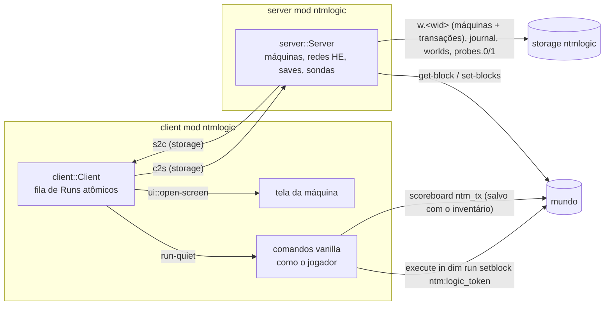

# Fundação da lógica (ntm-core, ntmlogic)

Estado de 2026-10-28, depois da revisão da fundação
(`artifacts/ntm-port-viabilidade/plano-m1/revisao-fundacao`). Todo o código é Rust
e roda como WebAssembly. Não há datapack nem mcfunction.

| Pacote | Pasta | Manifesto |
| --- | --- | --- |
| Biblioteca comum | `crates/ntm-core` | sem API do Horizon, testável com `cargo test` |
| Server mod | `mods/ntm-logic-server` | `id = "ntmlogic"`, api 0.3, `side = "server"`, `storage world players` |
| Client mod | `mods/ntm-logic-client` | `id = "ntmlogic"`, api 0.1, `side = "client"`, `game-read chat storage command ui input` (experimental `ui input`) |

Para compilar, rode `tools/build-logic.sh`. O script grava em `dist/` os arquivos
`ntmlogic-server.hmod`, `ntmlogic-client.hmod` e `ntm.hmod` (o conteúdo); `DIST` e
`CARGO_TARGET_DIR` mudam as pastas. Os dois mods de lógica têm o mesmo id, então o
empacotador escreve o mesmo `ntmlogic.hmod` para os dois, e o script copia cada um
logo depois de compilar.

O `ntm-core` não chama o Horizon. Cada mod entrega ao motor um *host*
(`server::ServerHost`, `client::ClientHost`) que traduz para a API. Com isso, os
testes em `crates/ntm-core/src/server/tests.rs` rodam os dois motores juntos
sobre um storage em memória e um mundo falso. O mundo falso interpreta os comandos
vanilla do protocolo como o jogo faz: dimensão por linha, corte silencioso em 256
linhas por chamada de hook e cliente que pode atrasar (pausa).



## Restrições que moldam o desenho

- O server mod não roda comandos, não dá dano, não lê inventário nem NBT e não
  recebe clique-direito. O client mod roda comandos (`command.run-quiet`), mas
  não recebe o resultado.
- `run-quiet` aceita até **256 linhas por chamada de hook**, somando todas as
  chamadas. O excedente é cortado sem erro, e **cada linha é cortada em 256
  caracteres** (`horizon_protocol::quiet::MAX_LINE`). No single player padrão,
  o servidor integrado consome as linhas pelo `lan_quiet`, **64 por tick por
  jogador**, cortando um lote em qualquer ponto. Uma sequência de linhas nunca
  é atômica.
- Os dois mods só se falam porque, em single player, mods irmãos com o mesmo id
  dividem a pasta de storage (S4). Essa pasta é por instalação, não por mundo, e
  fica ao lado do `.hmod` (`horizon-mods/.horizon-mod-data/ntmlogic`). Os
  limites são 64 chaves, 4 MiB no total e 1 MiB escrito por chamada.
  `storage.set` não é atômico: o arquivo é reescrito no lugar.
- Os comandos do cliente rodam com os direitos do jogador, então o mundo precisa
  de **comandos ligados** (cheats, ou Abrir para LAN > Permitir comandos).
- Em single player, o server mod é recriado a cada mundo aberto. Ao sair do
  mundo, ele não recebe aviso.
- `input.held` dá o id e a quantidade do item da mão, nunca os componentes.
  Predicados de componente funcionam em `execute if items` e em `clear`, desde
  que tenham namespace: `ITEM[minecraft:custom_data~{k:v}]` e
  `ITEM[!minecraft:custom_data]`. `item modify` com modificador inline não
  funciona no Horizon.

## (a) Identidade do mundo

O que a lógica salva precisa ficar numa chave do mundo certo, e nada que o
server mod lê identifica o mundo. A saída é guardar a identidade **dentro do
save**, no command storage do mundo (`data/ntmlogic/command_storage.dat`), e
lê-la de volta pelo mundo (`worldid.rs`):

1. O servidor propõe um id novo: 10 dígitos octais (30 bits) tirados da
   entropia. Entram as posições dos jogadores, o tick, o contador de boots, o
   conteúdo da pasta e tempos de frame.
2. O cliente roda
   `execute unless data storage ntmlogic:world v run data merge storage ntmlogic:world {v:1b,d0:..b,…,d9:..b}`.
   Um mundo que já tem id fica com o dele; um mundo novo fica com a proposta.
3. Para cada dígito `i` e valor `v`, o cliente roda
   `execute if data storage ntmlogic:world {d<i>:<v>b} run setblock <célula i> ntm:logic_token[level=v+1]`.
   São 81 linhas, e cada uma começa com `execute in <dim> run`. As células
   formam uma coluna de 10 blocos no fundo do mundo, embaixo **do jogador do
   cliente**: o `Hello` traz a dimensão e a posição dele, e o servidor escolhe o
   jogador online mais próximo disso. Assim, num host de LAN, o convidado no
   Nether não é usado. Só entram células com blocos que podem ser devolvidos
   exatamente (bedrock, deepslate, pedra, minérios, sem block entity) e que
   nenhuma outra sonda esteja usando.
4. O servidor lê a coluna, devolve o que havia lá e passa a ter o id (`wid`).

O id vai junto com o save (cópias e backups levam o id), sobrevive à perda da
pasta de storage e distingue dois mundos de mesma seed. Sem comandos ligados,
nada acontece: na segunda tentativa, o servidor avisa no chat e as máquinas ficam
paradas.

**Coluna órfã.** Se o jogo cai entre os `setblock` da coluna e a leitura, a sonda
persistida (ver (d)) é retomada na próxima identificação. A coluna soletra o
próprio mundo, então ela só é devolvida quando os tokens dela decodificam
exatamente o `wid` identificado. Uma coluna de outro mundo nunca é tocada.

**Quando há identificação nova:** a cada nova sessão do cliente e a cada salto
do contador de ticks do servidor. O cliente abre sessão nova ao entrar num mundo
(mais de 20 frames sem clock) e quando **o servidor muda** (o `s2c` passa a ter
outro `sid`/`inst`): em single player o server mod é recriado a cada mundo
aberto, e também ao reiniciar. Uma troca de dimensão ou um respawn **não** abre
sessão nova: isso foi verificado em jogo.

O `game-time` **não** é sinal de outro mundo. O do cliente anda nos ticks do
próprio cliente e é sobrescrito pelo `SetTime` do servidor
(`horizon-client/src/game/remote.rs`, `C::SetTime`): um servidor mais lento
que o cliente o faz voltar, e um cliente parado por segundos o faz saltar. A
regra antiga (`< t` ou `> t + 100` = mundo novo) abria uma sessão a cada
correção num PC carregado, reidentificava o mundo, fechava a tela e perdia
amostras de radiação. Hoje o salto só vai para o log, de forma esparsa.

### Sem client mod

Se nenhum client mod responde em 600 ticks, há dois casos:

- **A pasta nunca viu um cliente** (não existe `c2s`): é um servidor dedicado, que
  tem um mundo só. O mundo vira `server`.
- **A pasta já viu um cliente:** é single player com o client mod desligado ou
  quebrado. Antes, esse caso também caía na chave `server` e misturava os mundos
  de single player que passassem por ela. Agora o servidor **não identifica
  nada**: avisa uma vez no chat ("o mod cliente ntmlogic não respondeu…") e não
  simula nem salva até o cliente voltar.

Sobra um caso: uma instalação de single player em que o client mod **nunca**
foi ligado. Ela é indistinguível de um servidor dedicado, cai em `server` e
mistura os mundos que passarem por ela. A reconciliação (b) impede que isso
duplique itens, porque uma máquina nunca vista no mundo não solta conteúdo.

## (b) Persistência

Cada mundo ocupa uma chave, `w.<wid>`. Ela guarda, num mesmo commit (`persist.rs`):

- as máquinas e os cabos de todas as dimensões;
- a dose de radiação dos jogadores;
- as **transações de itens em voo e as aplicadas** (veja (d)), o contador delas,
  o sal dos nomes de score e o contador de ticks do mundo.

O formato é uma linha de cabeçalho `NTM1 <wid> <geração> <fnv64> <bytes>`
seguida do JSON.

- **Contra escrita rasgada:** cada save vai primeiro inteiro para a chave
  compartilhada `journal` e, no tick seguinte, para `w.<wid>`. A leitura escolhe,
  entre as duas, a cópia deste mundo com checksum válido e geração mais nova.
- **Entre mundos:** antes de sobrescrever o `journal`, o servidor confere se ele
  guarda o save mais novo de outro mundo; se guardar, copia esse save para a
  chave daquele mundo primeiro.
- **Quando salva:** qualquer mudança de itens, blocos ou transações salva **no
  mesmo tick**. Energia e progresso salvam a cada 200 ticks.
- **Falha de save:** se o save falha (quota, orçamento, I/O, tamanho), **nenhuma
  linha de transação sai** até um save dar certo. O jogador é avisado uma vez
  no chat.
- **Orçamento:** um save tem no máximo 256 KiB, porque a pior chamada escreve
  três cópias mais a caixa de saída, abaixo de 1 MiB. Passando de 80% da pasta,
  há aviso no chat; `/ntmlogic forget <wid>` apaga o save de outro mundo.
- **Reconciliação com o mundo:** a cada 20 ticks o servidor confere o bloco de
  cada máquina e cabo carregados. O bloco sumido em duas leituras seguidas sai
  do save. O conteúdo da máquina só cai no chão se ela foi vista neste mundo
  nesta sessão.

**Crash (rollback do mundo).** O vanilla salva o mundo a cada ~5 min, e o mod
salva a cada mudança. Depois de um crash, o mundo volta e o mod não. Isso é
reconciliado pelas próprias transações:

- Uma transação aplicada fica guardada por 18 000 ticks de jogo, mais que o
  autosave, sem resetar o score.
- A cada entrada no mundo, o servidor pergunta ao scoreboard se o score de cada
  uma ainda existe. O scoreboard é salvo com o inventário.
- Se o score sumiu, o mundo voltou a antes dela, e o lado do mod é desfeito.
  Cada transação guarda o **retrato da máquina** de antes do botão
  (`Tx.before`).
  - Se o bloco da máquina ainda está lá, a máquina **volta ao retrato**. Isso
    desfaz junto o que foi feito com o item: um minério tirado da mão já
    fundido, e o lingote já retirado depois, somem os dois.
    - Quando várias transações da mesma máquina foram esquecidas, vale o retrato
      mais antigo.
    - As transações posteriores dessa máquina ainda pendentes são canceladas.
      Os resets dos scores delas e as células delas entram na lista durável
      descrita abaixo.
  - Sem o bloco, ou numa transação antiga sem retrato, o desfazer é o de antes:
    - um `give` é feito de novo;
    - um drop é soltado de novo;
    - um `take` tira o item da máquina, se ele ainda estiver lá.
  - Um combustível já queimado não volta: o resto é uma pequena sobra de
    energia.
- **Resets duráveis.** Ao expirar uma transação aplicada, o reset do score entra
  em `resets` no save do mundo e só é publicado depois desse save.
  - Ele sai da lista só quando o cliente confirmou o lote e passaram
    `RESET_SETTLE` (200) ticks, para que o lote saia da fila do consumidor.
  - Se o jogo fecha antes disso, o reset é reenviado na sessão seguinte.
  - Sem isso, um score podia ficar para sempre no scoreboard.
- **Células aposentadas duráveis.** As células de resposta já lidas ficam em
  `retired`, no save, e são vigiadas por 12 000 ticks.
  - Um crash entre o commit da resposta e o `set-block` que a devolve deixava a
    célula com o token; agora ela é devolvida na volta.
  - Toda escrita continua condicionada ao estado visto.

Isso dispensa uma "época" no command storage, porque o próprio score de cada
transação diz o que o mundo lembra. Um crash depois do autosave não perde nada.
Os blocos de máquina colocados ou quebrados depois do autosave seguem a
reconciliação acima.

## (c) Protocolo cliente↔servidor

O protocolo está em `proto.rs`. Cada lado escreve só a sua chave: `c2s` é do
cliente, `s2c` do servidor. Cada chave guarda um envelope:

```json
{"v":1,"sid":<sessão>,"inst":<instância>,"peer":<sessão do outro, 0 se ainda não conheço>,
 "ack":<última msg do outro que processei>,"msgs":[[seq, msg], ...]}
```

- **Confiável e em ordem.** Uma mensagem vai em todas as escritas até receber
  `ack` cumulativo. Quem lê descarta `seq` já processado, então nada roda duas
  vezes. Um envelope rasgado não passa no parse e é lido de novo na próxima
  mudança. `send` devolve o `seq`, e `acked(seq)` diz se o par atual já
  confirmou. As sondas usam isso para saber se as linhas delas chegaram.
- **Sessões.** Um envelope endereçado a outra sessão é ignorado. Mudar `sid` ou
  `inst` conta como sessão nova: um servidor que reinicia com o mesmo `sid`,
  porque a pasta está cheia demais para avançar o boot, ainda é notado. Quando o
  par muda, a caixa de saída é descartada. As mensagens que moviam itens não se
  perdem com isso, porque vivem nas transações (d), salvas com o mundo, e são reenviadas por elas.
- **O que nunca é descartado.** `send` é para mensagens críticas (`Run`, `World`,
  `Close`), que nunca saem por estouro. `send_latest(msg, tag)` é para telas e
  avisos: substitui a mensagem anterior de mesma etiqueta ainda não confirmada e
  é o que sai primeiro se a caixa passar de 256.
- **Polling.** Cada lado lê a chave do outro uma vez por tick; bytes iguais aos
  da leitura anterior são pulados. A escrita só acontece quando há mudança.
- **Mensagens.**
  - Cliente→servidor: `Hello{protocol,dim,pos}`, `Open{dim,pos}`,
    `Action{dim,pos,action,held}`, `Close`, `Detonator{dim,target,link}`
    (o detonador das bombas, [bombas.md](bombas.md)).
  - Servidor→cliente: `World{wid}`, `View{dim,pos,vm}`, `Close`,
    `Run{tx,lines}`, `Toast{text}`, `Radiation{reading}`.
- **Run atômico no cliente.** O cliente põe cada `Run` numa fila e, a cada tick,
  executa os `Run`s **inteiros** que cabem nas 256 linhas da chamada. Um `Run`
  que não cabe espera o tick seguinte, para que um corte nunca separe o
  `setblock OK` do `clear`. Um `Run` maior que 256 linhas iria em pedaços, mas o
  servidor nunca manda um (o maior é a identificação, com 81). A fila é
  esvaziada numa sessão nova.

## (d) Transações de itens: a verdade fica no scoreboard do mundo

Todo movimento de item entre máquina e jogador é uma **transação** (`tx.rs`):
tirar 1 item da mão, dar itens ou soltar o conteúdo de uma máquina. A verdade
da transação fica num score do próprio mundo: objetivo `ntm_tx`, nome
`#t<sal><id>`, gravado na transação quando ela é criada. O vanilla salva esse
score junto com o inventário.

**Linhas de ato.** Cada ato move os itens num **único comando** que registra o
próprio resultado. O comando é protegido pelo score, então roda no máximo uma
vez, por mais que seja reenviado, atrasado, cortado entre ticks ou repetido
depois de um reinício:

| Tipo | Ato (uma linha) | Score |
| --- | --- | --- |
| Tirar | `execute if score H matches 0 if items entity @s weapon.mainhand I run execute store result score H run clear @s I 1` (antes: `unless score H matches -9.. run set H 0`; depois: `if score H matches 0 run set H -1`) | 1 tirado, -1 não estava na mão |
| Tirar molde | 7 linhas gravam o balde que a mão mostra (`HB`, nome `#u…`, que nunca colide com o `#t…` de outra transação) e 7 fazem `clear @s I[balde] 1` sob `if score HB matches b` | 1 + balde |
| Dar | `execute unless score H matches -9.. run execute store success score H run give @s I N` | 1 dado |
| Soltar | `execute in D unless score H matches -9.. run execute store success score H run summon item …` | 1 solto, 0 falhou (chunk descarregado: vira um `give`) |

**Linhas de consulta.** Só leem o score e escrevem um token
(`ntm:logic_token[level]`) numa **célula de resposta**. A célula é um bloco que o
servidor reservou na fileira do fundo do mundo, no chunk do jogador do cliente:
bedrock, deepslate, ar no End… Ela tem que poder ser devolvida exatamente, ter
estado curto e não estar em uso. Cada `setblock` é condicionado a `if block
<célula> <estado que o servidor viu>`, então um bloco posto pelo jogador nunca é
destruído. As consultas podem ser repetidas à vontade. O bloco da máquina nunca
é emprestado.

**Ciclo.**

1. Um botão cria a transação e já aplica o lado do mod: a saída sai da máquina
   no mesmo instante. As duas coisas entram no mesmo save.
2. As linhas só saem **depois** que esse save deu certo.
3. Sem resposta, ato e consulta são reenviados. A espera dobra a cada vez (60 →
   2400 ticks) e a célula atual é reaproveitada enquanto estiver carregada.
4. Com a resposta lida, a célula é devolvida e vigiada por 12 000 ticks contra
   consultas atrasadas. O resultado é aplicado: crédito na máquina, ou devolução
   se a máquina sumiu, ou falha avisada. A transação passa a "aplicada".
5. Depois de 18 000 ticks, o score é resetado, só após o save que a remove.

A tela mostra "Aguardando o cliente: N transação(ões)" enquanto houver algo
pendente.

**Limites de linha.** Toda linha cabe em 256 caracteres. Para isso:

- ids de item com no máximo 40 caracteres;
- estados de célula com no máximo 40;
- `matches -9..` no lugar de `..2147483647`;
- um drop longo demais (molde gasto com coordenadas grandes) vira `give` ao
  jogador.

Há um teste do pior caso, e o envio recusa qualquer linha maior.

**IDs nas linhas:** todo item passa por `token::valid_id` / `valid_item`.

### Sondas (sem itens)

A identidade do mundo e a amostra da radiação ainda são **sondas**
(`probes.rs`): elas escrevem tokens em colunas sob o jogador e não movem itens.

- São gravadas, alternando entre `probes.0` e `probes.1` com geração e checksum
  (uma escrita rasgada deixa a outra), **antes** de as linhas saírem. As linhas
  só saem se essa gravação deu certo.
- As colunas da identidade e da radiação condicionam cada `setblock` ao estado
  visto (`if block X Y Z <estado>`). Um bloco posto ali pelo jogador nunca é
  destruído. A radiação também evita células ocupadas por transações.
- A geração e a vaga só avançam depois de uma gravação que deu certo. Uma
  escrita falha, talvez rasgada, é repetida **na mesma vaga**, então a outra
  vaga, a mais nova inteira, continua legível mesmo após duas falhas seguidas.
- O prazo conta do **ack** do cliente para a mensagem com as linhas da sonda
  (`ACTIVE_TICKS`, 100 ticks), e não do envio: as linhas então rodam no ritmo
  do consumidor, seja qual for o do cliente. Sem ack, a sonda espera até
  `UNACKED_TICKS` (1200).
- Depois do prazo, numa sessão nova ou numa execução seguinte, a sonda fica
  tardia e só restaura células que ainda mostram token. Uma sonda tardia não
  guarda as linhas (nunca são reenviadas), para a gravação de cada tick ficar
  leve.
- Uma coluna de identidade órfã, de crash, só é restaurada se os tokens dela
  soletram o mundo identificado.
- A admissão de células olha só as sondas e transações do mesmo mundo.

## (e) Máquinas e barramento de estado de bloco

As máquinas estão em `machine.rs`, `press.rs` e `registry.rs`.

- **Registro.** A tabela `registry::BLOCKS` diz, para cada id de bloco, o tipo
  da máquina e as propriedades que mostram o estado. Ela espelha
  `content/ids.json`, e um teste confere que os dois batem. As máquinas do M1
  usam template beehive: `facing` mais `honey_level` 0..5 (0 parado, 1..5
  nível).
- **`trait Logic`.**
  - `tick() -> mudou`.
  - `energy() -> Option<&mut dyn EnergyNode>`.
  - `level(max)`: o que o bloco mostra.
  - `view() -> ViewModel`.
  - `action(id, held, efeitos)`.
  - `consumed(item)` e `consumed_tagged(item, balde)`.
  - `contents()`: os itens que caem ao quebrar.

  A máquina nunca toca o mundo nem o jogador. Ela devolve `Effect`
  (`TakeHeld`, `TakeTagged`, `Give`, `Toast`), e o servidor transforma isso em
  sondas.
- **Colocar e quebrar.** Vêm dos eventos do jogador. O `facing` é lido do estado
  colocado e mantido. Um bloco de máquina sem registro, aberto pelo jogador, é
  adotado.
- **Chunk não carregado.** A máquina congela e volta quando o chunk carrega.
- **Barramento de aparência.** O estado desejado (`facing` e `level`) só é
  escrito quando difere do que foi visto **e** quando um `get-block` feito na
  hora ainda mostra a máquina, ou um token dela. Se outra coisa ocupa a posição
  (explosão, baú posto por comando), nada é escrito e a reconciliação decide.

Máquinas implementadas:

| Máquina | Bloco | NTM | Lógica |
| --- | --- | --- | --- |
| Bateria | `machine_battery` | `TileEntityMachineBattery` | modos entrada/buffer/saída/desligada, 1 MHE, taxas do NTM; o botão "+10%" só aparece e só funciona no criativo |
| Queimador de madeira | `machine_wood_burner` | `TileEntityMachineWoodBurner` | 100 HE/t, buffer 100 kHE, combustível sólido da mão |
| Fornalha elétrica | `machine_electric_furnace_off` | `TileEntityMachineElectricFurnace` | 50 HE/t, 100 ticks, `furnace_recipes.json` |
| Prensa a combustível | `machine_press` | `TileEntityMachinePress` | 200 ticks de queima por prensagem; a velocidade sobe 1/tick até 400 e o avanço é `velocidade·25/400` em 200 de curso |
| Prensa elétrica | `machine_epress` | `TileEntityMachineEPress` | 100 HE por tick de trabalho, buffer 50 kHE, curso 56 para baixo e 25 para cima, 5 ticks de pausa |

As prensas usam `press_recipes.json`: o molde é um *tipo* (flat/plate/wire) e
tem durabilidade (ferro 64). O botão "Pôr item da mão" decide pelo item: molde,
material de receita ou, só na prensa a combustível, combustível. Também há
"Retirar a saída" e "Retirar o molde".

**Desgaste do molde.** O item do molde não tem durabilidade no Horizon (sem
`max_damage`), e o servidor não lê componentes. O desgaste vive na prensa.

- Ao sair da prensa, o molde leva `minecraft:custom_data={ntm_wear:B}`, com B
  um balde de 0 a 6, arredondado **para cima**.
- Ao voltar, a sonda `TakeTagged` lê o balde pelos predicados de componente.

Tirar e repor um molde nunca o conserta. Um molde quebrado ao quebrar a prensa
cai com o mesmo componente.

**Portas de energia.** Cada máquina liga à rede pelas portas que o NTM
declara, adaptadas a um bloco (`registry::Ports`, veja (g)).

| Máquina | Portas (NTM: `getPorts`) |
| --- | --- |
| Fornalha elétrica, prensa elétrica | uma porta aberta nas 6 faces (`TilePortShapes.around`) |
| Bateria | uma porta separada em cada lado horizontal (`solderer`); nem em cima, nem embaixo |
| Queimador de madeira | uma porta na traseira (oposta ao `facing`) |
| Prensa a combustível | nenhuma |

Para **acrescentar uma máquina**:

1. Crie a struct com serde e implemente `Logic` (e `EnergyNode`, se ela usa
   energia).
2. Acrescente a variante em `machine::Data`, `Kind`, `Machine::new`, `logic` e
   `logic_mut`.
3. Aponte o id em `registry::BLOCKS`.

## (f) Telas

As telas estão em `view.rs` e em `client::render`. O servidor manda um
`ViewModel` com título e widgets `Text`, `Bar`, `Button{action}` e `Item`. O
cliente o converte em widgets `ui`: a barra vira uma linha de texto
`Energia [###-------] 300k/1M HE`, e o botão usa o próprio `action` como id do
widget.

- **Abrir.** O cliente abre a tela com a tecla própria do mod, **R** por
  padrão (`input::register_key`, que pode ser trocada em Opções > Mods), ou com
  o botão de usar (`key.use`, mais `clicks-per-second` para cliques curtos). Com
  um bloco na mão, o botão de usar também coloca o bloco; a tecla R não. A mira
  tem que estar num bloco de máquina a até
  5 blocos. Também dá para abrir com `/ntm open x y z`.
- **Alcance.** O servidor recusa `Open` e `Action` com o jogador do cliente a
  mais de 8 blocos da máquina ou em outra dimensão.
- **Atualização.** A view é reenviada a cada 5 ticks, se mudou, e logo após cada
  ação, sempre substituindo a anterior na caixa de saída.

## (g) Rede de energia HE

A rede está em `energy.rs` e segue os nós do NTM (`TilePort` e
`UniNodespace.checkConnection`).

- **Nós.** Cada cabo (`ntm:red_cable`) é um nó aberto nas 6 faces. Cada máquina
  tem um ou mais nós de **porta**, cada um aberto em algumas faces.
- **Ligação mútua.** Dois nós vizinhos se ligam só quando **cada um** está aberto
  para o outro: cabo e porta virada para ele, ou duas portas frente a frente.
  Por isso a frente do queimador não liga em nada, e a bateria não liga por cima
  nem por baixo.
- **Redes.** Uma rede é um conjunto conexo de nós. Uma máquina entra em toda rede
  de que uma porta dela participa:
  - uma máquina de porta única aberta em volta (fornalha e prensa elétricas) liga
    tudo o que a cerca, então uma fila delas conduz, como no NTM;
  - uma máquina de portas separadas (a bateria) nunca passa energia de um lado
    para o outro.
- **Recálculo.** A topologia é recalculada quando cabos ou máquinas mudam,
  inclusive quando um cabo some sem evento.
- **Nós de energia.** `trait EnergyNode`: `role` (Provider/Consumer/Storage),
  `offer`, `demand`, `give`, `take`.
- **Passo por tick.** As redes andam uma depois da outra, e cada uma vê o que as
  anteriores deixaram (uma bateria em duas redes). Dentro de uma rede, ofertas e
  demandas são lidas uma vez, antes de mover energia. Depois, em ordem fixa:
  geradores→consumidores, sobra→baterias, baterias→demanda restante. A divisão é
  proporcional, com soma exata.

## Comandos

- `/ntmlogic [status|save|forget <wid>]` (servidor): mundo, máquinas, cabos,
  redes, geração do save, cliente conectado e sondas (quantas tardias).
  `forget` apaga o save de **outro** mundo (é a única limpeza da pasta; o mundo em
  jogo não pode ser esquecido).
- `/ntm [status | open x y z | run <linha> | reset]` (cliente). `run` manda uma
  linha pelo mesmo caminho silencioso das transações; é só para depuração: sessão, mundo, servidor, tela
  e comandos rodados. Digite no chat; `horizon-ctl command` pula os client mods.

## Achados da primeira revisão

Os itens 1–14 da primeira revisão continuam fechados. O mecanismo deles
(sondas de item com pares de níveis) foi **substituído** pelas transações de
(d), e os testes `review_1_*`, `review_4/5/8/9/12/13` foram portados ao desenho
novo e passam. Os itens 6 (journal e orçamento), 10 (cabos), 11 (`sid`), 13
(botão de teste e alcance) e 14 (custo) seguem como descritos em (b), (c), (e)
e (f).

## Achados da segunda revisão: status

| # | Achado | Status | Teste no mundo falso |
| --- | --- | --- | --- |
| 1 | 64 linhas por tick cortam um lote: OK e `clear` em ticks diferentes | corrigido: o ato é um comando só que grava o próprio resultado | `review_2nd_1_a_take_cut_anywhere…` (cortes de 50 a 69), `review_2nd_1_the_hand_emptying_mid_take_never_dupes` |
| 2 | célula dividida perde a 1ª resposta | corrigido: cada transação tem o próprio score, e a célula de resposta é só notificação | `review_2nd_2_two_takes…`, `review_2nd_2_two_gives…` (5 + 7 = 12, nunca 17) |
| 3 | sem token ≠ sem entrega (reenvio duplica) | corrigido: o reenvio é seguro porque o ato roda no máximo uma vez | `review_2nd_3_a_give_whose_answer_fails…` |
| 4 | mundo e sondas sem commit comum; escrita rasgada de `probes` | corrigido: as transações estão no save do mundo; `probes` usa duas vagas | `review_2nd_4_a_crash_after_the_save…`, `review_2nd_4_a_crash_after_the_give_ran…`, `probes::a_torn_write_leaves_the_other_slot` |
| 5 | falha de save não segura os comandos | corrigido: nada de transação sai sem save; sondas só depois de gravadas | `review_2nd_5_a_failing_save_holds_every_item_line` |
| 6 | `setblock` atrasado destrói o bloco do jogador | corrigido: células reservadas no fundo do mundo e escrita condicionada ao estado visto; a máquina nunca é emprestada | `review_2nd_6_a_late_drop_leaves_the_players_block` |
| 7 | admissão sem filtro de mundo | corrigido: as transações vivem no save do seu mundo; a admissão das sondas filtra por `wid` | `review_2nd_7_another_worlds_transaction…` |
| — | crash (rollback) | **corrigido**: as transações aplicadas são verificadas pelo score e desfeitas se o mundo as esqueceu | `a_crash_rollback_past_a_give_gives_again`, `a_crash_rollback_past_a_take…`, `a_clean_reload_confirms…` |
| — | `send` sem limite para estados de radiação | corrigido: leituras de radiação usam `send_latest` | — |

O mundo falso foi refeito para ser fiel:

- consumidor de 64 linhas por tick, que corta lotes em qualquer ponto;
- scoreboard e `execute store`;
- chunks descarregados (`setblock` e `summon` falham);
- `clear` no inventário todo;
- linhas acima de 256 caracteres falham;
- storage que recusa gravações.

**Mutação.** Desliguei cada correção, conferi que o teste dela falha e
restaurei:

| Mutação | Teste que falha |
| --- | --- |
| `take` dividido em checagem e `clear` | o da mão esvaziando |
| `give` sem guarda | os de 2, 3 e 4 |
| transações fora do save | o de 4 |
| publicar com save falho | o de 5 |
| resposta na máquina, sem condição | o de 6 |
| desfazer desligado | os dois de rollback |

## Achados da terceira verificação: status

| Achado | Status | Teste no mundo falso |
| --- | --- | --- |
| nome do balde `{h}b` colide com o score de outra transação | corrigido: o balde usa o prefixo próprio `#u` | `tx::holders_never_collide` |
| (a) o desfazer deixava os produtos do item (minério já fundido, placas) | corrigido: a máquina volta ao retrato `Tx.before`, e as transações posteriores dela são canceladas | `a_rollback_past_an_insert_undoes_what_was_smelted_of_it`, `a_rollback_past_an_insert_and_its_output_taken_out_undoes_both`, `a_rollback_past_press_inserts_undoes_the_plates` |
| (b) score eterno: o reset se perdia se o jogo fechasse antes de o lote rodar | corrigido: `resets` no save, publicados após o save, descartados só `RESET_SETTLE` ticks depois do ack | `resets_survive_a_stop_before_the_client_has_them` |
| (c) célula de resposta órfã quando o crash corta os `set-blocks` de restauração | corrigido: `retired` no save, vigiadas e devolvidas na volta | `an_answer_token_whose_restore_was_cut_off_is_put_back` |
| (d) duas escritas parciais seguidas destroem as duas vagas de `probes` | corrigido: geração e vaga só avançam após escrita bem-sucedida | `probes::failed_writes_retry_the_same_slot` |
| `setblock` da coluna da radiação sem condição | corrigido: `if block X Y Z <estado>` em cada um; evita células de transações | `a_replaced_sample_cell_is_never_overwritten`, `every_sample_line_fits_the_quiet_limit` |

O mundo falso agora aplica os `set-blocks` do servidor **depois** do hook, como
o Horizon, para simular um crash nessa janela.

**Mutação:**

| Mutação | Resultado |
| --- | --- |
| Ma: desfazer sem retrato | 3 testes de (a) falham |
| Mb: resets descartados já no ack | `resets_survive…` falha. Na primeira tentativa a mutação não pegou, porque esqueci de marcar o save urgente; refeita, pegou |
| Mc: `retired` fora do save | o teste de (c) falha |
| Md: vaga avança mesmo com escrita falha | o teste de (d) falha |

## Resets de sessão e fuel sob carga (2026-10-29)

Sintoma em jogo com o PC carregado: sessões novas a cada poucos segundos,
"radiation probe timed out or incomplete", dose ~10x abaixo do esperado e, ao
voltar a um mundo com 20 sondas herdadas, o server mod parado por
"it took too long".

| Causa | Correção | Teste no mundo falso (falha antes, passa depois) |
| --- | --- | --- |
| `game-time` do cliente volta (`SetTime` de servidor lento) ou salta (cliente parado) e abria sessão | só `left` e troca de servidor abrem sessão | `lag_tests::the_servers_time_corrections_never_start_a_session`, `a_client_stalled_for_seconds_keeps_its_session_and_gives_once` |
| prazo da sonda em ticks do servidor desde o envio; cliente lento ⇒ tardia ⇒ 600 ticks sem amostra | prazo a partir do ack | `a_stall_never_times_out_a_sample`, `a_stall_while_identifying_is_no_failure` |
| amostra valia o período fixo, o ciclo real é mais longo | dose pelos ticks desde a anterior | `radiation_keeps_its_rate_on_a_stalling_client` |
| server mod novo (outro mundo, reinício) seguia na sessão velha do cliente (fila de linhas, tela) | sessão nova quando o servidor muda | `another_world_is_told_by_its_new_server`, `a_restarted_server_mod_gets_a_new_session` |
| sondas herdadas gravadas com as linhas a cada tick (150 KB); `cell_busy` reconstruía as células ocupadas por célula; parse da tabela de 600 KB na 1ª amostra | sondas tardias sem linhas; `busy_cells()` uma vez; `radiation::warm()` no `init` | `inherited_probes_are_stored_without_their_lines` |

**Fuel medido no runtime real** (`horizon-mods` com contador de fuel, o
snapshot `fuel-repro` e os dois `.hmod`): tick comum 6,85M → 1,36M; o tick 600
(primeira amostra depois da retenção das sondas tardias) 26,6M → 3,3M; no pior
caso de terreno (nenhuma coluna aproveitável) o `.hmod` antigo **para** no tick
600 com "it took too long", como no jogo, e o novo fica em 5,3M de 50M. Com o
cliente travando 1,5 s e correndo, mais o `SetTime`, o cliente antigo abriu 61
sessões em 3 min; o novo, 1.

## Carga de mundo depois de crashes (2026-10-30)

Sintoma em jogo (mundo da cadeia do bedrock, 25 a 27 máquinas, 24
transações guardadas para conferência): depois de um panic do server mod, o
mundo não carregava mais. A cada entrada, "it took too long"; o mod parava e
deixava mais sondas, e o mundo continuava preso. Tirar `probes.0`/`probes.1`
de `.horizon-mod-data/ntmlogic` destravava. Mais tarde o mesmo save, com as
mesmas sondas, carregou; o gatilho exato não se reproduziu.

O que pesava no tick da carga, todo junto: a identificação, a leitura do
save, o 1º tick de todas as máquinas (primeira vista dos slots, topologia,
tabelas de receita) e a conferência de cada transação guardada. Cada uma
procura uma célula de resposta, e a busca pode ler os 256 blocos do fundo de
um chunk. Correções:

| Correção | Onde |
| --- | --- |
| o tick em que o mundo carrega faz só isso; as máquinas começam no seguinte | `Server::tick` |
| no máximo 4 células de resposta procuradas por tick (`ANSWER_CELLS_PER_TICK`); a conferência segue nos ticks seguintes | `answer_cell`, `run_applied`, `run_txs` |
| sondas de uma sessão anterior leem no máximo 40 células por tick (`LEFT_PROBE_READS_PER_TICK`), as colunas órfãs também, a partir do tick seguinte à carga | `run_probes`, `recover_columns` |
| as tabelas de receita são lidas no `init` do mod (fuel 2.000M), não no 1º tick (50M) | `warm_tables` (68800e7) |

Teste: `server::tests::a_world_loaded_after_crashes_spreads_its_first_work`
carrega o save real do fim da etapa 4 (`server/tests/fixtures/bedrock_stage4.save`)
depois de um crash no meio da identificação. Ele confere três coisas:
- o tick da carga não roda máquina nenhuma;
- nenhum tick lê mais que 4 × 256 + 40 + 640 blocos;
- no máximo 4 conferências saem por tick.

Em jogo, o mesmo mundo com 8 sondas herdadas carrega e as máquinas rodam.

**Fuel medido** (harness wasmtime de `spikes/m2-fuel`, `SERVER=1`: o save do
fixture como mundo dedicado, com o alocador em pool do mod):

| | antes (49e50fd) | agora (e42387d) |
| --- | ---: | ---: |
| `init` (tabelas de receita) | 0 | 78,7M (o init tem 2.000M) |
| `Server::new` | 25,6M | 5,0M |
| tick da carga | 11,9M | 5,5M |
| 5 ticks seguintes | 0,7M cada | 0,7M cada |

Ler todas as tabelas custa 78,7M, mais que o limite de 50M de um tick. No
código antigo elas eram lidas no 1º uso; no jogo, com os slots cheios, o
tick da carga lia muitas de uma vez. O harness não tem os slots do motor nem
as sondas herdadas, então mede menos que o jogo nesse tick.

**O que mais pesava: a reconstrução das redes de fluido.** Medido no mundo
do bedrock (32 máquinas, ~20 tipos de fluido):
- O 1º tick depois da carga gastava 41M, 37M deles na reconstrução das redes
  de fluido.
- Uma reconstrução no meio da sessão (um barril de um fluido novo) chegava ao
  mesmo custo. Foi o que parou o mod em jogo ao montar a refinaria e as torres.
- Cada fluido percorria todas as máquinas da dimensão e todas as células das
  que aceitam qualquer fluido.

Correção (4482adb):
- as redes de um fluido juntam só as máquinas que o têm, o aceitam ou o
  pediriam agora;
- a reconstrução se espalha por ticks (600 células por tick), com as redes
  antigas funcionando até a troca.

Depois disso: 1º tick 17M, reconstrução ~8,8M por tick durante 4 ticks,
tick comum 1,9M. As marcas por fase (`trace` em `Server::tick`) só existem no
build do harness.

**Limite que fica:** uma máquina posta enquanto o server mod está parado
(crash, "took too long") não é registrada depois. O servidor só conhece as
máquinas pelo evento de bloco posto, e não há como listar os blocos de
máquina de um chunk. Varrer os chunks perto do jogador custa ~98.000 leituras
por chunk, fora de qualquer orçamento de tick. Para registrá-la, quebre a
máquina e ponha de novo.

## Verificação

`cargo test -p ntm-core`: 82 testes, incluindo os da radiação. Clippy limpo.
Os três `.hmod` (`dist/`) passam no `cargo horizon-mod check`.

**Aceitação ponta a ponta** com os mods instalados como o usuário faria: veja
[aceitacao-m1.md](aceitacao-m1.md). A instalação está em
[INSTALAR.md](INSTALAR.md).

Em jogo (Horizon `release`, mudo, `target/test-game/fund1`), com o desenho de
transações:

- **Tirar carvão** da mão para o queimador: 3 → 2, e o queimador acendeu.
- **Fornalha:** 2 minérios de ferro bruto tirados da mão, 2 lingotes dados.
- **Molde gasto** (`ntm_wear:2`) na prensa elétrica: entrou com 42/64 usos e
  saiu com `ntm_wear:2`. Nenhum `logic_token` sobrou no mundo.
- **Crash real.** Salvei o mundo, tirei 2 lingotes da fornalha e matei o jogo
  com `kill -9`. Ao reabrir, o log disse "the world forgot transaction 11 (Give
  …): undoing", e o inventário ficou com 2 lingotes: nem 0, nem 4.
  Esse teste foi feito antes do retrato. Hoje, com a fornalha ainda no lugar, o
  desfazer devolve os 2 lingotes à saída dela em vez de dá-los de novo. Esse
  caminho novo só tem os testes no mundo falso.
- **Limite de 256 caracteres:** foi achado em jogo. As linhas do molde gasto
  eram cortadas e a inserção falhava; corrigido e verificado.

Antes do redesenho também foram verificados em jogo: identidade, bateria,
cadeia de energia pelas portas do NTM, prensas, troca de dimensão e respawn
(nenhuma sessão nova).

Não verificados em jogo: servidor dedicado, uma explosão real e um atraso real
do cliente; esses casos só têm os testes no mundo falso.

**Risco conhecido (versões de desenvolvimento):** o nome do score agora é
gravado em cada transação. Antes disso, a troca de formato do nome fez o mundo
de teste "esquecer" 4 transações antigas, que foram desfeitas por engano. O nome
gravado impede que isso se repita.
