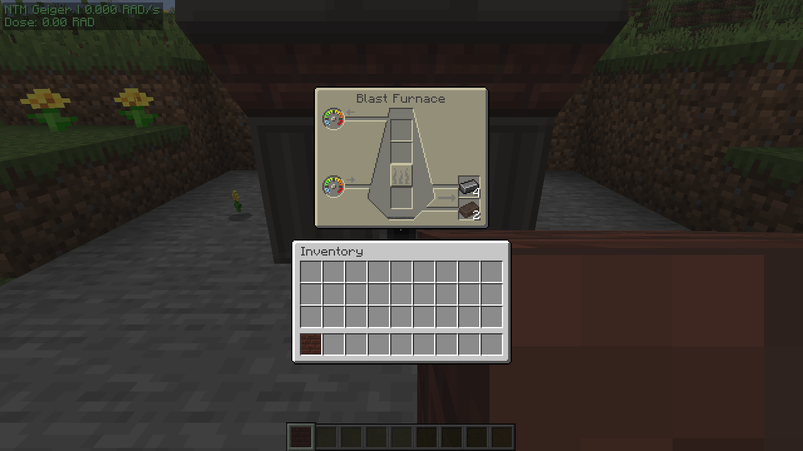

# Máquinas de processamento (Marco 3)

2026-10-29. Fluidos em [fluidos.md](fluidos.md). Caminhos de Java relativos a
`ntm-src/src/main/java/com/hbm/`.

## Ordem e cobertura

A ordem segue os itens que cada máquina destrava: `source_recipe_machine` em
`content/ids.json`, com o número de exclusivos entre parênteses.

| # | Máquina | Itens destravados | Receitas no port (puladas na extração) |
| ---: | --- | ---: | --- |
| 1 | Montadora `machine_assembly_machine` | 120 (106) | 398 (233 chamadas da fonte) |
| 2 | Centrífuga `machine_centrifuge` | 45 (45) | 54 (25) |
| 3 | Planta química `machine_chemical_plant` | 32 (25) | 47 (30) |
| 4 | Centrífuga de gás `machine_gascent` | (a cadeia UF6/PuF6) | transcrita à mão |

Depois do M3: o triturador (*shredder*), com 56 itens (47 exclusivos); ver a
seção abaixo.

As receitas vêm do agente de importação, que resolve itens e OreDict:
`content/machine-recipes/*.json`, schema 1, com `skipped` e motivo.
`tools/machine-gen/build.py` as converte para o formato embutido
(`crates/ntm-core/data/machines/*.json`), com os nomes em pt_BR. Cada
ingrediente aceita as alternativas do OreDict.

As receitas puladas dependem de itens fora do catálogo, laços de bedrock,
probabilidades, pressão ou configurações. Nenhuma receita foi inventada.

## Montadora, planta química, centrífuga (`crafter.rs`)

Uma lógica só sobre as tabelas de receita.

| | Montadora | Planta química | Centrífuga |
| --- | --- | --- | --- |
| NTM | `TileEntityMachineAssemblyMachine` | `TileEntityMachineChemicalPlant` | `TileEntityMachineCentrifuge` |
| Tanques | 1 + 1, 4.000 mB (ajustados à receita) | 3 + 3, 24.000 mB | — |
| Escolha da receita | lista (até 512 linhas) | lista | pelo item posto (`recipe_for`) |
| Energia | HE/t e ticks da receita; buffer `max(HE/t·100, 100k)` | idem | 200 HE/t, 200 ticks, 100k |

A tela tem três visões, porque a tela de mod do Horizon não rola: o que passa
de ~200 px some.

- **Máquina:**
  - energia;
  - a receita (ícone e nome);
  - progresso, ou "Falta: …" com o que falta;
  - "Pronto: N";
  - botões: escolher receita, pôr itens da mão, retirar o pronto, fluidos e
    recipientes (ou retirar as entradas).
- **Receita:** a lista. Um clique numa linha é `ui-events.select(id, linha)`,
  que vira a ação `LIST + linha`.
- **Fluidos:** os tanques, despejar e encher recipientes.

Regras:

- **Itens:** "Pôr itens da mão" tira até 16 de uma vez, uma transação por
  item, e só o que a receita escolhida aceita. O pronto volta por `Give`. Ao
  quebrar, entradas e saídas caem (transações `Drop`).
- **Saídas por chance** (`ChanceOutput`): o sorteio é um hash fixo de
  (receitas feitas, saída), não o aleatório do mundo.
- **Trocar de receita:** o progresso volta a 0; os tanques passam ao tipo da
  receita e, se o tipo muda, o conteúdo se perde (como no NTM).
- **Portas:** de energia e de fluido, abertas nas 6 faces.

**Fora, documentado:**
- upgrades (velocidade, energia, overdrive);
- os pools de `blueprints`: todas as receitas ficam selecionáveis;
- pressão;
- a fábrica de 4 módulos;
- o multibloco 3×3×3, que aqui é um bloco só.

## Centrífuga de gás (`gascent.rs`)

`TileEntityMachineGasCent.java` e `GasCentrifugeRecipes.java:24-34, 94-96`.

- **Tanques:** um tanque real de 2.000 mB (UF6, PuF6 ou lama do Watz), que vira
  um tanque de "pseudofluido" de 8.000 mB.
- **Estágios:** cada um tem consumo, produção, o próximo pseudofluido e suas
  saídas:

  | Estágio | Consome | Produz | Próximo | Saídas |
  | --- | ---: | ---: | --- | --- |
  | NUF6 | 400 | 300 | LEUF6 | 1 U238 |
  | LEUF6 | 300 | 200 | MEUF6 | U238 + fluorita |
  | MEUF6 | 200 | 100 | HEUF6 | U238 |
  | HEUF6 | 300 | 0 | — | 2 U238 + U235 + fluorita (**só com o upgrade**) |
  | PF6 | 300 | 0 | — | Pu238 + 2 Pu-mix + fluorita |
  | MUD | 1000 | 500 | MUD_HEAVY | chumbo em pó + poeira |
  | MUD_HEAVY | 500 | 0 | — | ferro em pó + poeira + resíduo nuclear |

- **Tempo e energia:** 150 ticks a 200 HE/t; com `upgrade_gc_speed`, 80
  ticks a 300 HE/t. O upgrade entra e sai por transação.
- **Cascata:** a cada 10 ticks, a centrífuga passa a saída para a que está
  atrás dela (oposta ao `facing`), se ela usa o mesmo fluido real. No fim de
  uma linha LEUF6, 600 mB viram 6 pepitas de combustível de urânio e 1
  fluorita. A cascata é do servidor, que vê as vizinhas
  (`fluid_server.rs::gascent_cascades`).
- **Desvio:** o tanque real aceita despejar célula ou tanque pela mão, além da
  rede (no NTM, só a rede). A tela não tem slot de identificador: o tipo vem do
  recipiente.

## Triturador (`shredder.rs`), no motor com slots

`TileEntityMachineShredder.java` e `ShredderRecipes.java`. É a primeira
máquina nova sobre os **slots reais** do motor (`ntm-visual`; desenho em
[visual-fiel.md](visual-fiel.md)). A máquina guarda os itens como os `Slots` da
ponte (trait `Slotted`, `Layout::Native`): sem transação de item e sem tela
`ui`. A tela é a `gui_shredder.png` original, gerada pelo agente de visual.

| | NTM | Port |
| --- | --- | --- |
| Slots | 0–8 entradas, 9–26 saídas, 27–28 lâminas, 29 bateria | os mesmos; a bateria fica guardada, sem uso (o port ainda não tem carga em item) |
| Ciclo | 60 ticks, 5 HE/t, buffer de 10.000 HE | igual; energia pela rede (portas nas 6 faces) |
| Por ciclo | cada slot de entrada com espaço dá 1 item à saída (`processItem`) | igual, com o mesmo empilhamento |
| Lâminas | aço 400, titânio 500, desh 0 (não gasta); +1 de dano por ciclo em cada uma; quebrada (dano = máximo) para a máquina | igual; o dano vai no item (`minecraft:damage`), então a lâmina leva o desgaste junto |
| Sem receita | `getShredderResult` nunca é nulo: vira `scrap` ×1 | igual; uma lâmina não entra como entrada |

**Receitas:** 722 (463 explícitas + 259 geradas do OreDict em `registerPost`).
São extraídas pelo agente de importação (`content/machine-recipes/shredder.json`;
o primeiro `setRecipe` vence, 54 colisões) e embutidas por
`tools/machine-gen/build.py` em `crates/ntm-core/data/machines/shredder.json`.
Todas as entradas e saídas `ntm:` existem no `ids.json`.

**Fora:** a barra de durabilidade das lâminas só aparece com `max_damage` no
item, que o motor base não aceita; o gerador de conteúdo tem `--max-damage` para
o motor `ntm-visual`. O upgrade (`upgrade_shredder`) também fica de fora.

**Verificação:**
- **Mundo falso** (`shredder::tests`, 6 testes; `server/tests/shredder_tests.rs`, 2):
  - um item por slot por ciclo, empilhando;
  - sem energia ou sem lâminas, nada acontece;
  - lâmina quebrada para a máquina;
  - saídas cheias param a máquina;
  - item sem receita vira sucata;
  - a tabela do NTM, com a explícita vencendo a gerada;
  - energia de uma bateria vizinha;
  - o dano da lâmina no save do mundo;
  - os itens soltos ao quebrar.
- **Em jogo** (motor `ntm-visual`, Xvfb `:15`, mudo, `tools/test-game/shredder.py`;
  mundo criativo, seed 1768123):
  - bateria cheia ao lado;
  - por shift-clique: 8 minérios de ferro, 4 lingotes e 2 pedregulhos nas entradas, lâminas de aço e desh nos slots delas;
  - 8 ciclos em 24,7 s (8 × 60 ticks a 20 TPS);
  - 20 pós de ferro (8 × 2 + 4) e 2 cascalhos; a lâmina de aço com dano 8, a de desh com 0;
  - o pó retirado para o inventário;
  - depois de sair e voltar ao mundo, o conteúdo e o dano das lâminas ficaram;
  - nenhum "took too long".

| | |
| --- | --- |
|  |  |
| Trabalhando: 14 pós e 2 cascalhos, a barra de energia e as luzes das lâminas. | No fim: o pó já no inventário, a lâmina de aço gasta. |

## Alto-forno (`blastfurnace.rs`), no motor com slots

É o `TileEntityMachineBlastFurnace.java`, com as receitas do
`BlastFurnaceRecipesNT.java`. O `machine_difurnace` antigo está
`@Deprecated` no NTM. Os exclusivos dele (tcalloy, tungstênio magnetizado,
napalm) saem também de outras receitas; o tcalloy, pelo cadinho da fundição.

Como o triturador, guarda os itens como os slots do motor (`Slotted`). A tela
é a `gui_blast_furnace.png` original, e o multibloco 3×7×3 é o do NTM; os dois
são do agente de visual.

| | NTM | Port |
| --- | --- | --- |
| Slots | 0 combustível, 1–2 entradas, 3–4 saídas | os mesmos |
| Energia | nenhuma: queima combustível, meia peça de carvão (800) por operação, até 38.400 | igual |
| Combustível | `ModuleBurnTime`: só itens com `Coal`, `Coke` ou `Lignite` no OreDict, mais `solid_fuel*` e `rocket_fuel`; madeira vale 0 | os 20 da tabela do agente de importação; carvão vegetal e madeira não entram |
| Receita | `getRecipe(s0, s1)`: a primeira da lista que serve, nas duas ordens; a quantidade só é cobrada na 2ª entrada | igual (`Tables::recipe`) |
| Velocidade | `1 + airblast × 8 / 4.000`, de 1× a 5×; o ar perde 5% por tick | igual; o ar vem pela rede de fluido |
| Gás | `flue`, 8 mB por tick da operação, tanque de 1.000 | igual; sai pela rede |

**Receitas:** 12 das 15 do NTM, na ordem dele (aço de lingote, pó, minério e
com fluxo; cobre vermelho; PAA; firebrick). As 3 que ficam de fora precisam de
itens ausentes do catálogo (espadas de meteorito e starmetal). Elas vêm do
agente de importação (`content/machine-recipes/blast_furnace.json`) e são
embutidas por `tools/machine-gen/build.py`.

**Portas de fluido:** as 6 faces do núcleo. Com o motor de slots, o multibloco
conduz também pelos proxies (`container_bridge::fluid_proxy_cells`): as
laterais, a coluna central, a frente e o fundo a +3 e +5, e o topo.

**Fora (com o acordo do coordenador):**
- a inclinação (`checkTilt`), que no NTM só vale com `enableMachineGravity`,
  desligado por padrão;
- o vazamento de `flue` no mundo quando o tanque enche: aqui o tanque só para
  no máximo;
- som e partículas;
- uma fonte de `airblast` no jogo: o port ainda não tem a máquina que o
  produz, então o ar quente está testado no mundo falso.

**Verificação:**
- **Mundo falso** (`blastfurnace::tests`, 6 testes; `server/tests/blastfurnace_tests.rs`, 3):
  - a busca de receita do NTM (as duas ordens, quantidade na 2ª);
  - o aço em 800 ticks;
  - sem combustível ou com a saída cheia, a máquina para;
  - madeira e carvão vegetal não são combustível;
  - o combustível cheio recusa mais;
  - com um tanque de `airblast` ligado por duto, mais de 4× mais rápido, gastando ~200 mB de ar por tick;
  - o `flue` sai por outro duto;
  - pelo topo do multibloco, o ar chega ao núcleo;
  - o nível no bloco e os itens soltos ao quebrar.
- **Em jogo** (motor `ntm-visual`, Xvfb `:15`, mudo, `tools/test-game/blastfurnace.py`;
  mundo criativo, seed 1768123):
  - o multibloco posto num piso livre;
  - por shift-clique, 2 carvões (viram combustível na hora), 4 lingotes de ferro e 2 areias;
  - 2 operações em 81,2 s (2 × 800 ticks a 20 TPS), com 4 aços e 2 escórias;
  - o aço retirado para o inventário;
  - depois de sair e voltar ao mundo, a escória continua na saída;
  - nenhum "took too long".

| | |
| --- | --- |
|  |  |
| Trabalhando: o ferro e a areia nas entradas, a chama acesa. | No fim: aço e escória nas saídas. |

## Fundição (`foundry/`), no motor com slots

São o `TileEntityHeaterFirebox`, o `TileEntityCrucible`, o
`TileEntityFoundryChannel`/`Tank`/`Outlet` e o
`TileEntityFoundryCastingBase` (molde e bacia), com os materiais do
`Mats.java`, as ligas do `CrucibleRecipes.java` e os moldes do
`ItemMold.java`. O plano em três etapas foi aprovado pelo coordenador. Telas e
modelos ficam com o agente de visual.

As tabelas vêm do agente de importação (`content/machine-recipes/foundry.json`):
109 materiais, 609 itens com o que cada um derrete, 13 ligas, 85 combustíveis
da firebox e 26 moldes.

| | NTM | Port |
| --- | --- | --- |
| Unidade | quanta: lingote 72, pepita 8, bloco 648 | igual (`foundry::quanta`) |
| Firebox | 2 slots; calor até 100.000 TU; o combustível rende `burn × heat` | igual; um balde de lava devolve o balde |
| Calor do cadinho | puxa 1/4 da diferença da fonte logo abaixo do núcleo | igual (`HeatSource`) |
| Cadinho | slots 1–9 de entrada (o 0 não é usado); derrete com ≥ 50.000 TU, 20.000 por item; pilhas de liga e de rejeito de 10.368 quanta | iguais; o slot 0 fica escondido na tela |
| Liga | escolhida numa lista; feita a cada `frequency` ticks | lista na tela antiga (botão 0 da tela com slots) |
| Despejo | dois jatos de 24 quanta/tick, caindo até 6 blocos, a núcleo ± 2 × frente | igual |
| Canal | 144 quanta; nivela com os vizinhos a cada 5 ticks em ordem sorteada | igual, com o sorteio por hash (`flow::roll`) |
| Tanque | 2.592 quanta | igual |
| Saída (*outlet*) | tira de trás e despeja até 4 blocos abaixo; filtro de material, invertível | igual |
| Molde e bacia | o molde define o custo; cheio, esfria 200 ticks e vira o item | igual; moldes pequenos (tamanho 0) no molde, grandes (1) na bacia |

**Desvios:**
- **Aleatoriedade determinística.** As sortes do NTM (ordem dos vizinhos,
  `nextInt`) saem de um hash da posição e do tick. Isso torna os testes
  reprodutíveis.
- **Metal fora da rede de fluido.** O metal derretido vai por blocos
  (`foundry_server`), como no NTM, e não pelos dutos.
- **Bica (*slagtap*) `Inert`.** Fica documentada como lacuna.
- **Estado salvo no bloco.** O estado que não é slot vai em `set-data` depois
  dos valores da tela (`Slotted::save_state`) e volta pelo `get-data` (motor
  `ntm-visual`, api 9) na primeira vez que a sessão vê a máquina:
  - calor, progresso, liga e as duas pilhas, no cadinho;
  - metal e resfriamento, no molde e na bacia.

**Verificação:**
- **Mundo falso, lógica:** 17 testes nos módulos, entre eles:
  - a firebox: carvão até o máximo e o calor que some parado;
  - o calor de baixo;
  - um item por vez;
  - aço de ferro, carvão e fluxo;
  - o metal que entra por cima;
  - a ordem sorteada dos canais;
  - o filtro da saída;
  - o molde de lingote em 200 ticks;
  - a bacia, que só aceita molde grande.
- **Mundo falso, servidor** (`server/tests/foundry_tests.rs`, 6):
  - a firebox aquece o cadinho e o ferro derrete e cai;
  - a liga escolhida na tela antiga;
  - quebrar o cadinho solta itens e sucata;
  - o metal corre por canais e uma saída até dois tanques (o de cima enche o
    de baixo antes), sem perda;
  - um material por rede;
  - o aço no molde de lingote.
- **Robustez dos slots** (`server/tests/slot_items_tests.rs`, 6). Em todos os
  ticks, a soma de itens, metal e o que foi retirado é o que entrou:
  - o triturador com a saída retirada em horas aleatórias;
  - quebrar com conteúdo solta uma vez só;
  - o metal do cadinho quebrado vira sucata;
  - uma queda entre o save do mundo e o do mod, nos dois sentidos, não duplica
    nem perde metal;
  - o ferro conservado do cadinho até o molde.
- **Em jogo** (motor `ntm-visual`, Xvfb `:15`, mudo, `tools/test-game/foundry.py`;
  mundo criativo, seed 1768123; sem "took too long"):
  - **`fundir`, etapas 1 e 3:** firebox com carvão; o cadinho posto agachado,
    com o núcleo sobre o da firebox; 3 lingotes de ferro por shift-clique.
    Fundem e caem no molde de lingote, 2 blocos atrás da frente. Os 3 lingotes
    são retirados em 70 s.
  - **`canais`, etapa 2:** canal, canal, tanque e saída, com um molde sob a
    saída. Os lingotes saem no molde (2 em 25 s).
  - **`reter` e `voltar`:** o molde sai de sob a saída; o metal fica no tanque
    (360 quanta pelo save do mod) e o jogo é fechado. Ao reabrir, o molde
    volta e saem os 5 lingotes, em 72 s.
  - A aceitação achou dois defeitos, corrigidos com teste no mundo falso:
    - **bloco novo com valores zerados.** Num bloco recém-posto, o `get-data`
      devolve zeros e o material 0 é pedra. Canais e tanques novos só
      aceitavam pedra, e a saída nova filtrava pedra. Agora o material é salvo
      como id + 1, com 0 = nenhum.
    - **rede de canais presa a um metal.** Um canal vazio guardava o material
      na checagem da rede. Agora, como no NTM, só canais com metal definem o
      material da rede.

## Bigorna (`anvil.rs`), no motor com slots

São o `NTMAnvil.java`, o `ContainerAnvil.java`, o `AnvilRecipes.java` e o
`AnvilCraftPacket.java`. Os 12 blocos, de `anvil_iron` (nível 1) a
`anvil_osmiridium` (8), mais o `anvil_murky`, vêm do agente de importação
(`content/machine-recipes/anvil.json`, [content-anvil.md](content-anvil.md)).
Os níveis estão fixos em `anvil::ANVILS`.

| | NTM | Port |
| --- | --- | --- |
| Bloco | sem block entity: a forja solta os itens ao fechar a tela; a construção tira do inventário do jogador | uma máquina com 19 slots do motor (desvio aprovado pelo coordenador) |
| Forja | slots esquerda/direita; o resultado sai ao ser retirado | slots 0, 1 e 2; o botão 3 ("forjar") consome e entrega no mesmo tick do servidor, sem a corrida de retirar a saída |
| Construção | lista filtrada pelo nível; faz 1 ou, com shift, um pacote | grade 3×4 (slots 3–14) e 4 saídas (15–18); botão 0 abre a lista na tela antiga, botão 1 faz uma, botão 2 faz um pacote |
| Saídas por chance | `rand` | sorteio por hash do número de construções (`anvil::roll`), salvo com o bloco |
| Saída cheia | os itens vão para o inventário ou caem | só constrói se todas as saídas couberem |

**Receitas:** 36 forjas (18 melhorias de bigorna, gunmetal e 17 gravações de
molde, que guardam o exemplo e gastam a base) e 103 construções, na ordem do
NTM. Elas são embutidas por `tools/machine-gen/build.py`.

**Fora (com o acordo do coordenador):**
- as 18 forjas "quentes" (calor no NBT do item);
- as receitas de etiqueta de nome e de cianeto (NBT);
- a queda como areia.

**Tela:** valores `[nível, receita + 1, pode construir, vezes, forja casa]`,
seguidos do estado salvo `[receita + 1, construções]`. O desenho é do agente
de visual: a grade fica na área da lista do NTM.

**Custo por tick:** a contagem de "vezes" roda a cada tick em cada bigorna
carregada. Simular até 64 construções custava 28,9 µs por chamada (nativo,
grade cheia de lingotes). Agora a contagem divide o total de cada entrada e
confere só a próxima construção: 0,98 µs. Os botões continuam simulando cada
construção.

**Verificação:**
- **Mundo falso, lógica** (`anvil::tests`, 4):
  - melhoria de bigorna;
  - molde com exemplo exato;
  - forja sem forma;
  - saída ocupada;
  - grade e nível;
  - chances perto da metade em 64;
  - saídas cheias;
  - a tabela embutida.
- **Mundo falso, servidor** (`server/tests/anvil_tests.rs`, 3), com os botões
  pela ponte de slots:
  - a forja da bigorna de aço;
  - chapas de aço numa bigorna de nível 3, uma e um pacote;
  - a receita escolhida volta do bloco depois de perder o save do mod;
  - a bigorna de ferro recusa um nível acima.
- **Em jogo** (motor `ntm-visual`, Xvfb `:15`, mudo, `tools/test-game/anvil.py`;
  mundo criativo, seed 1768123; sem "took too long"). A tela é a
  `gui_anvil.png` do NTM, com a grade e as saídas do agente de visual.
  - **`forjar`:** a bigorna de ferro e 12 lingotes de aço nos slots da forja.
    "Forjar" dá a bigorna de aço e sobram 2 lingotes.
  - **`construir`:** numa bigorna de desh (nível 3), "Placa de Aço" é
    escolhida na lista da tela antiga e 20 lingotes vão para a grade.
    "Construir uma vez" faz 1 chapa; com shift, faz as outras 19. As 20
    chapas vão para o inventário.
  - **`voltar`:** o mundo é fechado e reaberto. Os slots da bigorna de ferro
    estão como ficaram, e a de desh ainda tem a chapa escolhida: 2 lingotes
    dão a chapa.

## Prensas: a tabela inteira

As duas prensas do M1 (a queimador e a elétrica) agora usam a tabela completa
do `PressRecipes.java`. Ela vem do agente de importação
(`content/machine-recipes/press.json`, [content-press.md](content-press.md)) e
é embutida por `tools/machine-gen/build.py` em `data/press_recipes.json`, com
uma entrada por alternativa do OreDict.

| Matriz | Receitas | Durabilidade (`ModItems`) |
| --- | --- | --- |
| `flat` | 10, entre elas pós em quartzo, diamante, esmeralda e lápis; coque em grafite; tora da selva em resina; briquetes | pedra 32, ferro 64, aço 192, titânio 256, obsidiana 512, desh 0 (não gasta) |
| `plate` | 13 chapas | idem |
| `wire` | 11 fios finos ×8, inclusive ouro e carbono (do grafite) | idem |
| `circuit` | silício | idem |
| `c9`, `c50` | cápsulas de gunmetal e weaponsteel | 1000; desh 0 |
| `printing1..8` | as páginas, de papel | — |

A única receita pulada é a espada de meteorito, fora do catálogo. As
matrizes C357 e C44 existem, mas o NTM não tem receita para elas.

**Combustível que também é entrada.** Na prensa a queimador, a tora da selva
(prensada em resina) também é combustível. No NTM o jogador escolhe o slot;
aqui ela vai para a entrada só se a matriz posta a prensa, e senão vira
combustível.

**Verificação:** no mundo falso:
- a tabela inteira (32 matrizes, 49 entradas);
- o fio de ouro e a chapa de ouro;
- o grafite do coque de petróleo;
- uma página;
- a matriz desh, que não gasta em 40 prensagens, e a de pedra, que quebra na 32ª;
- a tora, queimada sob a matriz de chapa e prensada sob a plana.

## Prensas e centrífuga de gás com slots (etapa d.2)

São máquinas de antes dos slots: guardam os itens nos próprios campos, que
as transações da tela antiga movem (o motor sem slots continua usando essa
tela). No motor `ntm-visual` elas espelham os campos nos slots do motor, por
dois ganchos do `Slotted`:
- `sync_in`: lê os slots para os campos, depois que o bridge copia os do
  motor;
- `sync_out`: escreve os campos nos slots, antes que voltem ao motor.

Na primeira vista de uma sessão, com os slots do motor vazios, uma máquina
dessas mantém o que os campos têm e o escreve nos slots (`migrates`), como a
montadora e as bombas fazem. É a migração de uma máquina enchida por
transações.

| Máquina | Slots (`Container*` do NTM) | Valores da tela | Estado salvo |
| --- | --- | --- | --- |
| Prensa a combustível | 0 combustível, 1 matriz, 2 entrada, 3 saída | prensa, máx, velocidade, máx, queima, custo da prensagem | prensa, recuando, pausa, velocidade, queima |
| Prensa elétrica | 0 bateria, 1 matriz, 2 entrada, 3 saída, 4 upgrade | prensa, máx, energia, máx | prensa, recuando, pausa, energia |
| Centrífuga de gás | 0–3 saídas, 4 bateria, 5 identificador, 6 upgrade de velocidade | progresso, tempo do estágio, energia, máx, tanque (mB, cap), tanques pseudo (tipo, mB) e a cap deles | progresso |

**Detalhes:**
- **Desgaste da matriz:** vai no `damage` do item, com a barra nativa (o
  `max_damage` das 24 matrizes desgastáveis está no `ids.json`; as 8 desh
  não têm). Uma matriz gasta retirada e posta de volta volta com o mesmo
  desgaste.
- **Slots sem lógica no port:** a bateria, o upgrade da prensa elétrica e o
  identificador ficam como o jogador os deixou.
- **Saídas da centrífuga de gás:** ficam no slot onde estão; um produto novo
  ocupa o primeiro livre.
- **Onde está o código:** ele entrou no commit 31c087a ("feat(content): add
  max_damage ..."), do agente de conteúdo. Os arquivos estavam no índice
  compartilhado do git na hora do commit dele, e o histórico já publicado
  não é reescrito.

**Em jogo** (motor `ntm-visual`, Xvfb `:15`, mudo, `tools/test-game/presses.py`;
mundo criativo, seed 1768123; telas do agente de visual):
- **`prensa`:** 4 carvões, a matriz de chapa de ferro e 8 lingotes de ferro
  postos nos slots. As 8 chapas saem e são retiradas em 21,7 s, e a matriz
  fica com desgaste 8 (barra de durabilidade).
- **`eprensa`:** ao lado de uma bateria cheia, uma matriz de fio com desgaste
  62 e 5 lingotes de cobre. Depois de 2 prensagens a matriz quebra, com 16
  fios finos de cobre e 3 lingotes restantes.
- **`gascent`:** ao lado de uma bateria, 2 células de UF6 despejadas pela tela
  antiga (tecla R; voltam 2 células vazias). As 3 pepitas de U-238 do
  primeiro estágio aparecem no slot de saída. O upgrade de velocidade entra e
  sai pelo slot 6.

**Verificação** (`server/tests/press_slots_tests.rs`, 4):
- uma prensa enchida antes dos slots mostra matriz (com o desgaste), entrada
  e combustível nos slots;
- a prensa a combustível trabalha pelos slots enquanto o jogador retira as
  chapas em horas aleatórias: lingotes + chapas são sempre 8, e a matriz
  gasta 1 por prensagem;
- a matriz da prensa elétrica quebra no limite, e outra, posta com desgaste
  30, continua dali; bateria e upgrade intactos;
- a centrífuga de gás leva produto e upgrade para os slots, enche as saídas,
  e um produto retirado não mexe nos outros.

## PUREX (`crafter.rs`, `Station::Purex`), no motor com slots

É o `TileEntityMachinePUREX`, sobre o `ModuleMachineBase`, o mesmo módulo
da planta química, com as receitas do `PUREXRecipes.java`. No port é uma
estação do `crafter.rs`. As receitas vêm do agente de importação
(`content/machine-recipes/purex.json`) e são embutidas por
`tools/machine-gen/build.py`. Tela, multibloco 5×5×5 e as 16 portas da borda
de baixo (energia e fluido) são do agente de visual.

| | NTM | Port |
| --- | --- | --- |
| Slots | 0 bateria, 1 blueprint, 2–3 upgrades, 4–6 entradas, 7–12 saídas | as entradas e as saídas (`Layout::Crafter`); os outros sem lógica |
| Tanques | 3 de entrada e 1 de saída, 24.000 mB, tipados pela receita | iguais |
| Energia | máx = max(1.000.000, energia da receita × 100) | igual |
| Receita | escolhida numa lista; troca automática no grupo (`autoSwitchGroup`) | igual. A troca vale para todas as estações do crafter. A entrada é um monte, lido na ordem em que os itens chegaram (o NTM lê o slot 0) |
| Saídas com chance | `ChanceOutput` | sorteio por hash das receitas feitas |

**Receitas:** 22 das 59 do NTM, na ordem dele:
- os 3 especiais (UZH, ouro e chumbo reluzentes);
- as 15 do combustível PWR gasto, no grupo `autoswitch.pwr`;
- o sal de tório;
- o ICF;
- as 2 do grupo `autoswitch.schrab`.

As outras 37 precisam de itens fora do catálogo: as barras do pile, os
rejeitos do ZIRNOX, as placas, os pellets do Watz, a mistura de areia da
vitrificação e o naquadria.

**Fora (com o acordo do coordenador):**
- os upgrades, que entram depois para todas as estações do crafter;
- os blueprints, que nenhuma receita padrão usa;
- o modo restrito, o som e o redstone-over-radio.

Quase todas as entradas vêm de reatores que o port ainda não tem.

**Verificação:**
- **Mundo falso** (`crafter::purex_tests`, 1; `server/tests/purex_tests.rs`, 2):
  - a troca no grupo, numa tabela feita à mão;
  - 2 hastes PWR MEU pelos slots, com querosene e ácido nítrico: 6 pepitas
    de U-238, 8 de plutônio e 4 de tecnécio, e os tanques descem 1.000 e
    500 mB. Uma haste MEN posta troca a receita e dá 4 de Pu-239;
  - 32 vezes o sal de tório gasto: 16.000 mB de sal de tório a cada vez, e
    o U-233 perto da metade.
- **Em jogo** (motor `ntm-visual`, Xvfb `:15`, mudo, `tools/test-game/purex.py`;
  mundo criativo, seed 1768123; sem "took too long"):
  - **`pwr`:** o multibloco posto, com uma bateria cheia na borda.
    - A receita PWR MEU escolhida na lista da tela antiga (botão "Escolher
      receita" da tela com slots).
    - Um barril de querosene e um de ácido nítrico despejados pela tela
      antiga; voltam 2 barris vazios.
    - 2 hastes MEU no slot de entrada dão, nos slots de saída, 6 U-238,
      8 plutônio, 4 tecnécio e 6 rejeitos nucleares pequenos.
    - Os tanques ficam com 15.000 e 15.500 mB.
  - **`trocar`:** uma haste MEN posta troca a receita sozinha. Em 8 s saem
    4 Pu-239, 3 U-238, 2 tecnécio e 3 rejeitos.

## Cadeia do bedrock, etapa 1 (`bedrock.rs`, `excavator.rs`), no motor com slots

É o sistema novo do NTM: `ItemBedrockOreBase`, `ItemBedrockOreNew`,
`BedrockOre` (geração), `TileEntityMachineExcavator` e
`TileEntityMachineOreSlopper`. O `ItemBedrockOre` antigo está morto no NTM
(nada o gera) e fica de fora. O conteúdo e a geração são do agente de
importação; telas e multiblocos são do agente de visual.

**Etapas** (aprovadas pelo coordenador):
1. depósito → escavadora → ore slopper → centrífuga → fragmentos → pó;
2. cristalizador;
3. forno pirolítico e eletrólise de fluidos;
4. saídas fundidas (forno a arco, eletrolisador);
5. as linhas que dependem do petróleo.

**O depósito** (`ntm:ore_bedrock`) não guarda nada. Tudo é função da posição:
- **Densidades:** as 6 densidades (metais leves, pesados, terras raras,
  actinídeos, não metais, cristalinos) vêm de `getOreLevel`: o produto de dois
  ruídos Perlin de 4 oitavas, com sementes fixas (não as do mundo), no centro
  do chunk, × 0,05, limitado a 0..2.
- **Nível e fluido:** saem da média das densidades.

  | Média | Nível | Fluido por extração |
  | --- | ---: | --- |
  | ≤ 0,75 | 1 | nenhum |
  | > 0,75 | 2 | 1.000 mB de água |
  | > 1 | 3 | 1.000 mB de ácido sulfúrico |
  | > 1,5 | 4 | 2.000 mB de solvente |

- **Nether:** 4 glowstone, pó de fogo ou quartzo (pesos 100/50/100),
  escolhido pelo chunk.
- **Parity com o NTM:** o `java.util.Random` confere com o JDK. O simplex de
  1.7.10 é uma reconstrução, porque o código vanilla não está no repositório:
  concorda com o `SimplexNoise` do Horizon, menos os offsets por oitava. A
  paridade das densidades com o NTM não está verificada.

**O minério bruto** (`ntm:bedrock_ore_base`) leva as densidades do chunk ×
(1 + 0,1 × a sorte da broca) no `minecraft:custom_data`, como
`{ntm_ore:{light:1.5d,...}}`. O motor `ntm-visual` passa isso pelos slots
(`Stack.custom`, api 10). Brutos com densidades diferentes não se empilham.

**Escavadora** (7×7×4; slots 2–3 upgrades, 4 a broca, 5–13 o buffer;
botão 0 liga e desliga, 1–4 os interruptores; detalhes em "Escavadora:
anéis, upgrades e interruptores", abaixo):
- 10.000 HE por tick; abre um poço de 3×3 a partir de 4 blocos sob o núcleo
  (mais largo com o upgrade de efeito).
- Cada camada leva a dureza somada ÷ a velocidade da broca. Os blocos vão
  para o buffer, e um buffer cheio pausa a broca sem perder nada.
- Sobre um depósito, extrai um bruto a cada 6.000 ÷ velocidade ticks, se o
  nível da broca alcança o do depósito e o tanque tem o fluido pedido, que é
  gasto. O depósito é infinito.
- As 10 brocas têm velocidade de 1 a 2,5, nível de 1 a 5 e sorte de 0 a 4.
- Uma camada é lida uma vez (e de novo antes de quebrar), não a cada tick,
  porque ler um bloco custa fuel.

**Ore slopper** (7×3×4; slot 2 o bruto, 3–8 as saídas):
- 200 HE por tick, 600 ticks: um bruto e 1.000 mB de água viram 1.000 mB de
  slop.
- As densidades do bruto se acumulam por tipo; cada unidade inteira vira um
  minério BASE daquele tipo. O que não cabe espera no acumulador.

**Centrífuga:** as linhas de bedrock do `CentrifugeRecipes`. BASE → PRIMARY
+ cascalho; PRIMARY → os fragmentos dos 2 primários do tipo (9 fragmentos =
1 pó, receita de bancada).

**Desvios:**
- a rocha de profundidade (`BlockDepth`) desliga a escavadora, como no NTM,
  mas a geração dela ainda não existe no mundo;
- o servidor não tem a tabela de dureza nem as loot tables. A dureza vem de
  uma tabela vanilla resumida (1,5 no resto), e os blocos dão a si mesmos,
  com pedra virando pedregulho e grama virando terra;
- sem a saída para um baú ou esteira na frente da escavadora;
- o upgrade de sorte não existe na escavadora (no NTM também não).

**Verificação** (`bedrock::tests`, 5; `excavator::tests`, 2;
`server/tests/bedrock_tests.rs`, 3):
- o `Random` contra o JDK, as densidades por chunk e os vários níveis, o
  `custom_data` de ida e volta (no formato que o motor devolve);
- a escavadora com broca de ferro desce 10 camadas de deepslate (90
  pedregulhos de deepslate), chega ao depósito e tira um bruto com as
  densidades do chunk × 1,1;
- uma broca abaixo do nível do depósito não tira nada;
- o slopper transforma as densidades nos minérios BASE certos.

**Em jogo** (motor `ntm-visual` api 10, Xvfb `:15`, mudo,
`tools/test-game/bedrock.py`; mundo criativo, seed 1768123; sem "took too
long"). O depósito de nível 1 fica em (2920, −1886): actinídeos 2,0 e
cristalinos 1,0, sem fluido. Ele é posto por `fill`, porque não guarda nada.
O resto do poço é aberto antes, para o teste não levar horas.
- **`escavar`:** a escavadora sobre o depósito, com a bateria criativa e a
  broca ferro.
  - Cava as 5 camadas naturais (grama, terra e pedregulho no buffer).
  - Tira um bruto a cada ~2 min, com as densidades do chunk × 1,1 no
    `custom_data` (`/data`: actinídeos 2,2).
  - Os brutos do mesmo depósito se empilham.
- **`slop`:** 3 brutos e a água de um barril em modo saída na borda dão 6
  minérios BASE de actinídeos e 3 de cristalinos, em 85 s.
- **`centrifugar`:** 6 BASE → 6 PRIMARY + 6 cascalhos → 24 fragmentos de
  urânio e 24 de tório.
- **`craftar`:** 9 fragmentos de urânio na bancada dão 1 pó de urânio.
- **Achados:**
  - O motor devolve o `custom_data` em outra ordem e outro formato, e brutos
    iguais não se empilhavam. O port passou a comparar a forma canônica.
  - **Bug do motor, em aberto (agente de visual):** o shift-clique de uma
    pilha com mais de um item de um slot de máquina para o inventário perde o
    `custom_data`. O bruto perde as densidades. Itens isolados mantêm.

## Cadeia do bedrock, etapa 2: o cristalizador (`crafter.rs`, `Station::Crystallizer`)

É o `TileEntityMachineCrystallizer` com as receitas do
`CrystallizerRecipes`: 404 receitas do agente de importação
(`content/machine-recipes/crystallizer.json`, 5 puladas), cada uma com um só
fluido. Tela, multibloco 3×3×6 e portas são do agente de visual.

| | NTM | Port |
| --- | --- | --- |
| Receita | `getOutput(item, tipo do tanque)` | igual: o item da entrada e o fluido do tanque. O mesmo PRIMARY vai para a linha sulfúrica, de hidrogênio etc. conforme o tanque |
| Tanque | 8.000 mB, tipado pelo identificador do slot 7 | 8.000 mB, tipado pelo primeiro fluido que chega com o tanque vazio (o port não tem identificador). Pelas portas, um tanque vazio desse tipo entra em todas as redes de fluido da dimensão (`FluidNode::accepts_any`), o que vale também para a escavadora |
| Tempo e energia | `progress > duração`: duração + 1 ticks, 1.000 HE/t, máximo 1.000.000 | igual |
| Saída | um slot; outro item nele para a máquina | igual |
| Quantidade | `setReq` (por exemplo 4 subprodutos → 1 lavado) | igual |
| Upgrades e produtividade | velocidade, eficiência e overdrive; a produtividade é a chance de não gastar a entrada, só com eficiência | sem upgrades no port: a produtividade fica guardada e não age |
| Bateria criativa | no slot 1 | igual (o bridge lê o slot de bateria da estação; vale também para o PUREX) |

**Nível 3 do bedrock:** a escavadora com broca desh tira de um depósito de
nível 3 gastando 1.000 mB de ácido sulfúrico por extração, que chega por um
barril na camada de portas.

**Verificação:**
- **Mundo falso** (`server/tests/crystallizer_tests.rs`, 3):
  - lavar um BASE com 250 mB de água leva 101 ticks;
  - o tanque vazio pega o primeiro fluido;
  - o fluido escolhe a linha (sulfúrica ou hidrogênio);
  - outro item na saída para a máquina;
  - a bateria criativa no slot 1 alimenta.
- **Em jogo** (`tools/test-game/bedrock.py`, etapas `escavar3`, `pilha`,
  `lavar`, `acido` e `fim`; o mesmo mundo da etapa 1):
  - **`escavar3`:** a segunda escavadora sobre o depósito de nível 3 em
    (2920, −1848), com broca desh e ácido sulfúrico de um barril: 2 brutos
    com actinídeos 2,2 (2,0 × 1,1), em 412 s.
  - **`pilha`:** a pilha de 2 brutos sai pelo shift-clique com o
    `custom_data` (a correção do motor para o criativo).
  - **`lavar`:** com água de um barril pelas portas, os BASE lavados dão 2
    PRIMARY cada na centrífuga, contra 1 dos não lavados (3 lavados → 6;
    2 → 2).
  - **`acido`:** 8 PRIMARY com ácido sulfúrico dão 8 sulfúricos → 16
    sem-sulfúrico + 16 subprodutos.
    - Os 16 sem-sulfúrico dão 64 fragmentos de urânio, 64 de tório e 16
      migalhas.
    - Os 16 subprodutos lavados 4 → 1 dão 4 lavados → 16 de rádio, 8 de
      polônio e 4 migalhas. Todas as contas batem com as tabelas.
  - 9 fragmentos de urânio dão 1 pó de urânio. Sem "took too long".

## Cadeia do bedrock, etapa 3: forno pirolítico e eletrólise de fluidos (`crafter.rs`)

São o `TileEntityMachinePyroOven` (71 receitas do `PyroOvenRecipes`, entre
elas a torrefação do minério de bedrock, que dá vitríolo) e a linha de
fluidos do `TileEntityElectrolyser` (8 receitas do
`ElectrolyserFluidRecipes`). A linha de metal do eletrolisador é da etapa 4,
abaixo.
Os dois são estações do crafter; telas, multiblocos e portas são do agente de
visual.

| | Forno pirolítico | Eletrolisador (fluidos) |
| --- | --- | --- |
| Receita | o item da entrada e o fluido do tanque de entrada; uma receita sem item pede a entrada vazia (`doesRecipeMatch`) | o fluido do tanque de entrada |
| Tanques | entrada e saída de 24.000 mB; a de saída toma o fluido da receita ao terminar e é esvaziada se tinha outro (`setTankType`) | entrada e duas saídas de 16.000 mB; as saídas tomam os fluidos da receita quando ela é escolhida |
| Energia | 10.000 HE por tick, até 10.000.000 | 10.000 HE por tick, até 20.000.000 |
| Itens | 1 entrada, 1 saída | subprodutos nos slots 11–13 |
| Progresso | reinicia sem receita | fica parado sem receita, como no NTM |

Os tanques de entrada são tipados pelo primeiro fluido que chega
(`accepts_any`), como o do cristalizador.

**Defeito achado em jogo, corrigido com teste:** o vitríolo de saída do forno
voltava, pela rede, para o próprio tanque de entrada vazio. Um tanque desses
agora recusa o que a própria máquina põe para fora.

**Verificação:**
- **Mundo falso** (`server/tests/stage3_tests.rs`, 3):
  - torrar 2 BASE dá 2 torrados e 100 mB de vitríolo, e o tanque de entrada
    não aceita o próprio vitríolo;
  - uma receita só de fluido;
  - um minério na entrada escolhe a receita dele;
  - o tanque de saída troca de fluido;
  - o eletrolisador faz 2 × (1.000 mB de vitríolo → 500 de ácido sulfúrico +
    500 de cloro + pó de ferro + pepita de mercúrio).
- **Em jogo** (`tools/test-game/bedrock.py`, etapas `torrar`, `eletrolisar` e
  `ciclo`):
  - **`torrar`:** 40 BASE de actinídeos dão 40 torrados e 2.000 mB de
    vitríolo, num barril na porta do forno. Os torrados na centrífuga dão
    PRIMARY, um por torrado, como os BASE.
  - **`eletrolisar`:** o vitríolo, levado em tanques de 1.000 mB a um barril
    na porta do eletrolisador, dá 1.000 mB de ácido sulfúrico num barril de
    saída, mais 2 pós de ferro e 2 pepitas de mercúrio nos slots de
    subproduto.
  - **`ciclo`:** esse ácido, num cristalizador novo sem outro ácido, faz 2
    PRIMARY → 2 PRIMARY sulfúricos. O ciclo fecha: torrefação → vitríolo →
    eletrólise → ácido sulfúrico → cristalizador.
  - Sem "took too long".

## Cadeia do bedrock, etapa 4: forno a arco grande e metal do eletrolisador (`arc_furnace.rs`, `electrolyser.rs`)

São o `TileEntityMachineArcFurnaceLarge` (os dois modos do
`ArcFurnaceRecipes`: 143 receitas sólidas, 2 puladas na extração, e 491
fluidas) e a linha de metal do `TileEntityElectrolyser` (36 receitas do
`ElectrolyserMetalRecipes`). O metal fundido dos dois cai na fundição que já
existe (`server/foundry_server.rs`, `molten_tick`): no primeiro bloco até 6
abaixo da bica, um canal, um tanque ou um molde.

| | Forno a arco grande | Eletrolisador (metal) |
| --- | --- | --- |
| Slots | 0–2 eletrodos, 3 bateria, 4 upgrade (sem efeito), 5–24 a grade, 25–29 a fila | 14 a entrada, 15–20 os subprodutos, nas posições da receita; os da linha de fluidos seguem iguais |
| Lote | a grade toda, um item por slot (sem upgrade de velocidade); a fila enche a grade com a tampa aberta | um item por vez |
| Tempo | a tampa fecha em 60 ticks; 400 ticks de trabalho; 120 de espera depois, com a tampa aberta | 600 ticks, 20 nas receitas do bedrock; sem condição o progresso para, não volta a 0 |
| Energia | 1.000 HE por tick, até 2.500.000 | 10.000 HE por tick, as duas linhas no mesmo buffer |
| Insumo | 3 eletrodos; cada lote gasta 1 de cada (grafite 10, lantânio 100, desh 500, saturnita 1.500); no fim, o eletrodo vira o gasto (`arc_electrode_burnt__*`) | 100 mB de ácido nítrico, de um tanque próprio de 16.000 mB (tipo fixo) |
| Saída | modo sólido: o item vira a saída no mesmo slot; modo fluido: um buffer de até 82.944 quanta (as sucatas viram o próprio material) | duas pilhas fundidas, esquerda e direita, até 10.368 quanta cada; cada uma só aceita o mesmo material |
| Despejo | 72 quanta por tick, só com a tampa aberta, de 3 blocos à frente do núcleo, 1 acima | 24 por tick de cada pilha: a esquerda 6 blocos atrás do núcleo, a direita 6 à frente, 2 acima |

O botão 0 do forno troca o modo. Os valores que a tela e o modelo usam estão
no contrato com o agente de visual (`tools/visual-gen/visual.json`):
- **forno:** [20..22] os eletrodos (0 vazio, 1 novo, 2 em uso, 3 gasto), [23] o conteúdo, [24] a tampa (0..1000), [25..27] o fundido, [28] o modo;
- **eletrolisador:** [30..34] as duas pilhas, [35]/[36] o progresso, [37] a lâmpada.

Um mundo salvo antes desta etapa carrega o eletrolisador (antes um crafter)
e o forno (antes inerte) como as máquinas novas
(`Machine::upgraded`). O eletrolisador mantém a linha de fluidos e ganha o
tanque de ácido nítrico.

**Verificação:**
- **Unidade** (`arc_furnace.rs`, `electrolyser.rs`, 4 testes):
  - um lote fecha a tampa, leva 400 ticks e gasta os eletrodos; o grafite
    queima no 10º;
  - o modo fluido despeja só com a tampa aberta;
  - as duas pilhas do eletrolisador e o despejo delas;
  - a espera sem ácido ou sem lugar na pilha.
- **Mundo falso** (`server/tests/stage4_tests.rs`, 3; mais 1 em `persist.rs`):
  - o minério de bedrock fundido no forno vira lingote de ferro num molde
    sob a bica;
  - o modo sólido deixa a saída na grade e não despeja;
  - o eletrolisador enche um molde de cada lado (ferro e cobre);
  - um save antigo carrega as duas máquinas novas.
- **Em jogo** (`tools/test-game/bedrock.py`, etapas `hidrogenar`, `metal` e
  `arco`, no mundo das etapas 1–3):
  - **`hidrogenar`:** 3 PRIMARY de actinídeos + hidrogênio num cristalizador
    dão 3 PRIMARY FIRST.
  - **`metal`:** o eletrolisador da etapa 3, salvo como crafter, carrega como
    o novo. Com ácido nítrico de um barril e 1 PRIMARY FIRST, dá:
    - 3 lingotes de urânio no molde da esquerda (216 dos 256 quanta);
    - 1 lingote de tório-232 no molde da direita (72 dos 128);
    - 1 crumbs no slot 15.
  - **`arco`:** o forno a arco em modo fluido, com 3 eletrodos de grafite e
    2 PRIMARY FIRST na fila, dá 4 lingotes de urânio no molde sob a bica.
    Os eletrodos saem com dano 1.
  - Sem "took too long".

## Escavadora: anéis, upgrades e interruptores (`excavator.rs`)

Completa o `TileEntityMachineExcavator` (aprovado pelo coordenador depois da
etapa 4 do bedrock).

**Anéis** (`tryDrill`): cada camada é cavada anel por anel, do eixo para fora.
- O anel 1 é o 3×3; os outros são a borda do quadrado.
- Um anel leva a dureza somada ÷ a velocidade da broca; depois é quebrado.
  O mais externo também ganha muralha (com o interruptor) e minera os
  minérios logo além dele.
- Quando todos os anéis estão vazios, a broca desce uma camada.
- O raio é 1 + 2 × o nível do upgrade de efeito: 3×3, 7×7, 11×11 ou 15×15.
  A primeira camada e a do fundo do mundo são sempre 3×3.
- Desligada, sem broca ou sem energia, a broca volta para cima
  (`targetDepth = 0`), como no NTM.

**Upgrades** (slots 2–3; os níveis do mesmo tipo somam, até 3):
- velocidade: a broca ×(1 + nível ÷ 2), o consumo ×(1 + nível);
- energia: o consumo ÷ (1 + nível);
- efeito: os anéis.

**Interruptores** (botões 1–4):

| Botão | Interruptor | Efeito |
| --- | --- | --- |
| 1 | britador | o que sai passa pelo triturador; o que vira sucata ou pó (`dust`) fica como era. Desliga sozinho sobre um depósito de bedrock |
| 2 | paredes | barricadas (`ntm:barricade`) na borda de cada camada onde há ar ou fluido; sem ele, só onde há fluido. O fluido de dentro some sempre |
| 3 | veio | um minério leva o veio inteiro, a até 10 passos pelos 6 lados; com paredes, o buraco do veio vira barricada |
| 4 | toque de seda | o bloco sai como ele mesmo (pedra como pedra) |

O veio e a seda dependem da broca (`EnumDrillType`): aço não faz nenhum, aço
diamantado só seda, HSS só veio, as outras fazem os dois. Na tela, a lâmpada
fica verde quando pode e âmbar quando está ligada e a broca não deixa.

**Tela** (contrato com o agente de visual, data 20):
- [0..7] como antes;
- [8] britador, [9] paredes, [10]/[11] veio e seda (0 desligado, 1 verde, 2 âmbar), [12] a lâmpada âmbar da broca;
- [13..19] o save: ligado, profundidade, ticks, os 4 interruptores.

Um minério é reconhecido pelo nome (`*_ore` e `ntm:ore_*`): o servidor não
tem o OreDict. Sem loot tables, um minério sai como ele mesmo, então a sorte
da broca só vale no depósito de bedrock.

**Verificação:**
- **Mundo falso** (`server/tests/excavator_tests.rs`, 5):
  - com efeito 1 o poço é 7×7 a partir da 2ª camada, e volta a 0 quando
    desligada;
  - paredes no fluido sempre e no ar só com o interruptor; a lava de dentro
    some;
  - sem veio a broca tira o minério do poço e o vizinho de fora; com veio,
    o veio inteiro, cheio de barricadas com paredes;
  - britador e seda nas saídas, as lâmpadas pela broca;
  - os interruptores no save; os upgrades no consumo, na velocidade e no
    raio.
- **Em jogo** (`tools/test-game/bedrock.py`):
  - **`aneis`:** broca ferro, efeito 1, britador e veio. O canto do 7×7 some
    e o que está fora fica; a primeira camada é 3×3. Uma veia de 3 minérios
    de ferro que sai do poço some inteira, como 6 pós de ferro (britador). A
    pedra sai como cascalho.
  - **`seda`:** broca de aço diamantado com seda: a pedra sai como pedra
    (mais diorito e minérios inteiros).
  - **`paredes`:** com o interruptor, água e um bolsão de ar na borda da 3ª
    camada viram barricada; a pedra da borda fica e o poço fica vazio.

## Petróleo, lote A: liquefator e solidificador (`crafter.rs`)

São o `TileEntityMachineLiquefactor` (31 receitas do `LiquefactionRecipes`, 3
puladas na extração) e o `TileEntityMachineSolidifier` (45 do
`SolidificationRecipes`, 2 puladas), como estações do crafter. Conteúdo e
tabelas são do fc8e1d8f; telas e modelos do fbef4942.

| | Liquefator | Solidificador |
| --- | --- | --- |
| Receita | pelo item da entrada (slot 0) | pelo fluido do tanque |
| Tanque | saída de 24.000 mB; toma o fluido da receita só vazio; com outro fluido, a máquina para | entrada de 24.000 mB, tipada pelo primeiro fluido que chega (o NTM usa o identificador do slot 4) |
| Saída | o fluido, pelas portas | o item no slot 0; outro item ali para a máquina |
| Energia | 250 HE por tick, 60 ticks, até 100.000 | igual |
| Progresso | volta a 0 quando não pode (também sem energia) | igual |

Slots: 1 a bateria, 2–3 os upgrades. A tela usa o layout do crafter ([4..6]
o tanque de entrada, [7..9] o de saída).

**Desvios:** os upgrades ainda não têm efeito nos dois; o identificador do
solidificador também não; a regra do NTM que liquefaz qualquer comida
(`ItemFood`) fica de fora, porque falta a tabela de nutrição de 1.7.10.

**Verificação:**
- **Mundo falso** (`server/tests/oil_tests.rs`, 3):
  - 2 carvões → 500 mB de óleo de carvão;
  - gelo não entra num tanque com óleo de carvão; vazio, vira água;
  - o solidificador faz 2 alcatrões de carvão de 500 mB;
  - outro item na saída o para;
  - um liquefator salvo inerte carrega como crafter.
- **Em jogo** (`tools/test-game/bedrock.py`, etapa `petroleo`): um liquefator
  e um solidificador lado a lado, as portas dos lados se tocando. 4 carvões
  viram 1.000 mB de óleo de carvão, que passa ao solidificador e volta como 5
  alcatrões de carvão.

## Petróleo, lote B: refinaria, torre de fração, misturador (`refinery.rs`, `fraction.rs`, `crafter.rs`)

São o `TileEntityMachineRefinery` (4 receitas do `RefineryRecipes`), o
`TileEntityMachineFractionTower` (19 do `FractionRecipes`) e o
`TileEntityMachineMixer` (49 do `MixerRecipes`, 1 pulada na extração).
Conteúdo e tabelas são do fc8e1d8f; telas, modelos e portas do fbef4942.

| | Refinaria | Torre de fração | Misturador |
| --- | --- | --- | --- |
| Receita | pelo fluido de entrada | pelo fluido de entrada | escolhida na lista (fluido de saída × alternativa) |
| Ritmo | a cada tick: 100 mB → as 4 frações | a cada 10 ticks: 100 mB → 2 frações | o tempo da receita; o progresso volta a 0 quando não pode |
| Energia | 5 HE por tick, até 1.000 | nenhuma | 50 HE por tick, até 10.000 |
| Tanques | entrada de 64.000 mB, tipada pelo primeiro fluido com receita; 4 saídas de 24.000 tipadas pela receita | entrada e 2 saídas de 4.000 | 2 entradas de 16.000 e a saída de 24.000, tipadas pela receita |
| Itens | a cada 10 refinos, o sólido da receita (enxofre, alcatrão) no slot 11; outro item ali o perde, como no NTM | — | o item da receita no slot 1 |

**Torres empilhadas:** uma torre 3 blocos acima de outra recebe dela o
fluido de entrada e devolve as frações a cada tick. A de baixo é a saída da
pilha (`server/oil_server.rs`).

**Telas** (contrato com o agente de visual):
- **refinaria:** [0]/[1] energia, [2] lâmpada, [4..6] entrada, [7..18] as 4 saídas, [19]/[20] explodida/inclinada (sempre 0);
- **misturador:** o layout do crafter; o botão 0 abre a lista de receitas.

**Desvios:**
- a explosão e o fogo da refinaria ainda não existem (nada no port faz sobrepressão), nem os slots de recipientes 1–10;
- o identificador do misturador e o da refinaria não têm efeito: a receita do misturador é escolhida na lista, e a entrada da refinaria toma o primeiro fluido com receita;
- os upgrades do misturador ainda não têm efeito.

**Verificação:**
- **Unidade:** 4 testes. A refinaria faz as 4 frações e 2 enxofres de 2.000 mB, e para com saída cheia ou sem energia. A torre faz betume e smear; empilhada, o óleo sobe e as frações descem.
- **Mundo falso** (`server/tests/oil_b_tests.rs`, 4):
  - a refinaria com óleo quente;
  - as torres empilhadas, com a conta do fluido fechando;
  - o misturador com refrigerante escolhido;
  - saves inertes carregando como as máquinas novas.
- **Em jogo** (`tools/test-game/bedrock.py`, etapa `petroleo_b`):
  - **refinaria:** um barril de óleo quente dá as 4 frações e 48 enxofres, até as saídas encherem;
  - **torres:** duas torres empilhadas com óleo pesado. A de cima recebe 4.000 mB e trabalha; o betume desce à de baixo;
  - **misturador:** com o refrigerante escolhido na lista, água de um barril e 4 nitros dão 8.000 mB de refrigerante (16.000 depois da 2ª rodada).

## Pontes `m1_temp__`

Nenhuma sai neste marco: nenhuma das 10 ficou produzível com as máquinas
novas sem quebrar a cadeia.

| Ponte | Máquina real no M3? | Por que fica |
| --- | --- | --- |
| `machine_epress` | sim: montadora `ass.epress` | pede 2 `part_generic__piston_hydraulic`, sem receita no port; e placa de aço só sai da montadora a partir de aço |
| `machine_battery`, `machine_electric_furnace` | não (sem receita de montadora extraída) | — |
| `stamp_iron_plate`, `stamp_iron_wire` | sim: bigorna nível 1, a partir da `stamp_iron_flat` (`anvil.construction.155`/`156`) | pode sair; a retirada é decisão de quem cuida das receitas |
| `aluminium_from_ore`, `red_copper_alloy` | não (beneficiamento, alto-forno) | — |
| `machine_wood_burner`, `red_cable`, `wiring_red_copper` | não | o agente de conteúdo já importou as receitas originais de bancada (`bulk__*`); retirar a ponte é decisão de quem cuida das receitas |

## Otimização feita no caminho (item 0)

`same_look` agora usa `blockstate::shows`, sem os dois `BlockState::parse`,
equivalente em todos os pares de 16 estados de teste. Por máquina carregada a
cada tick, medido no harness (incluindo o `get-block` de ~490):

| | Antes | Depois |
| --- | ---: | ---: |
| Com pool | 7.526 fuel | 2.086 fuel |
| Sem pool | 9.259 fuel | 2.187 fuel |

(`spikes/m2-fuel/results-m3.txt`)

## Verificação

- **`cargo test --workspace`** (153) e **`clippy -D warnings`**: limpos.
- **Mundo falso:**
  - montadora: a receita escolhida pela lista; 5 lingotes postos da mão por
    transação; sem energia nada acontece; com energia, 5 placas; retiradas para
    o inventário; um item fora da receita fica na mão;
  - planta química: 8 tanques de ar despejados; 500 mB de oxigênio; encher um
    tanque de gás com menos que 1.000 mB é recusado;
  - centrífuga: a receita escolhida pela entrada;
  - quebrar solta o que a máquina tinha;
  - centrífuga de gás: um estágio; a cascata de 4 até HEUF6 (U235 só com o
    upgrade); PuF6; duas em fila no mundo falso passam LEUF6 para a de trás.
- **Em jogo** (Xvfb `:9`, mudo; `tools/test-game/m3.py`; mundo criativo,
  seed 1768123):
  - **Montadora** com bateria (+10% de teste, modo saída) do lado: receita
    escolhida na lista (`docs/img/m3-assembly-list.png`), 5 lingotes de ferro
    pela mão, 5 placas no inventário em 21,6 s (5 × 60 ticks mais os cliques;
    `m3-assembly-working.png`).
  - **Rede de fluido + planta química:** ver [fluidos.md](fluidos.md).
  - **Centrífuga de gás:** 2 células de UF6 pela mão (as 2 vazias voltaram),
    uma pepita de U238 retirada após o primeiro estágio.
  - Nenhum "took too long" no log.
  - **Aceitação visual do pacote de conteúdo** (opacidade das faces):
    `docs/img/m3-visual-*.png`.
- **Não verificado em jogo:** a centrífuga comum. Ela usa a mesma lógica da
  montadora, que tem teste no mundo falso.

## Comportamento a saber

Pôr um bloco encostado numa máquina com o botão de usar também abre a tela
dela, porque o cliente abre a máquina mirada quando "usar" é apertado. É o
desenho do M1 (tecla R ou usar). Isso pode surpreender ao montar fileiras de
máquinas.
