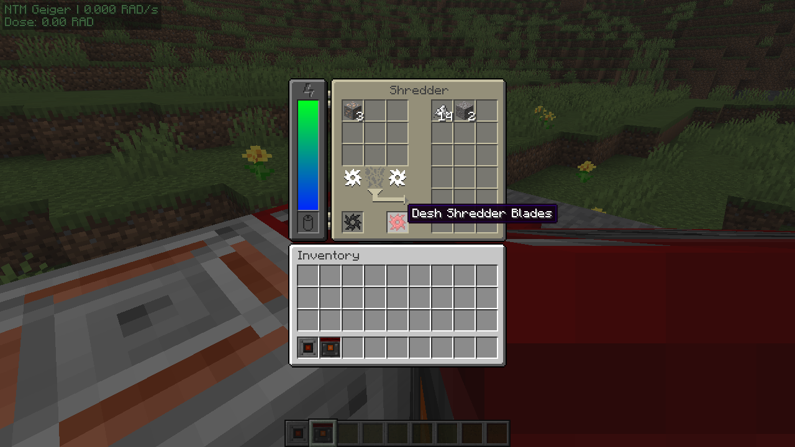
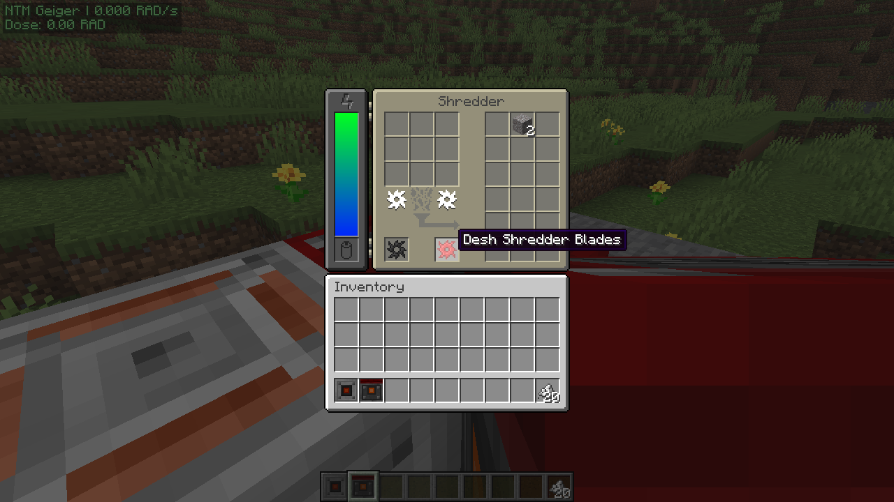
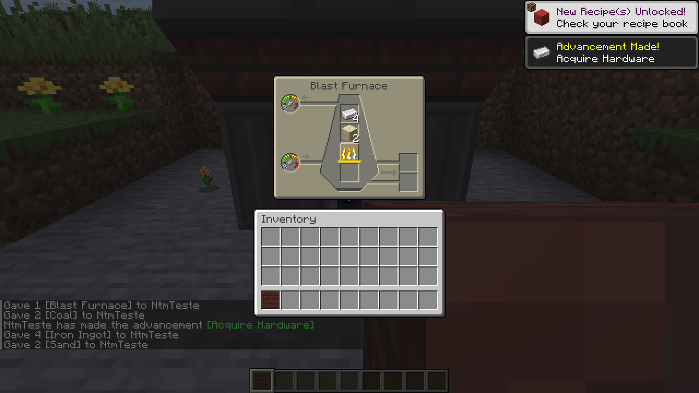

# Máquinas de processamento (Marco 3)

2026-10-29. Fluidos em [fluidos.md](fluidos.md). Caminhos de Java relativos a
`ntm-src/src/main/java/com/hbm/`.

## Ordem e cobertura

A ordem segue os itens que cada máquina destrava: `source_recipe_machine` em
`content/ids.json`, com o número de exclusivos entre parênteses.

| # | Máquina | Itens destravados | Receitas no port (puladas na extração) |
| ---: | --- | ---: | --- |
| 1 | Montadora `machine_assembly_machine` | 120 (106) | 398 (233 chamadas da fonte) |
| 2 | Centrífuga `machine_centrifuge` | 45 (45) | 54 (25) |
| 3 | Planta química `machine_chemical_plant` | 32 (25) | 47 (30) |
| 4 | Centrífuga de gás `machine_gascent` | (a cadeia UF6/PuF6) | transcrita à mão |

Depois do M3: o triturador (*shredder*), com 56 itens (47 exclusivos); ver a
seção abaixo.

As receitas vêm do agente de importação, que resolve itens e OreDict:
`content/machine-recipes/*.json`, schema 1, com `skipped` e motivo.
`tools/machine-gen/build.py` as converte para o formato embutido
(`crates/ntm-core/data/machines/*.json`), com os nomes em pt_BR. Cada
ingrediente aceita as alternativas do OreDict.

As receitas puladas dependem de itens fora do catálogo, laços de bedrock,
probabilidades, pressão ou configurações. Nenhuma receita foi inventada.

## Montadora, planta química, centrífuga (`crafter.rs`)

Uma lógica só sobre as tabelas de receita.

| | Montadora | Planta química | Centrífuga |
| --- | --- | --- | --- |
| NTM | `TileEntityMachineAssemblyMachine` | `TileEntityMachineChemicalPlant` | `TileEntityMachineCentrifuge` |
| Tanques | 1 + 1, 4.000 mB (ajustados à receita) | 3 + 3, 24.000 mB | — |
| Escolha da receita | lista (até 512 linhas) | lista | pelo item posto (`recipe_for`) |
| Energia | HE/t e ticks da receita; buffer `max(HE/t·100, 100k)` | idem | 200 HE/t, 200 ticks, 100k |

A tela tem três visões, porque a tela de mod do Horizon não rola: o que passa
de ~200 px some.

- **Máquina:**
  - energia;
  - a receita (ícone e nome);
  - progresso, ou "Falta: …" com o que falta;
  - "Pronto: N";
  - botões: escolher receita, pôr itens da mão, retirar o pronto, fluidos e
    recipientes (ou retirar as entradas).
- **Receita:** a lista. Um clique numa linha é `ui-events.select(id, linha)`,
  que vira a ação `LIST + linha`.
- **Fluidos:** os tanques, despejar e encher recipientes.

Regras:

- **Itens:** "Pôr itens da mão" tira até 16 de uma vez, uma transação por
  item, e só o que a receita escolhida aceita. O pronto volta por `Give`. Ao
  quebrar, entradas e saídas caem (transações `Drop`).
- **Saídas por chance** (`ChanceOutput`): o sorteio é um hash fixo de
  (receitas feitas, saída), não o aleatório do mundo.
- **Trocar de receita:** o progresso volta a 0; os tanques passam ao tipo da
  receita e, se o tipo muda, o conteúdo se perde (como no NTM).
- **Portas:** de energia e de fluido, abertas nas 6 faces.

**Fora, documentado:**
- upgrades (velocidade, energia, overdrive);
- os pools de `blueprints`: todas as receitas ficam selecionáveis;
- pressão;
- a fábrica de 4 módulos;
- o multibloco 3×3×3, que aqui é um bloco só.

## Centrífuga de gás (`gascent.rs`)

`TileEntityMachineGasCent.java` e `GasCentrifugeRecipes.java:24-34, 94-96`.

- **Tanques:** um tanque real de 2.000 mB (UF6, PuF6 ou lama do Watz), que vira
  um tanque de "pseudofluido" de 8.000 mB.
- **Estágios:** cada um tem consumo, produção, o próximo pseudofluido e suas
  saídas:

  | Estágio | Consome | Produz | Próximo | Saídas |
  | --- | ---: | ---: | --- | --- |
  | NUF6 | 400 | 300 | LEUF6 | 1 U238 |
  | LEUF6 | 300 | 200 | MEUF6 | U238 + fluorita |
  | MEUF6 | 200 | 100 | HEUF6 | U238 |
  | HEUF6 | 300 | 0 | — | 2 U238 + U235 + fluorita (**só com o upgrade**) |
  | PF6 | 300 | 0 | — | Pu238 + 2 Pu-mix + fluorita |
  | MUD | 1000 | 500 | MUD_HEAVY | chumbo em pó + poeira |
  | MUD_HEAVY | 500 | 0 | — | ferro em pó + poeira + resíduo nuclear |

- **Tempo e energia:** 150 ticks a 200 HE/t; com `upgrade_gc_speed`, 80
  ticks a 300 HE/t. O upgrade entra e sai por transação.
- **Cascata:** a cada 10 ticks, a centrífuga passa a saída para a que está
  atrás dela (oposta ao `facing`), se ela usa o mesmo fluido real. No fim de
  uma linha LEUF6, 600 mB viram 6 pepitas de combustível de urânio e 1
  fluorita. A cascata é do servidor, que vê as vizinhas
  (`fluid_server.rs::gascent_cascades`).
- **Desvio:** o tanque real aceita despejar célula ou tanque pela mão, além da
  rede (no NTM, só a rede). A tela não tem slot de identificador: o tipo vem do
  recipiente.

## Triturador (`shredder.rs`), no motor com slots

`TileEntityMachineShredder.java` e `ShredderRecipes.java`. É a primeira
máquina nova sobre os **slots reais** do motor (`ntm-visual`; desenho em
[visual-fiel.md](visual-fiel.md)). A máquina guarda os itens como os `Slots` da
ponte (trait `Slotted`, `Layout::Native`): sem transação de item e sem tela
`ui`. A tela é a `gui_shredder.png` original, gerada pelo agente de visual.

| | NTM | Port |
| --- | --- | --- |
| Slots | 0–8 entradas, 9–26 saídas, 27–28 lâminas, 29 bateria | os mesmos; a bateria fica guardada, sem uso (o port ainda não tem carga em item) |
| Ciclo | 60 ticks, 5 HE/t, buffer de 10.000 HE | igual; energia pela rede (portas nas 6 faces) |
| Por ciclo | cada slot de entrada com espaço dá 1 item à saída (`processItem`) | igual, com o mesmo empilhamento |
| Lâminas | aço 400, titânio 500, desh 0 (não gasta); +1 de dano por ciclo em cada uma; quebrada (dano = máximo) para a máquina | igual; o dano vai no item (`minecraft:damage`), então a lâmina leva o desgaste junto |
| Sem receita | `getShredderResult` nunca é nulo: vira `scrap` ×1 | igual; uma lâmina não entra como entrada |

**Receitas:** 722 (463 explícitas + 259 geradas do OreDict em `registerPost`).
São extraídas pelo agente de importação (`content/machine-recipes/shredder.json`;
o primeiro `setRecipe` vence, 54 colisões) e embutidas por
`tools/machine-gen/build.py` em `crates/ntm-core/data/machines/shredder.json`.
Todas as entradas e saídas `ntm:` existem no `ids.json`.

**Fora:** a barra de durabilidade das lâminas só aparece com `max_damage` no
item, que o motor base não aceita; o gerador de conteúdo tem `--max-damage` para
o motor `ntm-visual`. O upgrade (`upgrade_shredder`) também fica de fora.

**Verificação:**
- **Mundo falso** (`shredder::tests`, 6 testes; `server/tests/shredder_tests.rs`, 2):
  - um item por slot por ciclo, empilhando;
  - sem energia ou sem lâminas, nada acontece;
  - lâmina quebrada para a máquina;
  - saídas cheias param a máquina;
  - item sem receita vira sucata;
  - a tabela do NTM, com a explícita vencendo a gerada;
  - energia de uma bateria vizinha;
  - o dano da lâmina no save do mundo;
  - os itens soltos ao quebrar.
- **Em jogo** (motor `ntm-visual`, Xvfb `:15`, mudo, `tools/test-game/shredder.py`;
  mundo criativo, seed 1768123):
  - bateria cheia ao lado;
  - por shift-clique: 8 minérios de ferro, 4 lingotes e 2 pedregulhos nas entradas, lâminas de aço e desh nos slots delas;
  - 8 ciclos em 24,7 s (8 × 60 ticks a 20 TPS);
  - 20 pós de ferro (8 × 2 + 4) e 2 cascalhos; a lâmina de aço com dano 8, a de desh com 0;
  - o pó retirado para o inventário;
  - depois de sair e voltar ao mundo, o conteúdo e o dano das lâminas ficaram;
  - nenhum "took too long".

| | |
| --- | --- |
|  |  |
| Trabalhando: 14 pós e 2 cascalhos, a barra de energia e as luzes das lâminas. | No fim: o pó já no inventário, a lâmina de aço gasta. |

## Alto-forno (`blastfurnace.rs`), no motor com slots

É o `TileEntityMachineBlastFurnace.java`, com as receitas do
`BlastFurnaceRecipesNT.java`. O `machine_difurnace` antigo está
`@Deprecated` no NTM. Os exclusivos dele (tcalloy, tungstênio magnetizado,
napalm) saem também de outras receitas; o tcalloy, pelo cadinho da fundição.

Como o triturador, guarda os itens como os slots do motor (`Slotted`). A tela
é a `gui_blast_furnace.png` original, e o multibloco 3×7×3 é o do NTM; os dois
são do agente de visual.

| | NTM | Port |
| --- | --- | --- |
| Slots | 0 combustível, 1–2 entradas, 3–4 saídas | os mesmos |
| Energia | nenhuma: queima combustível, meia peça de carvão (800) por operação, até 38.400 | igual |
| Combustível | `ModuleBurnTime`: só itens com `Coal`, `Coke` ou `Lignite` no OreDict, mais `solid_fuel*` e `rocket_fuel`; madeira vale 0 | os 20 da tabela do agente de importação; carvão vegetal e madeira não entram |
| Receita | `getRecipe(s0, s1)`: a primeira da lista que serve, nas duas ordens; a quantidade só é cobrada na 2ª entrada | igual (`Tables::recipe`) |
| Velocidade | `1 + airblast × 8 / 4.000`, de 1× a 5×; o ar perde 5% por tick | igual; o ar vem pela rede de fluido |
| Gás | `flue`, 8 mB por tick da operação, tanque de 1.000 | igual; sai pela rede |

**Receitas:** 12 das 15 do NTM, na ordem dele (aço de lingote, pó, minério e
com fluxo; cobre vermelho; PAA; firebrick). As 3 que ficam de fora precisam de
itens ausentes do catálogo (espadas de meteorito e starmetal). Elas vêm do
agente de importação (`content/machine-recipes/blast_furnace.json`) e são
embutidas por `tools/machine-gen/build.py`.

**Portas de fluido:** as 6 faces do núcleo. Com o motor de slots, o multibloco
conduz também pelos proxies (`container_bridge::fluid_proxy_cells`): as
laterais, a coluna central, a frente e o fundo a +3 e +5, e o topo.

**Fora (com o acordo do coordenador):**
- a inclinação (`checkTilt`), que no NTM só vale com `enableMachineGravity`,
  desligado por padrão;
- o vazamento de `flue` no mundo quando o tanque enche: aqui o tanque só para
  no máximo;
- som e partículas;
- uma fonte de `airblast` no jogo: o port ainda não tem a máquina que o
  produz, então o ar quente está testado no mundo falso.

**Verificação:**
- **Mundo falso** (`blastfurnace::tests`, 6 testes; `server/tests/blastfurnace_tests.rs`, 3):
  - a busca de receita do NTM (as duas ordens, quantidade na 2ª);
  - o aço em 800 ticks;
  - sem combustível ou com a saída cheia, a máquina para;
  - madeira e carvão vegetal não são combustível;
  - o combustível cheio recusa mais;
  - com um tanque de `airblast` ligado por duto, mais de 4× mais rápido, gastando ~200 mB de ar por tick;
  - o `flue` sai por outro duto;
  - pelo topo do multibloco, o ar chega ao núcleo;
  - o nível no bloco e os itens soltos ao quebrar.
- **Em jogo** (motor `ntm-visual`, Xvfb `:15`, mudo, `tools/test-game/blastfurnace.py`;
  mundo criativo, seed 1768123):
  - o multibloco posto num piso livre;
  - por shift-clique, 2 carvões (viram combustível na hora), 4 lingotes de ferro e 2 areias;
  - 2 operações em 81,2 s (2 × 800 ticks a 20 TPS), com 4 aços e 2 escórias;
  - o aço retirado para o inventário;
  - depois de sair e voltar ao mundo, a escória continua na saída;
  - nenhum "took too long".

| | |
| --- | --- |
|  |  |
| Trabalhando: o ferro e a areia nas entradas, a chama acesa. | No fim: aço e escória nas saídas. |

## Fundição (`foundry/`), no motor com slots

São o `TileEntityHeaterFirebox`, o `TileEntityCrucible`, o
`TileEntityFoundryChannel`/`Tank`/`Outlet` e o
`TileEntityFoundryCastingBase` (molde e bacia), com os materiais do
`Mats.java`, as ligas do `CrucibleRecipes.java` e os moldes do
`ItemMold.java`. O plano em três etapas foi aprovado pelo coordenador. Telas e
modelos ficam com o agente de visual.

As tabelas vêm do agente de importação (`content/machine-recipes/foundry.json`):
109 materiais, 609 itens com o que cada um derrete, 13 ligas, 85 combustíveis
da firebox e 26 moldes.

| | NTM | Port |
| --- | --- | --- |
| Unidade | quanta: lingote 72, pepita 8, bloco 648 | igual (`foundry::quanta`) |
| Firebox | 2 slots; calor até 100.000 TU; o combustível rende `burn × heat` | igual; um balde de lava devolve o balde |
| Calor do cadinho | puxa 1/4 da diferença da fonte logo abaixo do núcleo | igual (`HeatSource`) |
| Cadinho | slots 1–9 de entrada (o 0 não é usado); derrete com ≥ 50.000 TU, 20.000 por item; pilhas de liga e de rejeito de 10.368 quanta | iguais; o slot 0 fica escondido na tela |
| Liga | escolhida numa lista; feita a cada `frequency` ticks | lista na tela antiga (botão 0 da tela com slots) |
| Despejo | dois jatos de 24 quanta/tick, caindo até 6 blocos, a núcleo ± 2 × frente | igual |
| Canal | 144 quanta; nivela com os vizinhos a cada 5 ticks em ordem sorteada | igual, com o sorteio por hash (`flow::roll`) |
| Tanque | 2.592 quanta | igual |
| Saída (*outlet*) | tira de trás e despeja até 4 blocos abaixo; filtro de material, invertível | igual |
| Molde e bacia | o molde define o custo; cheio, esfria 200 ticks e vira o item | igual; moldes pequenos (tamanho 0) no molde, grandes (1) na bacia |

**Desvios:**
- **Aleatoriedade determinística.** As sortes do NTM (ordem dos vizinhos,
  `nextInt`) saem de um hash da posição e do tick. Isso torna os testes
  reprodutíveis.
- **Metal fora da rede de fluido.** O metal derretido vai por blocos
  (`foundry_server`), como no NTM, e não pelos dutos.
- **Bica (*slagtap*) `Inert`.** Fica documentada como lacuna.
- **Estado salvo no bloco.** O estado que não é slot vai em `set-data` depois
  dos valores da tela (`Slotted::save_state`) e volta pelo `get-data` (motor
  `ntm-visual`, api 9) na primeira vez que a sessão vê a máquina:
  - calor, progresso, liga e as duas pilhas, no cadinho;
  - metal e resfriamento, no molde e na bacia.

**Verificação:**
- **Mundo falso, lógica:** 17 testes nos módulos, entre eles:
  - a firebox: carvão até o máximo e o calor que some parado;
  - o calor de baixo;
  - um item por vez;
  - aço de ferro, carvão e fluxo;
  - o metal que entra por cima;
  - a ordem sorteada dos canais;
  - o filtro da saída;
  - o molde de lingote em 200 ticks;
  - a bacia, que só aceita molde grande.
- **Mundo falso, servidor** (`server/tests/foundry_tests.rs`, 6):
  - a firebox aquece o cadinho e o ferro derrete e cai;
  - a liga escolhida na tela antiga;
  - quebrar o cadinho solta itens e sucata;
  - o metal corre por canais e uma saída até dois tanques (o de cima enche o
    de baixo antes), sem perda;
  - um material por rede;
  - o aço no molde de lingote.
- **Robustez dos slots** (`server/tests/slot_items_tests.rs`, 6). Em todos os
  ticks, a soma de itens, metal e o que foi retirado é o que entrou:
  - o triturador com a saída retirada em horas aleatórias;
  - quebrar com conteúdo solta uma vez só;
  - o metal do cadinho quebrado vira sucata;
  - uma queda entre o save do mundo e o do mod, nos dois sentidos, não duplica
    nem perde metal;
  - o ferro conservado do cadinho até o molde.
- **Em jogo:** pendente, à espera das telas e modelos do agente de visual.

## Bigorna (`anvil.rs`), no motor com slots

São o `NTMAnvil.java`, o `ContainerAnvil.java`, o `AnvilRecipes.java` e o
`AnvilCraftPacket.java`. Os 12 blocos, de `anvil_iron` (nível 1) a
`anvil_osmiridium` (8), mais o `anvil_murky`, vêm do agente de importação
(`content/machine-recipes/anvil.json`, [content-anvil.md](content-anvil.md)).
Os níveis estão fixos em `anvil::ANVILS`.

| | NTM | Port |
| --- | --- | --- |
| Bloco | sem block entity: a forja solta os itens ao fechar a tela; a construção tira do inventário do jogador | uma máquina com 19 slots do motor (desvio aprovado pelo coordenador) |
| Forja | slots esquerda/direita; o resultado sai ao ser retirado | slots 0, 1 e 2; o botão 3 ("forjar") consome e entrega no mesmo tick do servidor, sem a corrida de retirar a saída |
| Construção | lista filtrada pelo nível; faz 1 ou, com shift, um pacote | grade 3×4 (slots 3–14) e 4 saídas (15–18); botão 0 abre a lista na tela antiga, botão 1 faz uma, botão 2 faz um pacote |
| Saídas por chance | `rand` | sorteio por hash do número de construções (`anvil::roll`), salvo com o bloco |
| Saída cheia | os itens vão para o inventário ou caem | só constrói se todas as saídas couberem |

**Receitas:** 36 forjas (18 melhorias de bigorna, gunmetal e 17 gravações de
molde, que guardam o exemplo e gastam a base) e 103 construções, na ordem do
NTM. Elas são embutidas por `tools/machine-gen/build.py`.

**Fora (com o acordo do coordenador):**
- as 18 forjas "quentes" (calor no NBT do item);
- as receitas de etiqueta de nome e de cianeto (NBT);
- a queda como areia.

**Tela:** valores `[nível, receita + 1, pode construir, vezes, forja casa]`,
seguidos do estado salvo `[receita + 1, construções]`. O desenho é do agente
de visual: a grade fica na área da lista do NTM.

**Custo por tick:** a contagem de "vezes" roda a cada tick em cada bigorna
carregada. Simular até 64 construções custava 28,9 µs por chamada (nativo,
grade cheia de lingotes). Agora a contagem divide o total de cada entrada e
confere só a próxima construção: 0,98 µs. Os botões continuam simulando cada
construção.

**Verificação:**
- **Mundo falso, lógica** (`anvil::tests`, 4):
  - melhoria de bigorna;
  - molde com exemplo exato;
  - forja sem forma;
  - saída ocupada;
  - grade e nível;
  - chances perto da metade em 64;
  - saídas cheias;
  - a tabela embutida.
- **Mundo falso, servidor** (`server/tests/anvil_tests.rs`, 3), com os botões
  pela ponte de slots:
  - a forja da bigorna de aço;
  - chapas de aço numa bigorna de nível 3, uma e um pacote;
  - a receita escolhida volta do bloco depois de perder o save do mod;
  - a bigorna de ferro recusa um nível acima.
- **Em jogo:** pendente da tela do agente de visual.

## Pontes `m1_temp__`

Nenhuma sai neste marco: nenhuma das 10 ficou produzível com as máquinas
novas sem quebrar a cadeia.

| Ponte | Máquina real no M3? | Por que fica |
| --- | --- | --- |
| `machine_epress` | sim: montadora `ass.epress` | pede 2 `part_generic__piston_hydraulic`, sem receita no port; e placa de aço só sai da montadora a partir de aço |
| `machine_battery`, `machine_electric_furnace` | não (sem receita de montadora extraída) | — |
| `stamp_iron_plate`, `stamp_iron_wire` | não (bigorna) | — |
| `aluminium_from_ore`, `red_copper_alloy` | não (beneficiamento, alto-forno) | — |
| `machine_wood_burner`, `red_cable`, `wiring_red_copper` | não | o agente de conteúdo já importou as receitas originais de bancada (`bulk__*`); retirar a ponte é decisão de quem cuida das receitas |

## Otimização feita no caminho (item 0)

`same_look` agora usa `blockstate::shows`, sem os dois `BlockState::parse`,
equivalente em todos os pares de 16 estados de teste. Por máquina carregada a
cada tick, medido no harness (incluindo o `get-block` de ~490):

| | Antes | Depois |
| --- | ---: | ---: |
| Com pool | 7.526 fuel | 2.086 fuel |
| Sem pool | 9.259 fuel | 2.187 fuel |

(`spikes/m2-fuel/results-m3.txt`)

## Verificação

- **`cargo test --workspace`** (153) e **`clippy -D warnings`**: limpos.
- **Mundo falso:**
  - montadora: a receita escolhida pela lista; 5 lingotes postos da mão por
    transação; sem energia nada acontece; com energia, 5 placas; retiradas para
    o inventário; um item fora da receita fica na mão;
  - planta química: 8 tanques de ar despejados; 500 mB de oxigênio; encher um
    tanque de gás com menos que 1.000 mB é recusado;
  - centrífuga: a receita escolhida pela entrada;
  - quebrar solta o que a máquina tinha;
  - centrífuga de gás: um estágio; a cascata de 4 até HEUF6 (U235 só com o
    upgrade); PuF6; duas em fila no mundo falso passam LEUF6 para a de trás.
- **Em jogo** (Xvfb `:9`, mudo; `tools/test-game/m3.py`; mundo criativo,
  seed 1768123):
  - **Montadora** com bateria (+10% de teste, modo saída) do lado: receita
    escolhida na lista (`docs/img/m3-assembly-list.png`), 5 lingotes de ferro
    pela mão, 5 placas no inventário em 21,6 s (5 × 60 ticks mais os cliques;
    `m3-assembly-working.png`).
  - **Rede de fluido + planta química:** ver [fluidos.md](fluidos.md).
  - **Centrífuga de gás:** 2 células de UF6 pela mão (as 2 vazias voltaram),
    uma pepita de U238 retirada após o primeiro estágio.
  - Nenhum "took too long" no log.
  - **Aceitação visual do pacote de conteúdo** (opacidade das faces):
    `docs/img/m3-visual-*.png`.
- **Não verificado em jogo:** a centrífuga comum. Ela usa a mesma lógica da
  montadora, que tem teste no mundo falso.

## Comportamento a saber

Pôr um bloco encostado numa máquina com o botão de usar também abre a tela
dela, porque o cliente abre a máquina mirada quando "usar" é apertado. É o
desenho do M1 (tecla R ou usar). Isso pode surpreender ao montar fileiras de
máquinas.
