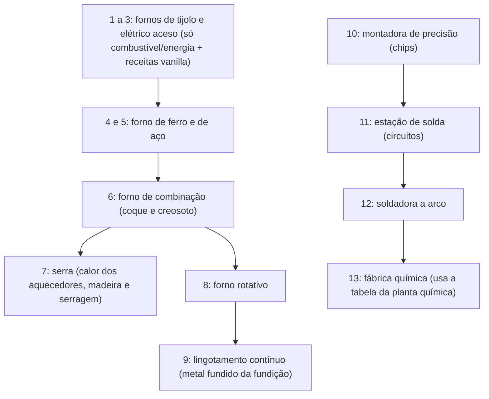

# Onda 2, sublote 1: máquinas K3 que saem do estado Inert

Branch `onda2-k3-s1` (a partir de `0e8eda47`). Meta: cada ID abaixo só deixa o
`Kind::Inert` quando operação, receita, portas, GUI, falha e save estiverem
demonstrados. Fonte: `ntm-src/src/main/java/com/hbm/` (Java 1.7.10). Este
arquivo é o inventário nominal e a ordem de trabalho; cada máquina acrescenta a
sua seção de contrato e de provas conforme fica pronta.

## O que o pedido pode ter confundido (sem mudar o escopo)

| Pedido | Estado real no `main` | Tratamento |
| --- | --- | --- |
| "arc furnace" | `ntm:machine_arc_furnace_large` já é `Kind::ArcFurnace` (etapa 4 do bedrock, `arc_furnace.rs`). O K3 Inert é a **soldadora a arco** (`machine_arc_welder`, `MachineArcWelder`), outra máquina. | A soldadora entra neste sublote. O forno grande não é refeito; só reabro se uma prova sua falhar. |
| "chemplant" | `ntm:machine_chemical_plant` já é `Kind::Crafter` (`Station::ChemicalPlant`). O K3 Inert é a **fábrica química** (`machine_chemical_factory`, 4 plantas em um multibloco 5x5x5). | A fábrica entra. A planta química só é revisitada como base de receitas. |
| "fornos (os ainda Inert)" | Fornos nativos: `machine_electric_furnace_off`, `machine_blast_furnace`, o forno pirolítico, `heater_oven`. Inert: os seis abaixo. | Os seis entram. |

## Inventário nominal (14 IDs)

Colunas: ID do bloco, classe do bloco e do block entity (BE) no Java, forma, o
que o BE tem. "Ports" são as portas de energia/fluido/item do multibloco
(`getAllPorts`); `dim` é `getDimensions()` e `off` é `getOffset()`.

| # | ID | Bloco / BE (Java) | Forma | Núcleo do comportamento |
| --- | --- | --- | --- | --- |
| 1 | `machine_furnace_brick_off` | `MachineBrickFurnace` / `TileEntityFurnaceBrick` | 1 bloco, `BlockContainer` | Forno de tijolo a combustível, 4 slots, receitas de fundição vanilla. Estado apagado. |
| 2 | `machine_furnace_brick_on` | `MachineBrickFurnace` (aceso) / mesmo BE | 1 bloco | O mesmo forno aceso: o Java troca o bloco entre `off` e `on`; o aceso solta o `_on`. |
| 3 | `machine_electric_furnace_on` | `MachineElectricFurnace` (aceso) / `TileEntityMachineElectricFurnace` | 1 bloco | Estado aceso do forno elétrico que já existe (`..._off` é `Kind::ElectricFurnace`). |
| 4 | `furnace_iron` | `FurnaceIron` / `TileEntityFurnaceIron` | `dim` 1,0,1,0,1,0, `off` 0 | Forno de ferro: 5 slots, combustível + fundição vanilla (`FurnaceRecipes`). |
| 5 | `furnace_steel` | `FurnaceSteel` / `TileEntityFurnaceSteel` | `dim` 1,0,1,1,1,1, `off` 1 | Forno de aço: 6 slots, aquecimento por item e fundição vanilla. |
| 6 | `furnace_combination` | `FurnaceCombination` / `TileEntityFurnaceCombination` | `dim` 1,0,1,1,1,1, `off` 1 | Forno de combinação: 4 slots, tanque de 24 000 mB (saída), receitas `CombinationRecipes` (coque, creosoto, assar minério do bedrock), poluição. |
| 7 | `machine_sawmill` | `MachineSawmill` / `TileEntitySawmill` | `dim` 1,0,1,1,1,1, `off` 1 | Serra: 3 slots, calor vindo do bloco de baixo (`IHeatSource`), 600 ticks, dano às entidades na lâmina, sobrevelocidade que lança a lâmina e explode. |
| 8 | `machine_rotary_furnace` | `MachineRotaryFurnace` / `TileEntityMachineRotaryFurnace` | `dim` 4,0,1,1,2,2, `off` 1 | Forno rotativo: 5 slots, tanques 16 000 / vapor 12 000 / vapor gasto 120, `RotaryFurnaceRecipes`, fumaça. |
| 9 | `machine_strand_caster` | `MachineStrandCaster` / `TileEntityMachineStrandCaster` | `dim` 0,0,6,0,1,0, `off` 0 (mais 2,0,1,0,1,0 de verificação) | Lingotamento contínuo: 7 slots, recebe metal fundido de cadinho/duto, tanques de água 64 000 e vapor gasto 64 000. |
| 10 | `machine_precass` | `MachinePrecAss` / `TileEntityMachinePrecAss` | multibloco da montadora (herda `MachineAssemblyMachine`) | Montadora de precisão: 22 slots, tanques 4 000, 100 000 HE de buffer mínimo, `PrecAssRecipes` (chips, relógio atômico, controladores). |
| 11 | `machine_soldering_station` | `MachineSolderingStation` / `TileEntityMachineSolderingStation` | `dim` 0,0,1,0,1,0, `off` 0 | Estação de solda: 11 slots, tanque de 8 000, 2 000 HE de buffer, `SolderingRecipes` (circuitos, PCBs). |
| 12 | `machine_arc_welder` | `MachineArcWelder` / `TileEntityMachineArcWelder` | `dim` 1,0,1,0,1,1, `off` 0 | Soldadora a arco: 8 slots, tanque de 24 000, 2 000 HE de buffer, `ArcWelderRecipes`. |
| 13 | `machine_chemical_factory` | `MachineChemicalFactory` / `TileEntityMachineChemicalFactory` | `dim` 2,0,2,2,2,2, `off` 2, `TileEntityProxyDyn` | Fábrica química: 32 slots, 12 tanques de entrada e 12 de saída de 24 000, água e vapor gasto de 4 000, 1 000 000 HE de buffer, módulos de planta. |
| 14 | `machine_assembly_factory` | `MachineAssemblyFactory` / `TileEntityMachineAssemblyFactory` | `dim` 2,0,2,2,2,2, `off` 2 | **Não está neste sublote** (par da fábrica química): fica registrado para o sublote 2. Listado aqui para fixar a fronteira. |

O item 14 é a única linha fora do escopo; o escopo executável são os itens 1 a 13.
`foundry_slagtap` e as demais linhas Inert de fundição ficam com a frente de
fundição. As caldeiras (`machine_boiler_off`) e o aquecedor de prensa
(`press_preheater`) já são blocos simples sem BE e não fazem parte da onda.

## Já nativo e que serve de base (não mexer sem prova de falha)

Montadora e planta química (`Kind::Crafter`, `crafter.rs`), forno elétrico
(`machine.rs`), forno grande a arco (`arc_furnace.rs`), cadinho, canais, tanque,
saída, moldes e bacia da fundição (`foundry.rs`), aquecedores
(`heater.rs`, `Kind::Heater`), redes de energia e de fluido
(`energy.rs`, `fluidbox.rs`), tabelas de fundição (`recipes.rs::furnace()`).

## Ordem por dependência (o que alimenta o quê)

Justificativa de cada degrau, com a fonte:

- **1 a 3** não dependem de nenhuma máquina nova: combustível (ou energia) e as
  receitas de fundição que o port já tem (`recipes.rs`). São o menor passo e
  provam o caminho completo (slots, GUI, save, falha) antes das máquinas maiores.
- **4 e 5** usam a mesma tabela de fundição e o mesmo modelo de queima; o de aço
  guarda calor em itens.
- **6** alimenta a siderurgia: o coque (`ModItems.coke`) é o insumo que o alto-forno
  e a cadeia do aço consomem; o creosoto e o óleo de madeira alimentam a petroquímica
  e os motores. Também assa os minérios do bedrock (`CombinationRecipes:70-76`).
- **7** precisa de calor vindo do bloco de baixo: depende dos aquecedores que já
  existem. Produz tábuas e serragem; a serragem entra na pirólise e nos briquetes.
- **8** depende de fluidos e vapor (rede de fluidos pronta) e produz ligas que
  alimentam os mesmos materiais do forno de aço.
- **9** só faz sentido com metal fundido da fundição, que já é nativa.
- **10 → 11 → 12:** a montadora de precisão faz chips e componentes; a estação de
  solda os junta em placas e circuitos (`SolderingRecipes` pede `CHIP`, `PCB`,
  `CAPACITOR`); a soldadora a arco usa os resultados dessas linhas e aço.
- **13** reaproveita a tabela de receitas já extraída da planta química; vem por
  último por ser o maior multibloco (5x5x5, 24 tanques).

Esta ordem é revisada nas seções de cada máquina se a leitura do Java mostrar
uma dependência diferente.

## Lacunas conhecidas que decidem o trabalho (a confirmar máquina a máquina)

| Tema | Onde aparece | Situação |
| --- | --- | --- |
| Entidades e dano (lâmina da serra) | `TileEntitySawmill` | Depende da API de entidades da Onda 0; a parte de dano e de lâmina lançada pode virar pendência explícita. |
| Poluição | `TileEntityMachinePolluting` (forno de combinação, rotativo) | Verificar o sistema de poluição do port antes de ligar. |
| Upgrades | montadora de precisão, solda, soldadora, fábrica | A montadora nativa deixou fora os upgrades (`docs/maquinas.md`); seguir a mesma decisão e registrar. |
| Controle por pacote (`IControlReceiver`) | precass, solda, fábrica | Escolha de receita pela lista nativa, como a montadora. |
| Multiblocos e portas | itens 4 a 13 | Declarar em `tools/visual-gen/visual.json` (`multiblock`, `inventory_ports` quando o Java tem porta de item). |
| Modelos 3D | itens 4 a 13 | Fora do contrato desta frente: continua o cubo do casing. Registrado, não escondido. |

## Entrega por máquina (lista de conferência)

Cada máquina fecha todos os itens e só então sai de `Inert`:

1. Contrato fonte (classe e linha) na seção da máquina deste arquivo.
2. Receitas: extraídas do Java para `content/machine-recipes/` e convertidas
   (`tools/machine-gen/build.py`); onde não houver extração, extrair do Java.
3. Lógica em `crates/ntm-core` com testes de unidade e mutações.
4. Registro (`registry.rs`, `machine.rs`), slots/filtros (`native.rs`), portas.
5. GUI (`tools/visual-gen/visual.json`) e tradução.
6. Falha e save: conteúdo fiel ao Java e prova de corte de gravação contra o
   controle vanilla (baú), quando mexe em inventário/itens.
7. Prova em jogo por roteiro de `tools/test-game/`.
8. `clippy -D warnings`, `cargo fmt`, e o commit da máquina.

## Pontes `m1_temp__` ligadas a este sublote

Dez pontes existem (`content/data/ntm/recipe/m1_temp__*.json`). Só uma toca este
sublote: `m1_temp__machine_electric_furnace`, que cria o forno elétrico sem a
cadeia real. Ela só sai quando a receita original do forno elétrico estiver
alcançável sem ela; a retirada é individual, com teste, e vem depois dos itens
1 a 3. As demais não têm relação com estas máquinas.

## Contratos implementados (fonte: classe e linha)

Todos guardam os itens como slots do motor (`Slotted`); a queima, o progresso,
o calor e os níveis de cinza viajam **com os slots** no `save_state`, para que
uma queda entre o save do mundo e o do mod nunca deixe um item gasto sem a
queima que ele deu (ou o contrário).

| ID | Contrato (`ntm-src/.../tileentity/machine/`) | Módulo |
| --- | --- | --- |
| `machine_furnace_brick_off/on` | `TileEntityFurnaceBrick.java:65-125`: o combustível só é consumido com algo a fundir; 200 de progresso, somado pela velocidade do item (`burnSpeed`, linhas 36-44: argila/netherrack ×4, pedregulho/areia/troncos ×2); cada 2000 de queima de uma família de combustível (`ashLevel*`, 86-92) deixa uma cinza no slot 3 se couber (`processAsh`, 163-176); balde de lava devolve o balde. `getAccessibleSlotsFromSide` (139-141): entrada por cima, combustível pelos lados, saída/combustível/cinza por baixo; `canExtractItem` só os slots 2 e 3. O bloco aceso solta ele mesmo (`_on`): `MachineBrickFurnace` não sobrescreve `getItemDropped`; só o `getItem` do cliente ("pick block", linhas 62-65) devolve o `_off`, e isso não é drop. | `furnace_brick.rs` + `fuel.rs` |
| `machine_electric_furnace_on` | O mesmo bloco aceso de `MachineElectricFurnace`: um nome a mais para a mesma máquina (`..._off` já era nativa); ambos soltam o `_off` (`getItemDropped`, linhas 61-64). | `machine.rs` (`ElectricFurnace`) |
| `furnace_iron` | `TileEntityFurnaceIron.java:67-123`: um combustível entra sem entrada mas só queima enquanto funde; `ModuleBurnTime` (49-55: carvão e linhito ×1,25, coque ×1,5, sólido/foguete/balefire ×2); 160 ticks, `baseTime - (baseTime/2)·nível/3` com o upgrade de velocidade (slot 4). Multibloco `{1,0,1,0,1,0}` com `TileEntityProxyCombo(true,false,false)`: toda célula do multibloco alcança o inventário. | `furnaces.rs`, `upgrades.rs` |
| `furnace_steel` | `TileEntityFurnaceSteel.java:49-80, 191-218`: três linhas; calor puxado do bloco de baixo (`tryPullHeat`: ⌈5 % da diferença⌉); funde acima de 1/3 do calor máximo gastando `(calor − 1/3)/10` por tick e linha, 40 000 TU por item; bônus de 25 % (minérios), 50 % (troncos, alcatrão) paga um item extra a cada 100 %. Multibloco `{1,0,1,1,1,1}`. | `furnace_steel.rs`, `oredict.rs` |
| `furnace_combination` | `TileEntityFurnaceCombination.java:65-136`: calor do bloco de baixo (¼ da diferença), `calor/100` de progresso por tick, 20 000 por item; saída de item e de fluido (tanque de 24 000 mB, emissor da rede de fluidos, enche recipientes no slot 2→3); 53 receitas extraídas de `CombinationRecipes` (item exato primeiro, depois chaves do OreDict). Portas de fluido: o anel de 16 células de `TilePortShapes.comboven`. | `furnace_combination.rs` |

### Regras de mão e de funil (as duas são diferentes no Java)

`Slot.isItemValid` do 1.7.10 é sempre verdadeiro: uma mão põe qualquer item nos
`Slot` comuns (entrada e combustível). Só os `SlotSmelting`/`SlotCraftingOutput`
(saídas) recusam e o `SlotUpgrade` aceita só upgrades. O funil, ao contrário,
pergunta `isItemValidForSlot` e `canExtractItem` do bloco. Os módulos expõem as
duas regras; o atalho com shift do forno de tijolo visita o slot de combustível
antes do de entrada (`transferStackInSlot`), como o Java.

### Lacunas honestas (declaradas, não escondidas)

| Lacuna | Por quê |
| --- | --- |
| Fuligem, fumaça e poluição (`PollutionHandler`, `TileEntityMachinePolluting`) | O port inteiro não tem sistema de poluição (a fornalha, os aquecedores e o forno elétrico também omitem). Entra com a frente de sobrevivência. |
| Cinza do forno de tijolo vira item no slot 3, sem o cinzeiro | O cinzeiro (`machine_ashpit`) é da Onda 1. |
| Pilha de saída em 64 | O Java usa o `getMaxStackSize` do item; o port não tem esse dado em Rust. |
| Sons e partículas dos fornos | `fire.fire`, lava e fumaça são do cliente; fora desta frente. |
| Fogo em entidades acima do forno de combinação | Depende da API de entidades. |
| Direções das portas de fluido | O motor liga as células do anel como dutos, sem restringir a face de cada uma (`TilePortShapes.comboven` fixa direções). |
| Modelos 3D | Continua o cubo; ver acima. |

## Provas do grupo 1 (fornos), cliente release `8bfa57b0…`

Cliente `horizon-client` SHA-256 `8bfa57b0df397dd62b7b215f3b0d1b2ab47ff161e76af3d15193fbddc06bc700`,
pacote `ntm.hmod` `bc085356685f39bd16d13e3e399807ac63b52fe8ce5d031c0ebc7a97af937f51`,
construídos do código de `abe0262d` (os commits seguintes só acrescentam docs,
roteiros e a soldadora/estação de solda). Mundos descartáveis em
`/mnt/ssd120/sacer/so/onda2/`, apagados depois; evidências em
`content-gen-evidence/onda2-s1/`.

| Prova | Resultado |
| --- | --- |
| `run-native-reactors.py furnace-brick` (`native_furnace_brick.py`) | 24 verificações, 0 falhas: atalho com shift (combustível vai ao slot 1, o resto ao 0), 16 lingotes e 2 cinzas de carvão (3 carvões, 4 800 de queima), funil por cima só no slot de entrada, funil lateral só no de combustível (as barras que ele não aceita ficam no funil), funil de baixo tira lingotes sem tirar combustível, e a reabertura do mundo no meio de uma fusão: a queima caiu exatamente o que o progresso subiu (módulo 200) e as cinzas ficaram. |
| `furnaces` (`native_furnaces.py`) | 23 verificações, 0 falhas: o bloco aceso é máquina, derrete 4 lingotes numa bateria criativa e solta o bloco apagado ao quebrar; o forno de ferro abre pela célula do multibloco, só faz 4 lingotes em 345 ticks com o upgrade de velocidade 3 (sem ele seriam 2) e recebe por um funil numa célula do multibloco; o de aço puxa calor de um fogareiro (100 000), 8 minérios dão 10 lingotes (bônus 25 % × 8 = 200 %) e 4 ferros crus dão 4; o de combinação faz coque e 100 mB de creosoto por carvão. |
| Corte de gravação `furnace-break` | 7 pontos (`none`, `kill`, `kv_committed`, `save_begin`, `live_chunk:8,0`, `chunks_written`, `entities_written`): um forno de tijolo quebrado com 16 itens conta o mesmo que o baú de controle em cada corte, nas duas reaberturas. |
| Corte de gravação `furnace-smelt` | 7 pontos (+ `players_saved`): morto durante a fusão, raw iron + lingotes = 16 exato nas duas reaberturas e o forno continua máquina viva. |

Os roteiros caíram em três erros do próprio roteiro antes de passar (ponto de
colocação sem face visível, funil pegando de uma caixa ao lado e não de cima,
combustível posto no funil de entrada); todos foram corrigidos no roteiro e nada
foi afrouxado no jogo. Detalhe real descoberto: o forno de tijolo gasta
combustível enquanto há entrada, mesmo com o funil devagar (Java faz isso).

### Testes de unidade, clippy e mutantes (HEAD `dc1fbe89`)

`cargo test -p ntm-core --lib` + 9 alvos de integração: 580 na biblioteca + 47 de integração (627), 0 falhas
(os dois ignorados são os que já eram; o `save_model` não roda em debug).
`cargo clippy --workspace --all-targets -- -D warnings`: limpo. 15 mutantes
escolhidos à mão (constantes e ramos de cada máquina; `mutate.py`, resultados em
`content-gen-evidence/onda2-s1/mutants.txt`): 12 mortos de primeira; 2 sobreviveram
(o módulo de queima do forno de ferro e a difusão do forno de combinação não tinham
teste no nível certo) e foram mortos pelos testes novos. Um teste de servidor
roda cada máquina em um mundo falso com conservação de itens a cada tick.

## Correções da revisão do grupo 1 (APROVADO COM RESSALVAS)

| Achado | O que mudou | Prova |
| --- | --- | --- |
| P1: o forno de aço perdia progresso e bônus ao reabrir o mundo | A ponte carrega o estado **antes** de atribuir os slots, então o `lastItems` (`TileEntityFurnaceSteel.java:147-174`, que o Java grava) era lido de slots vazios e o primeiro passo zerava cada linha. O `save_state` agora leva uma marca por linha ("o último item é o do slot") e o primeiro passo a resolve depois que os slots chegam; um save antigo, sem a marca, conserva o progresso. | O corte de gravação `steel-state` mostrou, no jogo, uma segunda camada do mesmo defeito: o mundo reconstrói a máquina reaberta dos próprios dados serializados, onde o `last` também era pulado (`serde(skip)`), e o bônus de 25 % de uma linha se perdia (4 lingotes em vez de 5); o `last` agora vai nos dados da máquina. | 5 testes de unidade na **ordem da ponte** e na dos dados serializados (máquina nova → `load_state` → slots → `step`), um com o caso da revisão (12 666 não pode cair para 5 400); 5 mutantes novos, todos mortos; corte de gravação `steel-state` (abaixo). |
| P2: o forno de tijolo aceso soltava o `_off` | `MachineBrickFurnace` não sobrescreve `getItemDropped`; só o `getItem` do cliente ("pick block") devolve o `_off`. O aceso agora solta o `_on`; o elétrico aceso continua soltando o `_off` (`MachineElectricFurnace.java:61-64`). | `native_furnaces.py`: `lit_brick_furnace_drops_itself`. |
| P2: o bônus de minério do aço não aparece com `raw_*` e `deepslate_*` | **Decisão do coordenador, pelo Java: desvio documentado, sem ampliar o OreDict.** O `TileEntityFurnaceSteel.addBonus` (linhas 177-186) conta só os nomes que começam com `ore` (`oreIron`, ...); `raw_iron`, `raw_copper`, `raw_gold` e os minérios de ardósia profunda não existem no 1.7.10 e não têm esses nomes no OreDict exportado. Para o jogador de Horizon, o minério picado dá `raw_*`: o bônus só aparece com o bloco de minério (toque de seda). Ampliar o OreDict (ou o `bonus_of`) para contar os `raw_*` e os `deepslate_*` fica fora: o port segue o 1.7.10 para o qual o mod foi escrito. | Documentado; nenhuma mudança de código. |
| P2: cortes de gravação só cobriam o tijolo, só contavam itens | Seis cenários novos e um ampliado, todos contra o controle de baú quando há quebra: `furnace-smelt` agora confere a queima, o progresso e a cinza com o carvão gasto, os lingotes e as cinzas; `iron-state`, `steel-state` e `combination-state` conferem o estado com os itens em cada corte (ferro: queima × progresso; aço: o bônus é 25 × (minérios feitos mod 4) e os lingotes são feitos + feitos/4; combinação: carvão + coque = 8 e 100 mB de creosoto por coque); `iron-break`, `steel-break` e `combination-break` quebram o multibloco com itens contra o baú. | Ver a tabela de provas abaixo. |
| P3: combustíveis | Escadas de madeira e o detector de luz queimam 300; a porta de madeira queima 0 (`ItemDoor` não é `ItemBlock`); cerca, portão, alçapão, placa de pressão e detector de luz deixam cinza `misc`; areia vermelha cozinha ×2 no tijolo. A diferença de madeiras modernas entre o forno de aço/tijolo e o de combinação (P3-8) fica como está: sem regressão. | 4 testes de unidade novos; 3 mutantes novos, mortos. |
| P3: "14 mutantes" | São 15 (13 do grupo e 2 da soldadora). Com os 7 novos desta correção: 22, todos mortos nesta rodada. | `mutants-regroup.log` em `content-gen-evidence/onda2-s1/`. |

## Provas das correções (grupos 1 e 1b e BrokenItem), em `content-gen-evidence/onda2-s1-recheck/`

Testes de unidade: 597 na biblioteca + 47 de integração (644), 0 falhas; `cargo clippy --workspace --all-targets -- -D warnings`
limpo; `python3 tools/content-gen/test_welders.py`: 2 testes. Mutantes (todos mortos): 22 dos fornos e dos combustíveis
(os 15 de antes e 7 novos), 9 da soldadora e da estação (um sobreviveu, o número do slot do identificador, e foi morto por um
teste novo) e 1 do `last` do forno de aço (`serde(skip)`).

Os pacotes `ntm.hmod` são todos `0ee17b08…4365`. Os clientes release:

| Cliente | SHA-256 | O que rodou nele |
| --- | --- | --- |
| B | `b39ac922563f5174471b1846d622f39ce7d8f653b2ff9c68f1a9a5b46c2654ca` | `furnace-brick` 24/24, `furnaces` 24/24, cortes `furnace-smelt`, `iron-state`, `steel-state`, `combination-state`, `iron-break`, `steel-break`, `combination-break`, `furnace-break`: 7 pontos cada, todos ok |
| D (final) | `b203a6f79399afd4f6371d2dd1c0b8f1d01820d9b1dd94851102e4ea04b015c7` | `welders` 26/26, `broken` 9/9, corte `welder-run` 7/7 |

D difere de B só pelo que a soldadora relata ao mudar o tipo do tanque e pelo `custom_data` que o glue passa dos slots para o
identificador e o item quebrado; nenhum código de forno mudou entre os dois.

O que cada corte compara (mundo morto em cada fronteira do save, duas reaberturas): `furnace-smelt`, a queima, o progresso e a
cinza contra o carvão gasto, os lingotes e as cinzas; `iron-state`, o mesmo com o tempo do forno; `steel-state`, o bônus
(25 × minérios feitos mod 4) e os lingotes (feitos + feitos/4); `combination-state`, carvão + coque = 8 e 100 mB de creosoto
por coque; os três `-break`, os itens do multibloco quebrado contra o baú de controle, item a item, contados uma vez só.
O `steel-state` mostrou, no jogo, o que o teste de unidade da ponte não mostrou: o bônus de uma linha se perdia ao reabrir.

Os roteiros caíram em erros do próprio roteiro antes de passar (ponto de clique fora da plataforma, tanque lido antes de o
dado salvo acompanhar o tick, parser do `Items` com dados aninhados, total-base do corte de quebra), todos corrigidos nos
roteiros; um deles revelou o defeito real do glue (o identificador chegava à máquina sem o tipo).

## Soldadora a arco e estação de solda (provadas)

`welders.rs`: uma só máquina de receita com os dois modelos. Receitas extraídas
do Java por `arc_welder_recipes.py` (24; as 18 de míssil ficam `skipped` até os
itens de míssil da Onda 5) e `soldering_recipes.py` (27, com as cadeias de
upgrade expandidas). `matchesIngredients` na ordem do Java; tempo e consumo com
`speed/power/overdrive` (`duration - duration·vermelho/6 + duration·azul/3`,
`consumo·2^preto`); tanque (24 000 / 8 000 mB) tipado pelo identificador de fluido
(`setType(5, slots)` / `setType(8, slots)`); saída que para no `getMaxStackSize` do
produto; o botão de colisão da estação.

Provas (cliente release `19a89ffb…`, `ntm.hmod` `4321c94f…`, de `d66ad17c` +
docs, em `content-gen-evidence/onda2-s1/welders/`): `welders` 17 verificações,
0 falhas. Soldadora: duas placas de aço e dois fios densos viram 2 motores em
60 ticks **só com o upgrade de velocidade 3** (50 ticks; sem ele são 100); a
saída sai por shift; um funil sobre uma célula do multibloco alimenta e ela
solda de novo. Estação: uma pedra é recusada num slot de cobertura
(`SlotNonRetarded`), e 3 válvulas + 2 capacitores + 4 PCB + 4 fios de chumbo dão
uma placa analógica. Corte de gravação `welder-run` (soldadora fazendo motores
numa bateria criativa, morta em cada fronteira do save): 7 de 7 pontos, placas
de aço + motores = 40 exato nas duas reaberturas.

Lacunas declaradas: o motor tem um contêiner por máquina, então as listas de slot
por célula da soldadora (`getAccessibleSlotsFromSide(x,y,z,side)`: o núcleo e uma célula
com o slot 1, duas com o 0, duas com o 2, e a saída em todas) viram uma só, com as três
entradas e a saída em cada célula-porta. **Pedido ao motor (lacuna nominal):** a política de
slot recebe slot, item, ação e origem, mas não a célula; listas por célula exigem estender
`ModSlotFilter::policy` com a posição da célula. Só as 5 células da camada de baixo e o
núcleo são portas (as 6 de cima dão `{}` no Java e deixaram de ser).
Carregar a máquina com outra bateria que não a criativa (`Library.java:257-274`, qualquer
`IBatteryItem`) segue como no resto do projeto: só a bateria criativa carrega (`charge_from_slot`).
Faltam o som `item.upgradePlug` e o painel de informação das melhorias. As 18 receitas de
míssil ficam `skipped` até os itens de míssil existirem (Onda 5); a guarda
`tools/content-gen/test_welders.py` falha quando algum deles entrar no catálogo e a linha
está no `roadmap-100` (família "Mísseis e lançamento espacial").

## Correções da revisão do grupo 1b (REPROVADO, correções pequenas)

| Achado | O que mudou | Prova |
| --- | --- | --- |
| P1: tanque vazio ficava tipado e nunca aceitava outro fluido | O Java tipa o tanque pelo **identificador de fluido** (`ArcWelder.java:84`, `SolderingStation.java:94`) e é só isso que o muda: sem identificador o tanque não aceita nada e outro identificador o esvazia (`FluidTank.java:62-68`). O port agora faz o mesmo (slots 5 e 8, `type_from_identifier` de `combustion.rs`) e a demanda do tanque é "o fluido que o identificador deu". Um tanque que esvazia continua tipado, como no Java; para outro fluido troca-se o identificador. **Diferença para o `refinery.rs:174`:** a refinaria tipa o tanque pelo fluido que chega (um tanque vazio aceita qualquer fluido); a soldadora e a estação tipam só pelo identificador, como o Java delas (`ArcWelder.java:84`, `SolderingStation.java:94`). **Desvio do pedido literal:** o teste "oxigênio, esvazia, reformgas" do revisor não vale mais, porque a regra "tanque vazio aceita qualquer fluido" (`refinery.rs:174`) contraria o identificador; o teste novo faz a troca de identificador. | 2 testes de unidade (sem identificador, troca de identificador nos dois modelos), 4 mutantes; em jogo `identifier`. |
| P2: pilha de saída fixa em 64 | Cada receita leva o `max_stack_size` do produto (de `ids.json`, pelo gerador): 16 receitas da estação com pilha 1 (15 melhorias e `sat_chip`), 2 com 16 (`upgrade_radius`, `upgrade_health`), 9 com 64; a soldadora, 24 com 64. A saída para quando não cabe, como `getMaxStackSize`. | teste de unidade do `sat_chip` e da contagem (16, 2); em jogo `solder-stack`: 3 chips de insumo dão 1 chip e os outros esperam. |
| P2: funil nas células de cima | As 6 células da camada de cima saíram de `inventory_ports` (o Java dá `{}`, `ArcWelder.java:312-331`); ficam as 5 da camada de baixo e o núcleo. A prova antiga usava a célula de cima; a nova põe um funil sobre ela (não pode mover nada) e outro ao lado de uma célula de baixo (alimenta e solda de novo). Listas por célula são **pedido ao motor**, lacuna nominal (abaixo). | `native_welders.py`: `hopper_over_an_upper_cell_moves_nothing`, `arc_hopper_on_a_port_fed_and_welded_again`. |
| P3: energia truncada em `i32` no save | Energia, máximo e consumo são salvos como `long` (os 31 bits baixos nos valores de antes, mais três palavras altas); um save antigo ainda lê. | teste de unidade (3,2·10⁹ e 3,2·10¹⁰); 1 mutante. |
| P3: `allows`, `container`, botão de colisão, mutantes M3, M4, M7 | Testes novos para a regra de mão e de funil (inclusive o gêmeo), a lista do contêiner, o botão com receita de fluido e os números dos slots. | 5 testes; 9 mutantes novos, todos mortos (o do número do slot do identificador sobreviveu e foi morto por um teste novo). |
| P3: verificações só de colocar item | O roteiro ganhou checagens de resultado: a bateria e a melhoria seguem nos slots, o tanque sem tipo e o tipo de cada identificador, o chip único, as outras receitas esperando, a retirada do chip liberando a próxima. | `native_welders.py`. |
| P3: carregar a máquina fora da bateria criativa | Lacuna comum ao projeto (só a criativa carrega, `Library.java:257-274`); registrada nas lacunas. | doc. |
| P3: receitas de míssil sem guarda | A guarda `test_welders.py` e a linha no `roadmap-100` (família "Mísseis e lançamento espacial"). | `python3 tools/content-gen/test_welders.py`: 2 testes. |
| `build.py` regenera `anvil.json`, `blast_furnace.json` e `radioisotopes.json` diferentes | Restaurados ao commit de base e fora dos commits (`git diff 0e8eda47 -- ` desses três: vazio). | `git diff`. |

### Máquinas que passaram a receber o tipo do identificador (glue, `2147f340`)

Antes dessa correção o glue entregava o item do slot à lógica **sem** o `custom_data`, então nenhuma máquina conseguia ler o
tipo de um identificador de fluido posto num slot (os testes de unidade punham o dado à mão e passavam). As máquinas do port que
leem o identificador do slot (`type_from_identifier`, `combustion.rs`) e a conformidade de cada uma com o Java:

| Máquina | Java | Port | Conforme o Java (leitura + teste de unidade) | Provada no jogo? |
| --- | --- | --- | --- | --- |
| `machine_arc_welder` | `TileEntityMachineArcWelder.java:84` `tank.setType(5, slots)` | `welders.rs`, slot 5 | sim | **sim** (`welders`: `identifier_oxygen_types_the_tank`, `identifier_reformgas_types_the_tank`) |
| `machine_soldering_station` | `TileEntityMachineSolderingStation.java:94` `setType(8, slots)` | `welders.rs`, slot 8 | sim | só no unitário (o roteiro prova a soldadora; a estação tem o mesmo código com o slot 8) |
| `machine_diesel` | `TileEntityMachineDiesel.java:167` `tank.setType(3, slots)` | `combustion.rs:241`, slot 3 | sim | **não** |
| `machine_combustion_engine` | `TileEntityMachineCombustionEngine.java:81` `if(tank.setType(4, slots)) tenth = 0` | `combustion.rs:331`, slot 4, usa o retorno | sim | **não** |
| `machine_turbofan` | `TileEntityMachineTurbofan.java:175` `tank.setType(4, slots)` | `combustion.rs:449`, slot 4 | sim | **não** |
| `machine_turbinegas` | `TileEntityMachineTurbineGas.java:107-110`: só um fluido combustível de grau gás | `combustion.rs:581`, slot 1, com o mesmo filtro | sim (o teste recusa `diesel` e aceita `syngas`) | **não** |

Fora dessa lista o glue não muda nada: o resto das máquinas do port tipa o tanque pelo fluido que chega, pela receita ou por botão, e
não lê o item do identificador (a centrífuga a gás, por exemplo, só tem o slot reservado: `gascent.rs:112`); onde o Java lê o
identificador de um slot e o port não, é lacuna nominal de cada máquina, não efeito desta correção.

**Pendências, sem bloquear a soldadora e a estação:** quatro itens de prova no jogo, um por máquina sem prova (`machine_diesel`,
`machine_combustion_engine`, `machine_turbofan`, `machine_turbinegas`), cada um com o mesmo roteiro da soldadora (dar o identificador com
o `ntm_fluid`, pô-lo no slot, deixar passar ticks, ler o tipo do tanque no estado salvo, trocar o identificador e ver o tanque esvaziar;
na turbina a gás, mais um identificador de um fluido que não é gás, que não pode mudar o tipo), e a estação de solda no mesmo roteiro.

## BrokenItem (mini-sublote)

O que a montadora de precisão deixa quando a receita falha (`PrecAssRecipes.registerPair`,
linhas 222-248) e o que a reciclagem consome.

| Java | Port |
| --- | --- |
| `BrokenItem.make(stack)` (`BrokenItem.java:52-63`): item `broken_item` com a **quantidade do produto** e NBT `itemID` (nome do registro) e `itemMeta`; o NBT do produto se perde. | Item `ntm:broken_item` (textura `broken_item`, nomes "Broken Item" / "Item Quebrado") com a quantidade do produto e, no `minecraft:custom_data`, `{ntm_broken:{id:"ntm:upgrade_speed_2"}}`. Um subtipo é parte do id aqui, então não há `itemMeta`; o NBT do produto também não se guarda, como no Java. |
| `NBTStack(BrokenItem.make(output))` na reciclagem (`PrecAssRecipes.java:244-246`): casa o item quebrado cujo NBT tem o mesmo `itemID`/`itemMeta` e consome a quantidade do produto. | `broken::matches(stack, produto, quantidade)`: o item é o quebrado, o `id` do NBT é o do produto (outras chaves são ignoradas, como `NBTStack`) e a pilha tem ao menos a quantidade. |
| Pilhas de produtos diferentes não se juntam (NBT diferente). | O `custom_data` diferente impede a pilha; o canônico do SNBT (`snbt.rs`) ignora a ordem das chaves e o espaçamento que o motor usa. |

Código: `crates/ntm-core/src/broken.rs` (`make`, `product`, `matches`; 5 testes). Catálogo:
`m3_catalog.py` (a linha `broken_item`, gerada com `generate.py`).

Lacunas: o Java mostra o nome do produto ("Upgrade de Velocidade Quebrado") e o ícone do
produto sob o ícone quebrado (`getItemStackDisplayName`, `getIcon`); aqui o nome é o
genérico e o ícone o quebrado. Não há aba criativa (o Java também não põe o item em aba).
A máquina que o produz (`machine_precass`) continua Inert: esta entrega é o item e o seu NBT.

Provas: 5 testes de unidade (`broken.rs`) e o roteiro `native_broken.py` (`run-native-reactors.py broken`, 10 verificações): dois produtos
(`upgrade_speed_2` ×2 e `upgrade_speed_1` ×1) dados com o NBT, mantidos pelo inventário, postos à mão em dois slots de
uma máquina, um terceiro item do outro produto (por shift) **não** se junta à pilha do primeiro, o modelo da máquina
enxerga os produtos (o glue passava o `custom_data` do slot só para barras e pastilhas; agora também para o
identificador de fluido e o item quebrado), e depois de salvar e reabrir o mundo os slots têm os mesmos itens e dados.
O "criar, quebrar, reciclar" completo precisa da máquina e fica para a entrega dela; o que este item prova é o formato
e que ele sobrevive à máquina, ao funil de mão e ao save.

## Montadora de precisão e fábrica química: o que bloqueia (lido no Java, 10/11)

| Máquina | O que o Java faz | O que falta no port |
| --- | --- | --- |
| `machine_precass` | `PrecAssRecipes.registerPair` (linhas 222-248): toda receita rende **o produto com `chance` % ou um `BrokenItem` com o resto**, e cada uma ganha uma receita de reciclagem que consome o item quebrado (`NBTStack`). Com `enable528 = false` (o perfil do port, decisão do coordenador) só existem `crystalcircuit` e as 10 cadeias de upgrade (`addFirstUpgrade`/`addSecondUpgrade`), todas com chance (25 a 75 %). | O item `ntm:broken_item` e o seu NBT agora existem (seção "BrokenItem", abaixo); falta a máquina em si (receitas com chance, reciclagem que consome o item quebrado, a ponte de slots). |
| `machine_chemical_factory` | Quatro módulos de planta química (`ModuleMachineChemplant`) a velocidade ×2 e potência ×2, cada um com 3 entradas, 3 saídas, 3+3 tanques e o seu próprio botão de receita; água e vapor gasto de 4 000 mB. | O Crafter nativo e o painel de receitas (`native::recipes(block)`, botões `RECIPE_BASE + i`) servem **uma receita por bloco**; quatro seletores independentes exigem estender o painel e o hook de botão do motor, e a ponte de slots (`Layout::Crafter`) não tem quatro linhas. |

Perfil 528: fica como lacuna nominal; não é ativado no port até decisão do usuário.

## Serra: recorte proposto (sem a API de entidades)

`TileEntitySawmill.java` mistura três coisas. O que dá para entregar agora, fiel
ao Java, e o que fica como lacuna nominal:

| Parte | Linhas | Recorte |
| --- | --- | --- |
| Calor do bloco de baixo (`tryPullHeat`, 10 % do calor guardado, vira zero a cada tick), progresso `calor/10` por tick acima de 100 de calor, 600 de tempo, as 4 receitas (tronco → 6 tábuas, tábua → 6 gravetos, graveto → serragem, muda → 1 graveto) e a serragem com 50 % / 10 % | 63-97, 190-244 | **Proposto**; a lógica está pronta e testada (9 unitários e um teste de servidor com fogareiro), estacionada na branch lateral `onda2-sawmill-wip` (`38c2bf49`), não nesta. |
| Clique no bloco: pôr um item, recolher as saídas, repor a lâmina (`ntm:sawblade`) | `MachineSawmill.onBlockActivated` 83-130 | **Proposto**, pela mesma regra de slots (só entra 1 item por vez e só com os três slots vazios, `isItemValidForSlot` 190-193). |
| Sobrevelocidade: calor > 300 por mais de 60 ticks avisa (som), por mais de 300 ticks tira a lâmina e explode (`newExplosion` de força 5) | 99-128 | **Proposto** (revisto): a explosão, a perda da lâmina e o aviso são efeitos de mundo e dependem de D1 + D2 do artifact `onda2-efeitos-mundo` (D1: efeitos vindos do passo de uma máquina comum; D2: a explosão genérica com guarda de ordem no replay; o piloto é o Stirling); o D3 cobre só o item "sem lâmina" ao quebrar e recolocar o bloco, e a serra só sai de `Inert` depois do D3 e da prova em jogo de que o `custom_data` do item chega ao gancho de colocação; até lá a lâmina nunca sai da máquina (uma lâmina perdida não teria como voltar); depois a lâmina vira o item `ntm:sawblade` caído no chão (o `EntitySawblade.interactFirst` devolve exatamente esse item ao jogador). |
| Lâmina como entidade que voa e mata (`EntitySawblade`, dano `rubble` 1000, giblets) e o dano `turbofan` 100 a qualquer ser vivo na caixa da lâmina enquanto serra (81-95) | 81-95, `EntitySawblade` | **Lacuna nominal** até a API de entidades: nenhuma entidade é ferida nem a lâmina voa. |
| Bloco sem lâmina (`ItemStack` com dano 1) | `MachineSawmill.onBlockPlacedBy`, `getDrops` | **Lacuna nominal**: o port não tem variante por metadado; um bloco sem lâmina solta o bloco comum. |

**A serra só sai de `Inert` com o D3 pronto; o D2 é mudança de motor, em branch separada (pin definido pelo Opus e pelo agente do Horizon), então a serra espera o D2.** Esta branch não a contém: `machine_sawmill` continua Inert aqui.

Confirmado no `roadmap-100`: a poluição/fuligem está registrada como sistema
inexistente (linha "Poluição", 4 tipos Java: SOOT, POISON, HEAVYMETAL, FALLOUT) e
a Onda 1 traz "ashpit/fuligem básica", a Onda 3 "resíduos/gases/poluição"; as
lacunas de fuligem e de cinzeiro deste sublote ficam nominais para elas.

## Estado

| # | ID | Estado |
| --- | --- | --- |
| 1, 2 | `machine_furnace_brick_off/on` | pronto para re-revisão |
| 3 | `machine_electric_furnace_on` | pronto para re-revisão |
| 4 | `furnace_iron` | pronto para re-revisão |
| 5 | `furnace_steel` | pronto para re-revisão (P1 corrigido e provado no jogo) |
| 6 | `furnace_combination` | pronto para re-revisão |
| 12, 11 | `machine_arc_welder`, `machine_soldering_station` | pronto para re-revisão (P1 e P2 do 1b corrigidos) |
| `ntm:broken_item` | item e NBT do produto | pronto para revisão (a máquina que o produz segue Inert) |
| 7 | serra | proposta; espera D1, D2 e D3 (branch `onda2-sawmill-wip`) |
| 8, 9, 10, 13 | rotativo, lingotamento contínuo, montadora de precisão, fábrica química | Inert; esperam a infraestrutura do `onda2-efeitos-mundo` |
