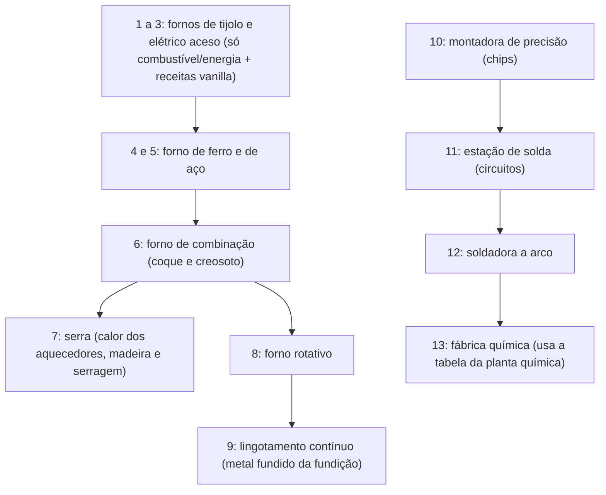

# Onda 2, sublote 1: máquinas K3 que saem do estado Inert

Branch `onda2-k3-s1` (a partir de `0e8eda47`). Meta: cada ID abaixo só deixa o
`Kind::Inert` quando operação, receita, portas, GUI, falha e save estiverem
demonstrados. Fonte: `ntm-src/src/main/java/com/hbm/` (Java 1.7.10). Este
arquivo é o inventário nominal e a ordem de trabalho; cada máquina acrescenta a
sua seção de contrato e de provas conforme fica pronta.

## O que o pedido pode ter confundido (sem mudar o escopo)

| Pedido | Estado real no `main` | Tratamento |
| --- | --- | --- |
| "arc furnace" | `ntm:machine_arc_furnace_large` já é `Kind::ArcFurnace` (etapa 4 do bedrock, `arc_furnace.rs`). O K3 Inert é a **soldadora a arco** (`machine_arc_welder`, `MachineArcWelder`), outra máquina. | A soldadora entra neste sublote. O forno grande não é refeito; só reabro se uma prova sua falhar. |
| "chemplant" | `ntm:machine_chemical_plant` já é `Kind::Crafter` (`Station::ChemicalPlant`). O K3 Inert é a **fábrica química** (`machine_chemical_factory`, 4 plantas em um multibloco 5x5x5). | A fábrica entra. A planta química só é revisitada como base de receitas. |
| "fornos (os ainda Inert)" | Fornos nativos: `machine_electric_furnace_off`, `machine_blast_furnace`, o forno pirolítico, `heater_oven`. Inert: os seis abaixo. | Os seis entram. |

## Inventário nominal (14 IDs)

Colunas: ID do bloco, classe do bloco e do block entity (BE) no Java, forma, o
que o BE tem. "Ports" são as portas de energia/fluido/item do multibloco
(`getAllPorts`); `dim` é `getDimensions()` e `off` é `getOffset()`.

| # | ID | Bloco / BE (Java) | Forma | Núcleo do comportamento |
| --- | --- | --- | --- | --- |
| 1 | `machine_furnace_brick_off` | `MachineBrickFurnace` / `TileEntityFurnaceBrick` | 1 bloco, `BlockContainer` | Forno de tijolo a combustível, 4 slots, receitas de fundição vanilla. Estado apagado. |
| 2 | `machine_furnace_brick_on` | `MachineBrickFurnace` (aceso) / mesmo BE | 1 bloco | O mesmo forno aceso: o Java troca o bloco entre `off` e `on`. |
| 3 | `machine_electric_furnace_on` | `MachineElectricFurnace` (aceso) / `TileEntityMachineElectricFurnace` | 1 bloco | Estado aceso do forno elétrico que já existe (`..._off` é `Kind::ElectricFurnace`). |
| 4 | `furnace_iron` | `FurnaceIron` / `TileEntityFurnaceIron` | `dim` 1,0,1,0,1,0, `off` 0 | Forno de ferro: 5 slots, combustível + fundição vanilla (`FurnaceRecipes`). |
| 5 | `furnace_steel` | `FurnaceSteel` / `TileEntityFurnaceSteel` | `dim` 1,0,1,1,1,1, `off` 1 | Forno de aço: 6 slots, aquecimento por item e fundição vanilla. |
| 6 | `furnace_combination` | `FurnaceCombination` / `TileEntityFurnaceCombination` | `dim` 1,0,1,1,1,1, `off` 1 | Forno de combinação: 4 slots, tanque de 24 000 mB (saída), receitas `CombinationRecipes` (coque, creosoto, assar minério do bedrock), poluição. |
| 7 | `machine_sawmill` | `MachineSawmill` / `TileEntitySawmill` | `dim` 1,0,1,1,1,1, `off` 1 | Serra: 3 slots, calor vindo do bloco de baixo (`IHeatSource`), 600 ticks, dano às entidades na lâmina, sobrevelocidade que lança a lâmina e explode. |
| 8 | `machine_rotary_furnace` | `MachineRotaryFurnace` / `TileEntityMachineRotaryFurnace` | `dim` 4,0,1,1,2,2, `off` 1 | Forno rotativo: 5 slots, tanques 16 000 / vapor 12 000 / vapor gasto 120, `RotaryFurnaceRecipes`, fumaça. |
| 9 | `machine_strand_caster` | `MachineStrandCaster` / `TileEntityMachineStrandCaster` | `dim` 0,0,6,0,1,0, `off` 0 (mais 2,0,1,0,1,0 de verificação) | Lingotamento contínuo: 7 slots, recebe metal fundido de cadinho/duto, tanques de água 64 000 e vapor gasto 64 000. |
| 10 | `machine_precass` | `MachinePrecAss` / `TileEntityMachinePrecAss` | multibloco da montadora (herda `MachineAssemblyMachine`) | Montadora de precisão: 22 slots, tanques 4 000, 100 000 HE de buffer mínimo, `PrecAssRecipes` (chips, relógio atômico, controladores). |
| 11 | `machine_soldering_station` | `MachineSolderingStation` / `TileEntityMachineSolderingStation` | `dim` 0,0,1,0,1,0, `off` 0 | Estação de solda: 11 slots, tanque de 8 000, 2 000 HE de buffer, `SolderingRecipes` (circuitos, PCBs). |
| 12 | `machine_arc_welder` | `MachineArcWelder` / `TileEntityMachineArcWelder` | `dim` 1,0,1,0,1,1, `off` 0 | Soldadora a arco: 8 slots, tanque de 24 000, 2 000 HE de buffer, `ArcWelderRecipes`. |
| 13 | `machine_chemical_factory` | `MachineChemicalFactory` / `TileEntityMachineChemicalFactory` | `dim` 2,0,2,2,2,2, `off` 2, `TileEntityProxyDyn` | Fábrica química: 32 slots, 12 tanques de entrada e 12 de saída de 24 000, água e vapor gasto de 4 000, 1 000 000 HE de buffer, módulos de planta. |
| 14 | `machine_assembly_factory` | `MachineAssemblyFactory` / `TileEntityMachineAssemblyFactory` | `dim` 2,0,2,2,2,2, `off` 2 | **Não está neste sublote** (par da fábrica química): fica registrado para o sublote 2. Listado aqui para fixar a fronteira. |

O item 14 é a única linha fora do escopo; o escopo executável são os itens 1 a 13.
`foundry_slagtap` e as demais linhas Inert de fundição ficam com a frente de
fundição. As caldeiras (`machine_boiler_off`) e o aquecedor de prensa
(`press_preheater`) já são blocos simples sem BE e não fazem parte da onda.

## Já nativo e que serve de base (não mexer sem prova de falha)

Montadora e planta química (`Kind::Crafter`, `crafter.rs`), forno elétrico
(`machine.rs`), forno grande a arco (`arc_furnace.rs`), cadinho, canais, tanque,
saída, moldes e bacia da fundição (`foundry.rs`), aquecedores
(`heater.rs`, `Kind::Heater`), redes de energia e de fluido
(`energy.rs`, `fluidbox.rs`), tabelas de fundição (`recipes.rs::furnace()`).

## Ordem por dependência (o que alimenta o quê)

Justificativa de cada degrau, com a fonte:

- **1 a 3** não dependem de nenhuma máquina nova: combustível (ou energia) e as
  receitas de fundição que o port já tem (`recipes.rs`). São o menor passo e
  provam o caminho completo (slots, GUI, save, falha) antes das máquinas maiores.
- **4 e 5** usam a mesma tabela de fundição e o mesmo modelo de queima; o de aço
  guarda calor em itens.
- **6** alimenta a siderurgia: o coque (`ModItems.coke`) é o insumo que o alto-forno
  e a cadeia do aço consomem; o creosoto e o óleo de madeira alimentam a petroquímica
  e os motores. Também assa os minérios do bedrock (`CombinationRecipes:70-76`).
- **7** precisa de calor vindo do bloco de baixo: depende dos aquecedores que já
  existem. Produz tábuas e serragem; a serragem entra na pirólise e nos briquetes.
- **8** depende de fluidos e vapor (rede de fluidos pronta) e produz ligas que
  alimentam os mesmos materiais do forno de aço.
- **9** só faz sentido com metal fundido da fundição, que já é nativa.
- **10 → 11 → 12:** a montadora de precisão faz chips e componentes; a estação de
  solda os junta em placas e circuitos (`SolderingRecipes` pede `CHIP`, `PCB`,
  `CAPACITOR`); a soldadora a arco usa os resultados dessas linhas e aço.
- **13** reaproveita a tabela de receitas já extraída da planta química; vem por
  último por ser o maior multibloco (5x5x5, 24 tanques).

Esta ordem é revisada nas seções de cada máquina se a leitura do Java mostrar
uma dependência diferente.

## Lacunas conhecidas que decidem o trabalho (a confirmar máquina a máquina)

| Tema | Onde aparece | Situação |
| --- | --- | --- |
| Entidades e dano (lâmina da serra) | `TileEntitySawmill` | Depende da API de entidades da Onda 0; a parte de dano e de lâmina lançada pode virar pendência explícita. |
| Poluição | `TileEntityMachinePolluting` (forno de combinação, rotativo) | Verificar o sistema de poluição do port antes de ligar. |
| Upgrades | montadora de precisão, solda, soldadora, fábrica | A montadora nativa deixou fora os upgrades (`docs/maquinas.md`); seguir a mesma decisão e registrar. |
| Controle por pacote (`IControlReceiver`) | precass, solda, fábrica | Escolha de receita pela lista nativa, como a montadora. |
| Multiblocos e portas | itens 4 a 13 | Declarar em `tools/visual-gen/visual.json` (`multiblock`, `inventory_ports` quando o Java tem porta de item). |
| Modelos 3D | itens 4 a 13 | Fora do contrato desta frente: continua o cubo do casing. Registrado, não escondido. |

## Entrega por máquina (lista de conferência)

Cada máquina fecha todos os itens e só então sai de `Inert`:

1. Contrato fonte (classe e linha) na seção da máquina deste arquivo.
2. Receitas: extraídas do Java para `content/machine-recipes/` e convertidas
   (`tools/machine-gen/build.py`); onde não houver extração, extrair do Java.
3. Lógica em `crates/ntm-core` com testes de unidade e mutações.
4. Registro (`registry.rs`, `machine.rs`), slots/filtros (`native.rs`), portas.
5. GUI (`tools/visual-gen/visual.json`) e tradução.
6. Falha e save: conteúdo fiel ao Java e prova de corte de gravação contra o
   controle vanilla (baú), quando mexe em inventário/itens.
7. Prova em jogo por roteiro de `tools/test-game/`.
8. `clippy -D warnings`, `cargo fmt`, e o commit da máquina.

## Pontes `m1_temp__` ligadas a este sublote

Dez pontes existem (`content/data/ntm/recipe/m1_temp__*.json`). Só uma toca este
sublote: `m1_temp__machine_electric_furnace`, que cria o forno elétrico sem a
cadeia real. Ela só sai quando a receita original do forno elétrico estiver
alcançável sem ela; a retirada é individual, com teste, e vem depois dos itens
1 a 3. As demais não têm relação com estas máquinas.

## Contratos implementados (fonte: classe e linha)

Todos guardam os itens como slots do motor (`Slotted`); a queima, o progresso,
o calor e os níveis de cinza viajam **com os slots** no `save_state`, para que
uma queda entre o save do mundo e o do mod nunca deixe um item gasto sem a
queima que ele deu (ou o contrário).

| ID | Contrato (`ntm-src/.../tileentity/machine/`) | Módulo |
| --- | --- | --- |
| `machine_furnace_brick_off/on` | `TileEntityFurnaceBrick.java:65-125`: o combustível só é consumido com algo a fundir; 200 de progresso, somado pela velocidade do item (`burnSpeed`, linhas 36-44: argila/netherrack ×4, pedregulho/areia/troncos ×2); cada 2000 de queima de uma família de combustível (`ashLevel*`, 86-92) deixa uma cinza no slot 3 se couber (`processAsh`, 163-176); balde de lava devolve o balde. `getAccessibleSlotsFromSide` (139-141): entrada por cima, combustível pelos lados, saída/combustível/cinza por baixo; `canExtractItem` só os slots 2 e 3. | `furnace_brick.rs` + `fuel.rs` |
| `machine_electric_furnace_on` | O mesmo bloco aceso de `MachineElectricFurnace`: um nome a mais para a mesma máquina (`..._off` já era nativa); ambos soltam o `_off` (`getItemDropped`, linhas 61-64). | `machine.rs` (`ElectricFurnace`) |
| `furnace_iron` | `TileEntityFurnaceIron.java:67-123`: um combustível entra sem entrada mas só queima enquanto funde; `ModuleBurnTime` (49-55: carvão e linhito ×1,25, coque ×1,5, sólido/foguete/balefire ×2); 160 ticks, `baseTime - (baseTime/2)·nível/3` com o upgrade de velocidade (slot 4). Multibloco `{1,0,1,0,1,0}` com `TileEntityProxyCombo(true,false,false)`: toda célula do multibloco alcança o inventário. | `furnaces.rs`, `upgrades.rs` |
| `furnace_steel` | `TileEntityFurnaceSteel.java:49-80, 191-218`: três linhas; calor puxado do bloco de baixo (`tryPullHeat`: ⌈5 % da diferença⌉); funde acima de 1/3 do calor máximo gastando `(calor − 1/3)/10` por tick e linha, 40 000 TU por item; bônus de 25 % (minérios), 50 % (troncos, alcatrão) paga um item extra a cada 100 %. Multibloco `{1,0,1,1,1,1}`. | `furnace_steel.rs`, `oredict.rs` |
| `furnace_combination` | `TileEntityFurnaceCombination.java:65-136`: calor do bloco de baixo (¼ da diferença), `calor/100` de progresso por tick, 20 000 por item; saída de item e de fluido (tanque de 24 000 mB, emissor da rede de fluidos, enche recipientes no slot 2→3); 53 receitas extraídas de `CombinationRecipes` (item exato primeiro, depois chaves do OreDict). Portas de fluido: o anel de 16 células de `TilePortShapes.comboven`. | `furnace_combination.rs` |

### Regras de mão e de funil (as duas são diferentes no Java)

`Slot.isItemValid` do 1.7.10 é sempre verdadeiro: uma mão põe qualquer item nos
`Slot` comuns (entrada e combustível). Só os `SlotSmelting`/`SlotCraftingOutput`
(saídas) recusam e o `SlotUpgrade` aceita só upgrades. O funil, ao contrário,
pergunta `isItemValidForSlot` e `canExtractItem` do bloco. Os módulos expõem as
duas regras; o atalho com shift do forno de tijolo visita o slot de combustível
antes do de entrada (`transferStackInSlot`), como o Java.

### Lacunas honestas (declaradas, não escondidas)

| Lacuna | Por quê |
| --- | --- |
| Fuligem, fumaça e poluição (`PollutionHandler`, `TileEntityMachinePolluting`) | O port inteiro não tem sistema de poluição (a fornalha, os aquecedores e o forno elétrico também omitem). Entra com a frente de sobrevivência. |
| Cinza do forno de tijolo vira item no slot 3, sem o cinzeiro | O cinzeiro (`machine_ashpit`) é da Onda 1. |
| Pilha de saída em 64 | O Java usa o `getMaxStackSize` do item; o port não tem esse dado em Rust. |
| Sons e partículas dos fornos | `fire.fire`, lava e fumaça são do cliente; fora desta frente. |
| Fogo em entidades acima do forno de combinação | Depende da API de entidades. |
| Direções das portas de fluido | O motor liga as células do anel como dutos, sem restringir a face de cada uma (`TilePortShapes.comboven` fixa direções). |
| Modelos 3D | Continua o cubo; ver acima. |

## Estado

| # | ID | Estado |
| --- | --- | --- |
| 1, 2 | `machine_furnace_brick_off/on` | lógica, receitas, slots, funil, tela e testes prontos; prova em jogo e de corte pendentes |
| 3 | `machine_electric_furnace_on` | pronto na lógica e testes; prova em jogo pendente |
| 4 | `furnace_iron` | idem |
| 5 | `furnace_steel` | idem |
| 6 | `furnace_combination` | idem |
| 7 a 13 | demais | Inert; trabalho não iniciado |
