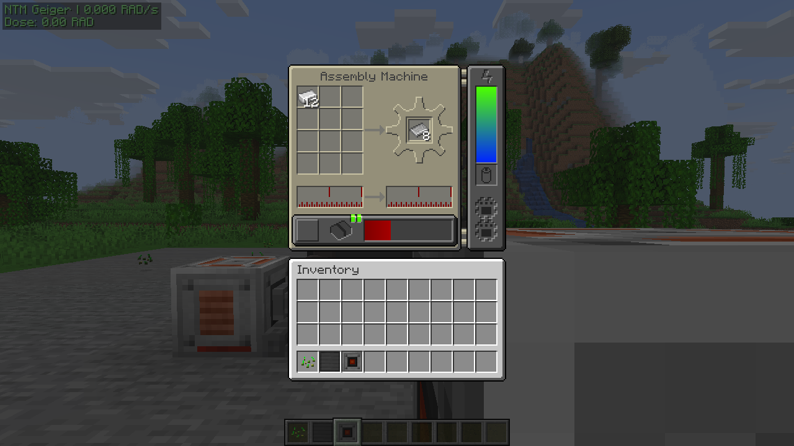
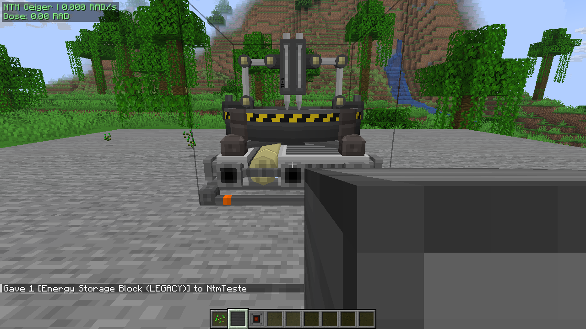
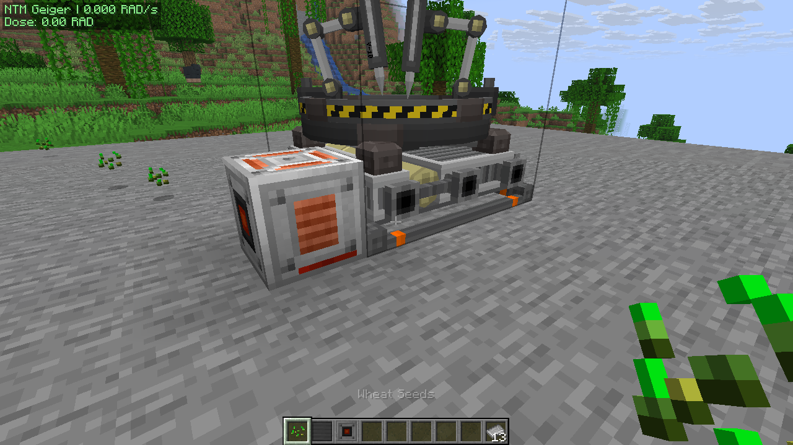
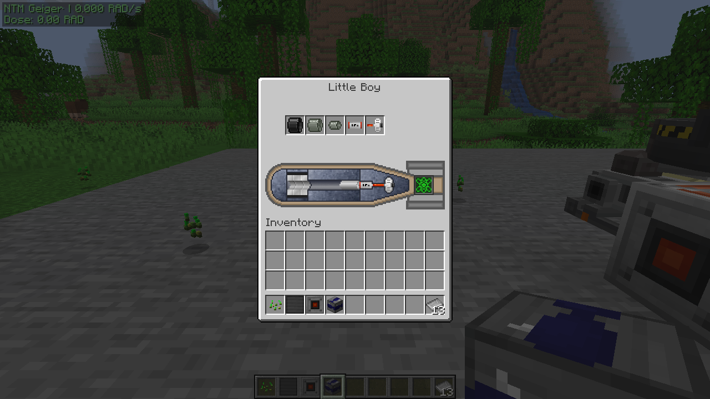
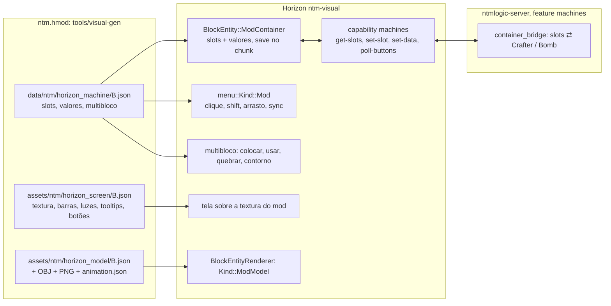

# Visual fiel ao NTM: telas, modelos 3D e multiblocos (protótipo)

2026-10-29. Protótipo de ponta a ponta com a **montadora** (`ntm:machine_assembly_machine`) e a **Little Boy**
(`ntm:nuke_boy`). Motor: branch `ntm-visual` em `~/Workspace/horizon-visual` (16 commits sobre b26b1de1e; já em `ntm-patched`, 4b962af45),
diff em [`horizon-patches/ntm-visual.diff`](../horizon-patches/ntm-visual.diff). Port: `tools/visual-gen/`,
`crates/ntm-core/src/server/container_bridge.rs` e a feature `machines` dos dois mods de lógica.
Fonte do NTM: `ntm-src/src/main/java/com/hbm/` (Java) e `ntm-src/src/main/resources/assets/hbm/` (recursos).

| | |
|---|---|
|  |  |
| A tela é a `gui_assembler.png` original: 17 slots nas posições do `ContainerMachineAssemblyMachine`, a barra de energia vinda da bateria pelo anel de baixo do multibloco e o inventário embaixo. | 20 lingotes postos por shift-clique na entrada; com a receita escolhida, 8 placas na saída, a barra de progresso e os LEDs verdes recortados da textura. |
|  |  |
| O OBJ `assembly_machine.obj` com a textura UV, virado pelo `facing`, e o contorno único do multibloco 3×3×3. | Trabalhando, o anel gira e os braços batem (animação no formato do GeckoLib, gerada do `AssemblerArm`). |
|  |  |
| A `lilBoySchematic.png` com os 5 slots: cada peça aparece desenhada no esquema, e o ícone "pronta" vem do `Bomb::blast()` do port. | O `LilBoy1.obj`, deslocado do bloco como no `RenderNukeBoy` (1 bloco de hitbox, o modelo passa 2 blocos). |

Mais capturas:
- `img/visual-overview.png`;
- `img/visual-assembler-recipe-button.png`: o botão do seletor abre a lista de receitas;
- `img/visual-cost-25.png`;
- `img/visual-fallback-hidden.png`: com os blockstates originais, o cubo de fallback sai da malha e só o OBJ aparece.

Para rodar: `tools/build-visual.sh [test]` e `tools/test-game/run-visual.sh <nome> --world W --creative` (Xvfb :15,
mudo, pasta em `/tmp/ntm-visual-game`).

## 1. Pesquisa antes de construir

| Onde | O que tem | Uso aqui |
|---|---|---|
| upstream #1189 (draft, `feat/codemods-1`) | API 0.4 *preview*: `interface machine` (`get-slot`, `set-slot`, `get-property`, `set-property`; handles emprestados por tick) e o export `block-entities` (`types`, `create`, `tick`, `save`, `remove`, `data`). O próprio PR diz: "the game doesn't create, tick or save mod block entities". `code-mods-plan.md`: menus têm "data values done; layout and screen missing"; renderização é "missing (API 0.5)". | O registro `item-stack {id, count}` e as regras de `set-slot` (corta no máximo da pilha, recusa item desconhecido) são as mesmas. A metade que falta ao #1189 (o motor criar, salvar e abrir o block entity e desenhar a tela) é este patch. |
| `docs/modpacks.md:177-178` | 0.4: "a declared screen layout the game draws (`ui`), with server-side menu logic in the mod". 0.5: "animated models (block-entity, entity, item; GeckoLib's format): data models (Bedrock geometry + animations)". | A tela é um layout declarado. A lógica do menu fica no servidor. A animação usa o formato Bedrock/GeckoLib. |
| `docs/native-mods.md` | Mods nativos (horizon-mixins, `native_hooks.rs`, API 2: painel de itens). | Um caminho de distribuição futuro. Variantes novas de enum e braços de `match` não cabem bem em mixins. |
| Stink-O/horizon `mod-api-input-ui-render-world` (14 commits à frente, 3.419 atrás do main) | `ui` = lista de desenho livre (fills, sprites, texto) só no cliente, sem slots; `render` = pós-processamento WGSL. | Nada para slots, OBJ ou multibloco. |
| PR #2888 (aberto) | Efeitos visuais: partículas, luzes, overlays emissivos, filtros. | Não cobre modelos nem menus. |
| playhorizon.dev/mods | 19 mods (HUD e utilidades). | Nenhum de menus ou modelos. |
| `tobj` 4.0.5 (MIT, 3,1 mi downloads, ago/2026) | Leitor de OBJ. | **Usado** (`default-features = false`). |
| GeckoLib / Bedrock | `animation.json`: `{animations: {nome: {loop, animation_length, bones: {osso: {rotation, position}}}}}`. | **Usado** como formato das animações (subconjunto numérico). |

## 2. Desenho



### 2.1 GUI: um container genérico no motor, não o `ui`

**Escolha: `ModContainer` no motor.**

O `ui` do mod é só do cliente e sem posições (o WIT diz que o mod diz o que o widget tem, nunca onde fica). Slots de
verdade precisam de:
- armazenamento autoritativo no servidor;
- a semântica de clique do vanilla (pegar, dividir, shift, arrastar, duplo clique);
- sync servidor↔cliente, save no NBT do chunk e drop ao quebrar.

O motor já tem tudo isso para fornalha e funil (`menu::Menu`, o hub, `lan_machine_click`, `ContainerSetData`).
Uma variante genérica `BlockEntity::ModContainer { block, items, data }` mais `menu::Kind::Mod(n)`, guiadas por
dados, servem as ~420 máquinas. Funcionam no servidor-thread (o padrão), num host de LAN e no servidor dedicado, que
usam o mesmo hub.

O ganho para o port: **os itens das máquinas saem das transações por comando**, a parte mais frágil (256 linhas
por hook, células de resposta, scores). Elas continuam funcionando ao lado ("Pôr itens da mão" ainda serve), porque
a ponte aplica só a diferença.

### 2.2 Formatos de dados

Tudo fica fora de `data/<ns>/horizon/`: um Horizon sem o patch ignora e o `ntm.hmod` continua válido nele, com os
cubos e as telas antigas.

**`data/ntm/horizon_machine/<bloco>.json`** (lido em `horizon_world::mod_machines`, no servidor e no cliente):

```json
{ "slots": [ {"x": 152, "y": 81, "accept": ["ntm:battery_spark"]},
             {"grid": [8, 18, 3, 4]},
             {"x": 8, "y": 90, "reject": ["ntm:blades_steel"]},
             {"x": 98, "y": 45, "output": true} ],
  "inventory": [8, 174], "data": 12,
  "multiblock": {"min": [-1, 0, -1], "max": [1, 2, 1], "offset": 1, "dummy": "ntm:dummy_machine"} }
```

O multibloco é o `getDimensions`/`getOffset` do `BlockDummyable`, no referencial de quem coloca: x à direita, z para
longe. Os valores (`data`) são `i32`: no fio, cada um vira dois `i16` (o vanilla manda `short`).

**`assets/ntm/horizon_screen/<bloco>.json`** (`mod_screens.rs`):
- `texture` e `size`;
- `title`, `inventory_label`;
- `bars`: valor/máximo, retângulo, uv ou cor vinda de um valor, direção (o `drawTexturedModalRect` das GUIs do NTM);
- `overlays`: um pedaço da textura quando um slot tem item ou um valor ≥ mín (LEDs, as peças da Little Boy);
- `tooltips` com `{0:si}`, como o `BobMathUtil.getShortNumber`;
- `buttons`: o clique vira `ServerboundContainerButtonClick`, que chega aos server mods.

**`assets/ntm/horizon_model/<bloco>.json`** (`mod_models.rs`):

```json
{ "obj": "ntm:models/obj/assembly_machine.obj", "texture": "ntm:textures/models/machines/assembly_machine.png",
  "rotation": 90, "translate": [0, 0, 0], "radius": 2.2, "hide": ["Ring2", "Frame"],
  "bones": {"ArmLower1": {"parent": "Ring", "pivot": [0, 1.625, 0.9375]}},
  "animations": "ntm:animations/machine_assembly_machine.animation.json",
  "play": [{"animation": "animation.assembler.work", "property": "honey_level", "not": "0"}] }
```

- `rotation` e `translate` são o `glRotate`/`glTranslate` do renderer do NTM. O `facing` gira como o `switch(meta)`
  deles: north 0, west 90, south 180, east 270.
- Cada `o` do OBJ é um osso. A animação é o `animation.json` do GeckoLib: rotação em graus sobre o pivô (z, y, x),
  posição em pixels (1/16) e interpolação linear.
- A animação toca enquanto uma propriedade do blockstate diz que sim: o `honey_level`, que o port já usa como
  "barramento de aparência".
- Os UVs do OBJ são invertidos em v, como no `HFRWavefrontObject`.

**Alinhamento com o upstream:**
- O registro e as regras da API de servidor são os do `machine` do #1189; trocar para os handles dele quando ele
  entrar é mecânico.
- As animações já estão no formato do 0.5.
- A geometria Bedrock (cubos) cabe no mesmo `Model` (ossos com pivô): é mais um leitor ao lado do OBJ.

### 2.3 API de servidor `machines` (api level 8, experimental)

```wit
interface machines {
    record item-stack { id: string, count: u32, damage: u32 }
    record button-press { player: string, dimension: string, x: s32, y: s32, z: s32, button: u32 }
    get-slots: func(dimension: string, x: s32, y: s32, z: s32) -> option<list<option<item-stack>>>;
    set-slot: func(dimension: string, x: s32, y: s32, z: s32, slot: u32, stack: option<item-stack>) -> bool;
    set-data: func(dimension: string, x: s32, y: s32, z: s32, values: list<s32>) -> bool;
    poll-buttons: func() -> list<button-press>;
}
```

- **Leitura:** os block entities são emprestados ao mod junto com os chunks (`LentWorld`).
- **Escrita:** é aplicada logo depois do hook, antes de os jogadores agirem de novo. Um slot que já tem o item mantém
  os componentes e troca a contagem e o dano.
- **Dano:** o `damage` é o `minecraft:damage`, o desgaste de uma ferramenta (as lâminas do triturador). Um item de
  content mod ganha a barra com `"max_damage": N` no seu `data/<ns>/horizon/item/*.json` (só no motor com o patch;
  um Horizon sem ele recusa o campo, por isso o content-gen o põe só com `--max-damage`).

### 2.4 A ponte no port (`container_bridge.rs`)

- **Os slots são a verdade.** Antes de `simulate`, `slots_in` aplica à máquina o que os jogadores mudaram desde a
  última escrita (por diferença, nunca por cópia). Depois de `run_txs`, `slots_out` devolve o estado da máquina aos
  slots e manda os valores da tela.
- **Por diferença:** um `Give` da tela antiga, ou um `TakeHeld` que se confirma, muda a máquina, e a próxima escrita
  mostra isso. Copiar os slots duplicaria.
- **Sessão nova:**
  - com slots vazios e a máquina com itens (vindos de transação), os itens vão para os slots (migração);
  - senão, os slots mandam.
- **Quebrar:** o motor espalha os slots. O `drop_contents` do port não solta nada de uma máquina que a ponte viu.
- **Bombas:** espelha os slots em `Bomb.slots`; o `Bomb::blast()` do agente das bombas segue lendo só isso. Na
  detonação o `set-blocks` (ar) remove o block entity **sem** espalhar (é o `place_state` do `/setblock`), então não
  há duplicação: as peças somem, como o `clearSlots` do NTM.
- **Botão 0:** abre a lista de receitas da tela antiga, por uma mensagem nova `S2C::Show`.
- **Máquinas novas** (o triturador): guardam os itens como `Slots` e implementam o trait `Slotted` (`slots_mut`,
  `screen_data`, `button`), com `Layout::Native`. Sem transações e sem nada a reconciliar.
- **Energia:** o anel de baixo do multibloco conta como cabo na topologia (os proxies `makeExtra` do NTM). A bateria
  encostada no anel alimenta a montadora.
- A feature `machines` (ntm-core e os dois mods) fica desligada por padrão: um Horizon sem o patch recusaria o mod.

### 2.5 Modelo 3D

- **O que é:** `Kind::ModModel` no `BlockEntityRenderer`, no pipeline de entidades. Lightmap e shader packs vêm
  junto.
- **Cache:** os ossos parados ficam em cache por (modelo, rotação, dimensão). Por quadro, só a posição e a luz mudam.
  Os ossos animados são posados por quadro.
- **Triângulos:** viram quads degenerados.
- **Luz:** a maior das 7 células em volta do núcleo.
- **Cull:** pelo `radius` do arquivo.
- **Textura:** entra no atlas da GUI. Só entram as que as telas e os modelos citam.
- **Blocos com modelo:**
  - ficam "vazados" (luz e faces vizinhas passam, como o `isOpaqueCube` falso do NTM);
  - ganham block entity mesmo que o template não tenha (o `redstone_lamp` da Little Boy);
  - saem da malha do chunk (`ENTITYBLOCK_ANIMATED`).
- **Sem o patch:** os blockstates não mudam, e um Horizon sem o patch mostra os cubos de antes.

### 2.6 Multibloco

| Ação | Como |
|---|---|
| Colocar | `place.rs` põe o núcleo a `offset` blocos de quem coloca. Exige o volume livre (senão falha, como o NTM) e enche o resto com o `dummy` (template barrier com dureza) |
| Usar | Usar um dummy abre o menu do núcleo. O núcleo é achado varrendo os núcleos próximos cujo volume contém a célula, sem vínculo salvo |
| Quebrar | Minar qualquer célula quebra o núcleo como jogador (um drop, os slots espalhados) e tira os dummies |
| Contorno | O contorno e a mira de qualquer célula são a caixa inteira |

### 2.7 JSON de blocos (cubos) em vez de OBJ: avaliado, não recomendado

Modelos JSON vanilla já funcionam em content mods sem patch. Um conversor OBJ→cubos teria estes problemas:

1. **Geometria:** os OBJ do NTM são em grande parte cilindros e chanfros (anel e braços da montadora, corpo da
   Little Boy, Fat Man). Cubos só aproximam.
2. **Textura:** a do modelo teria que ir para o atlas de blocos. Lá todas as camadas têm o tamanho da maior
   (`sprites.rs:157-181`): uma textura de 152×108 leva todas as camadas a 256², até o teto de 256 MB. A saída seria
   reamostrar cada face em tiles de 16×16 (milhares de texturas).
3. **Sem animação:** só variantes por blockstate.
4. **Limite de espaço:** elementos limitados a −16..32, divididos entre as células do multibloco.

O renderizador OBJ do patch é genérico: qualquer um dos 519 OBJ entra com ~10 linhas de JSON. Por isso a
recomendação é **OBJ para tudo** com o patch.

O JSON convertido só faz sentido como queda para um Horizon sem o patch. Ele já mostra os cubos de hoje, então
fica como opcional.

## 3. Custo medido

Xvfb, RX 7600 (RADV), 1280×720, `bench 10` (quadro limitado a 30 fps, por isso CPU/GPU em ms). Duas passadas: a
segunda com a câmera em céu aberto. As 25 montadoras foram postas por `setblock` (só o núcleo; o modelo é o mesmo).

| Cena | CPU médio (ms) | CPU p95 | GPU médio | `render` | `prepare` |
|---|---:|---:|---:|---:|---:|
| Sem máquinas | 2,02 / 2,59 | 2,55 / 3,55 | 0,18 / 0,24 | 0,91 / 1,07 | 0,64 / 0,74 |
| 25 montadoras paradas | 5,69 / 6,26 | 6,51 / 6,95 | 0,23 / 0,26 | 3,20 / 3,29 | 2,03 / 2,08 |
| 25 montadoras animadas | 5,89 / 5,82 | 6,88 / 7,11 | 0,23 / 0,23 | 3,29 / 3,25 | 2,12 / 2,10 |

- **CPU:** ≈ **0,14 ms por montadora visível**. Animada custa quase o mesmo que parada: o custo é copiar e mandar os
  vértices (1.524 triângulos = 6.096 vértices × 44 B ≈ **268 KB por montadora por quadro**; 6,7 MB/quadro com 25),
  não a pose.
- **GPU:** +0,05 ms.
- **Memória de GPU (`gpu_allocated_bytes`):** 539 MB → 573 MB (25 paradas) → 624–632 MB (animadas). Não volta ao
  tirar as máquinas: o buffer de entidades cresce em potência de 2 e fica.
- **Atlas da GUI:** +2 texturas de GUI 256² e 2 de modelo, < 1 MB. Com **todas** as do NTM seriam 470 GUIs
  (88,9 MiB RGBA) e 1.001 texturas de modelo (117,5 MiB): **não cabe carregar tudo**.
- **Carga:** `Horizon: 2 block models (1802 triangles)` no início; ler os OBJ com `tobj` não aparece no tempo de
  carga.

**Etapa b, otimização (feita):**

- **Malhas na GPU** (`gfx/mod_models.rs`, `vs_model` no `entity.wgsl`):
  - cada osso de cada modelo vai uma vez para a GPU, no seu referencial;
  - por quadro, só uma matriz e a luz por osso de cada bloco (68 B);
  - o shader aplica a matriz à posição e à normal, e a luz por normal é a do próprio shader de entidades;
  - é o padrão do `gfx/lightning.rs` (raios retidos com offset por instância) e o mesmo espírito da origem por seção
    do terreno. O upstream não tem instancing de entidades: só o staging belt (#520), o reuso do buffer (#240) e o
    cache de texto de placa (#3284).
  - Com shader pack ligado, os modelos voltam ao caminho por vértices: o pack desenha as entidades.
- **Texturas de tela sob demanda:**
  - o atlas da GUI não empacota mais as texturas de tela de máquina;
  - a tela aberta carrega a sua num de 2 slots de 512×512 (2 MB fixos), e o menos recente cede (o mesmo mecanismo das
    skins baixadas);
  - o atlas tem o mesmo tamanho com 3 ou 420 máquinas. As texturas de modelo continuam no atlas, só as citadas
    pelos `horizon_model`.

**Medido de novo** (mesma cena, as mesmas 25 montadoras):

| Cena | CPU médio (ms) | CPU p95 | GPU médio | `render` | `prepare` |
|---|---:|---:|---:|---:|---:|
| Sem máquinas | 1,71 | 2,24 | 0,28 | 0,81 | 0,45 |
| 25 montadoras paradas | 1,71 | 2,20 | 0,43 | 0,83 | 0,46 |
| 25 montadoras animadas | 1,76 | 2,22 | 0,62 | 0,85 | 0,48 |

- **CPU:** de **+3,5 ms para +0,05 ms** com 25 montadoras: ~70× menos, e a animação não pesa mais.
- **GPU:** +0,15 a +0,34 ms, porque agora é ela que posa os vértices.
- **Memória de GPU:** +7 a +13 MB (antes, +34 a +90 MB).
- Captura: `img/visual-instanced-25.png`.

## 3b. Etapa c: o extrator (feito)

`tools/visual-gen/extract.py` lê o Java do NTM e grava `tools/visual-gen/extracted.json`:
- **Cobertura:** 412 blocos do `ModBlocks`; para cada um, a classe do bloco, o tile entity e o renderer (o
  `bindTileEntitySpecialRenderer` do `ClientProxy`).
- **Modelos:** o OBJ e a textura do `ResourceManager` (224 modelos). O giro do `case 2` mais o de antes do `switch`,
  e o `glTranslate` (lidos em 157 dos 224; os outros 67 não têm `switch` por metadata). As partes desenhadas.
- **Multiblocos e telas:** `getDimensions`/`getOffset` (154 multiblocos), a GUI (textura, tamanho) e os slots do
  container (186 GUIs).
- **Conferência:** o extrator reproduz os valores que eu tinha posto à mão: montadora 90°; Little Boy 90° com
  translate −2; alto-forno 90°.

O `generate.py` usa o extraído para os blocos do catálogo do port que o `visual.json` não descreve à mão. Hoje são 13
(`img/visual-auto-models.png`): centrífuga, planta química, as duas prensas, tanque, centrífuga de gás, queimador de
madeira e as bombas Gadget, Fat Man, Ivy Mike, Tsar, N2 e balefire.

Desses, entra **só o modelo**: sem slots e sem multibloco. Eles têm lógica no port, e um multibloco sem proxies das
portas quebraria as redes de energia e fluido deles. A tela texturizada e o multibloco de cada um viram uma entrada à
mão no `visual.json`, com os dados do `extracted.json` como ponto de partida (slots, textura, dimensões).

## 4. Motor (patch) e port

**Patch no motor** (`horizon-visual`, branch `ntm-visual`, 16 commits):

| Commit | O quê |
|---|---|
| `feat(world): content mod machines and multiblocks` | `horizon_world::mod_machines`, usar/colocar/espalhar |
| `feat(mods): capability machines for server mods` | WIT, SDK, manifesto, api level 8, runtime, referência da API |
| `feat(client): mod machine containers and menus` | `BlockEntity::ModContainer`, save, `menu::Kind::Mod`, hub/LAN, cliente remoto, tipos de menu no `registries.json`, ponte `machines`, quebrar o multibloco, blocos vazados |
| `feat(client): textured screens for mod machines` | `mod_screens.rs`, texturas do mod no atlas, desenho/slots/tooltips/botões |
| `feat(render): obj models with animations for mod blocks` | `mod_models.rs` (tobj), `Kind::ModModel`, cull pelo raio |
| `feat(client): outline a mod multiblock as one box` | `context_outline` |
| `fix(cargo-horizon-mod): report machine slot and value writes in check` | |
| `fix(mod-content): draw a model block whatever its template` | O bloco com modelo ganha block entity |
| `fix(mod-content): leave a model block out of the chunk mesh` | `ENTITYBLOCK_ANIMATED`: o blockstate fica como está (o cubo para quem não tem o patch) |
| `style(render): read obj triangles with as_chunks` | clippy |
| `feat(mods): machine slots carry their stack's damage` | `item-stack.damage` |
| `feat(mods): max_damage for content mods' items` | O schema dos itens aceita `max_damage` (pilha 1) |
| `feat(world): a machine slot may refuse a list of items` | `reject` |
| `feat(render): a screen overlay may show for a range of values` | Overlay com `min..=max` (as luzes das lâminas) |
| `perf(render): draw mod block models from bone meshes on the gpu` | Malhas na GPU por osso e instâncias (etapa b) |
| `perf(client): load a machine screen's texture when it opens` | Os 2 slots de GUI sob demanda (etapa b) |

**No port:**

| Arquivo | O quê |
|---|---|
| `tools/visual-gen/{generate.py,visual.json}` | Copia OBJ e PNG do ntm-src; escreve máquina, tela, modelo, animação e o `ntm:dummy_machine` |
| `crates/ntm-core/src/server/container_bridge.rs` (novo) | A ponte, `Stack`, `Slotted`, os proxies de energia e os testes |
| `tools/build-visual.sh`, `tools/test-game/run-visual.sh` | Build dos mods para o motor com o patch, numa cópia, e o jogo de teste em Xvfb :15 |
| `server.rs` (+33) | Métodos padrão do `ServerHost`, 2 linhas no tick, o campo `bridge`, `drop_contents` |
| `proto.rs` (+3) | `S2C::Show` |
| `client.rs` (+10) | Com a feature, o botão de usar numa máquina com slots não abre a tela antiga |
| `crafter.rs` (+1) | `max_power` `pub(crate)` |
| `mods/ntm-logic-server` | Os métodos do host e a feature `machines` |
| `mods/ntm-logic-client` | A feature `machines` |

O build do protótipo (feature ligada, SDK do `horizon-visual`, manifesto com `machines`) é feito numa cópia, para
não mexer no `Cargo.toml` do workspace (o caminho do SDK aponta para `~/Games/horizon`).

## 5. Estimativa para o resto

O NTM tem 218 GUIs (177 containers), 237 renderers de tile entity (144 com interpolação ou animação) e 151
multiblocos (`extends BlockDummyable`). O port tem hoje 11 máquinas e 11 bombas com lógica.

| Trabalho | Estimativa |
|---|---|
| **Motor, para fechar:** malhas na GPU (instâncias), textura de GUI sob demanda, ícone de item na tela (o `renderRecipeIcons`), textura de fluido nos tanques (hoje, cor), item 3D no inventário, acesso de funil/duto por lado, explosão e `/fill` em multiblocos, caminho in-frame, testes de LAN e dedicado, harness | **2–3 semanas** |
| **Extrator** (Java → `visual.json`): `getDimensions`/`getOffset`, o `switch(meta)` e os `glTranslate` do renderer, `ResourceManager` (OBJ e textura), `addSlotToContainer`/`addSlots`, os `drawTexturedModalRect` com seus valores | 3–5 dias |
| **Visual estático das 237 entradas** (modelo, rotação, multibloco), com o extrator e revisão por captura | ~10 min cada: **4–6 dias** |
| **Telas das 177 máquinas com container** (posições pelo extrator; barras ligadas aos valores da lógica do port) | 30–60 min cada: **2–3 semanas** |
| **Animações** (cada `AssemblerArm`/`prevRot` vira keyframes, à mão) | 0,5–1 h cada para as 144: **2–3 semanas** (ou parado nas menos vistas) |
| **Bombas:** as 11 do port, com facing (ver pendências) | 1–2 dias |

A lógica das máquinas que faltam (o port tem 11 de ~420) não entra nesta conta: o visual de uma máquina sem lógica
fica pronto e parado.

## 6. Pendências e o que se sabe

- **Triturador (feito, etapa a):**
  - A lógica do agente das bombas usa `Slotted` e `Layout::Native` (324212c). O visual é só a tela: o
    `MachineShredder` do NTM é um `BlockContainer` sem renderer, e o cubo do agente de importação é o visual certo.
  - `gui_shredder.png`, com os 30 slots do `ContainerMachineShredder`:
    - entradas com `reject` das lâminas;
    - saídas só de saída;
    - lâminas só com as 3 lâminas;
    - bateria.
  - As barras de energia e de progresso e as luzes das lâminas por estado (overlay com `min..=max`).
  - Captura: `img/visual-shredder-screen.png`. A aceitação com energia (pó saindo, lâminas gastando) fica com o agente
    das bombas.
- **Juntar ao build do usuário (feito):** o `ntm-visual` entrou no `ntm-patched` por fast-forward (fd44a1d1a). O
  `install-side-by-side.sh` exige o patch e o server mod com `machines` (`tools/build-visual.sh`). Aplicar na
  instalação do usuário depende da aprovação do coordenador.
- **Facing das bombas:** o template `redstone_lamp` das bombas não tem `facing`, então o modelo da Little Boy tem
  orientação fixa. Decisão do coordenador: **opção B**, guardar o `facing` de quem colocou nos dados da máquina e
  girar só o modelo (sem o `dispenser`). Pendente, na etapa d.
- **Drop do item da máquina (não é um bug):** em sobrevivência, com uma picareta de diamante:
  - minar um dummy da montadora solta o item da máquina;
  - o triturador solta o item e o conteúdo (2 minérios, 2 lâminas).
  A falta de drop vista antes foi um artefato do teste: o `break` do horizon-ctl responde antes de o item aparecer, e
  o modo ainda era trocado.
- **Fluidos:** só a energia passa pelo anel do multibloco. As portas de fluido continuam no núcleo.
- **Explosões e comandos:** uma explosão, um `/fill` ou um `set-blocks` que tira uma célula não tira o resto.
- **Interface:**
  - A tela de 256 de altura pede escala de GUI ≤ 2 em 720p, como no NTM.
  - O `horizon-ctl state` não mostra o menu do `ModContainer` (o `screen` mostra).
  - O `close` do horizon-ctl não avisa o client mod, então a tela antiga volta (use Esc).
- **Não testado:** o caminho in-frame (`--in-frame`), convidados de LAN e o servidor dedicado (usam o mesmo hub do
  servidor-thread).
- **Funis e dutos** não mexem em `ModContainer`: falta acesso por lado (saída/entrada).

## 7. Verificação

- **Testes do motor:**
  - `horizon-world` `mod_machines` (2);
  - `horizon-client-render` `mod_screens` (2) e `mod_models` (2);
  - `horizon-mods --test api_reference` (4, com a referência regenerada).
- **Testes e lint do motor**, em release:
  - `cargo test -p horizon-client --features mods --lib --bins`: lib 628, binário 141, horizon-ctl 18, sem falhas;
  - `horizon-world` 180 e `horizon-mods` 18;
  - `cargo clippy -D warnings` nas 5 crates tocadas e `cargo fmt --check`: limpos;
  - `horizon-client-render --lib` em release: 501 ok e 2 falhas em `crash.rs`. Esse arquivo não foi tocado; os
    testes leem o primeiro quadro da pilha, que um build release sem debuginfo não tem.
  - O `tools/pr_ready.py` e os harnesses de paridade não rodaram: esta máquina não tem o `.local/` de paridade.
- **Testes do port:** `cargo test -p ntm-core --lib`: 152 ok, incluindo os 2 da ponte e os dos outros agentes
  (bombas, triturador).
- **Em jogo** (Xvfb :15, mudo, `/tmp/ntm-visual-game/p1`, servidor-thread):
  - montadora posta com 26 dummies e o núcleo `facing=north`;
  - a bateria alimenta pelo anel;
  - 20 lingotes por shift-clique (os slots de bateria e upgrade recusam);
  - receita pelo botão;
  - 8 placas na saída, conservando 20 = 12 + 8;
  - shift-clique leva as placas ao inventário;
  - animação com `honey_level>0`;
  - minar um dummy tira o volume todo e espalha o conteúdo uma vez (7 placas);
  - Little Boy: 4 peças por shift-clique e 1 pegando e soltando, overlays e "pronta";
  - capturas acima.
