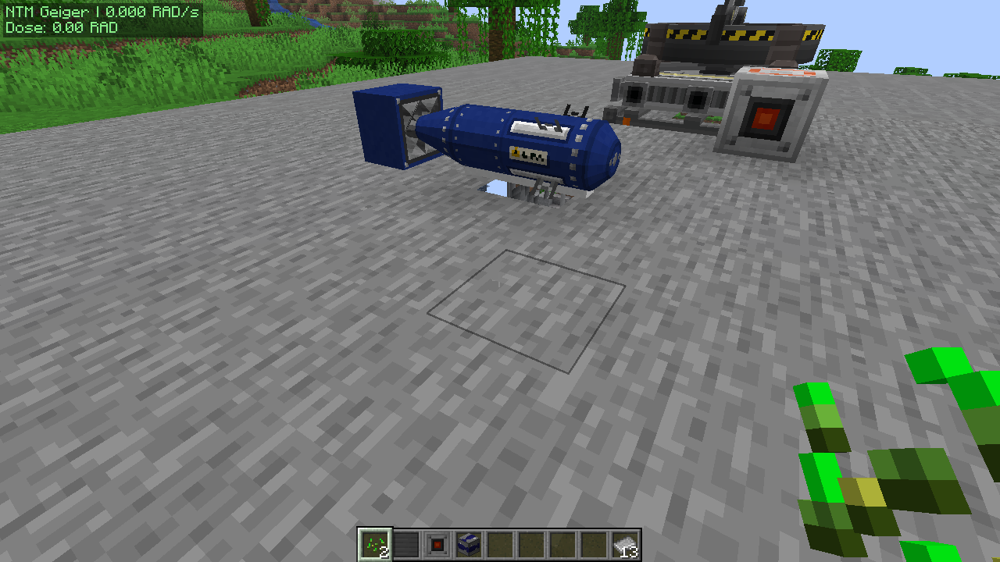
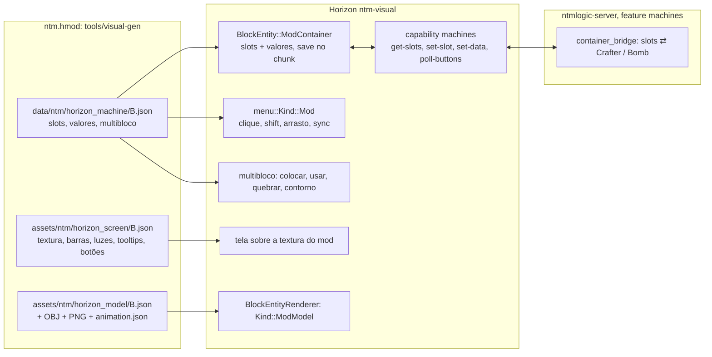

# Visual fiel ao NTM: telas, modelos 3D e multiblocos (protótipo)

2026-10-29. Protótipo de ponta a ponta com a **montadora** (`ntm:machine_assembly_machine`) e a **Little Boy**
(`ntm:nuke_boy`). Motor: branch `ntm-visual` em `~/Workspace/horizon-visual` (16 commits sobre b26b1de1e; já em `ntm-patched`, 4b962af45),
diff em [`horizon-patches/ntm-visual.diff`](../horizon-patches/ntm-visual.diff). Port: `tools/visual-gen/`,
`crates/ntm-core/src/server/container_bridge.rs` e a feature `machines` dos dois mods de lógica.
Fonte do NTM: `ntm-src/src/main/java/com/hbm/` (Java) e `ntm-src/src/main/resources/assets/hbm/` (recursos).

| | |
|---|---|
|  |  |
| A tela é a `gui_assembler.png` original: 17 slots nas posições do `ContainerMachineAssemblyMachine`, a barra de energia vinda da bateria pelo anel de baixo do multibloco e o inventário embaixo. | 20 lingotes postos por shift-clique na entrada; com a receita escolhida, 8 placas na saída, a barra de progresso e os LEDs verdes recortados da textura. |
|  |  |
| O OBJ `assembly_machine.obj` com a textura UV, virado pelo `facing`, e o contorno único do multibloco 3×3×3. | Trabalhando, o anel gira e os braços batem (animação no formato do GeckoLib, gerada do `AssemblerArm`). |
|  |  |
| A `lilBoySchematic.png` com os 5 slots: cada peça aparece desenhada no esquema, e o ícone "pronta" vem do `Bomb::blast()` do port. | O `LilBoy1.obj`, deslocado do bloco como no `RenderNukeBoy` (1 bloco de hitbox, o modelo passa 2 blocos). |

Mais capturas:
- `img/visual-overview.png`;
- `img/visual-assembler-recipe-button.png`: o botão do seletor abre a lista de receitas;
- `img/visual-cost-25.png`;
- `img/visual-fallback-hidden.png`: com os blockstates originais, o cubo de fallback sai da malha e só o OBJ aparece.

Para rodar: `tools/build-visual.sh [test]` e `tools/test-game/run-visual.sh <nome> --world W --creative` (Xvfb :15,
mudo, pasta em `$NTM_GAME_DIR/<nome>`, por padrão `~/Workspace/.agent-tmp/ntm-visual-game`, com uma cópia própria
dos mods e do armazenamento do mod do servidor; o `/tmp` desta máquina é RAM).

## 1. Pesquisa antes de construir

| Onde | O que tem | Uso aqui |
|---|---|---|
| upstream #1189 (draft, `feat/codemods-1`) | API 0.4 *preview*: `interface machine` (`get-slot`, `set-slot`, `get-property`, `set-property`; handles emprestados por tick) e o export `block-entities` (`types`, `create`, `tick`, `save`, `remove`, `data`). O próprio PR diz: "the game doesn't create, tick or save mod block entities". `code-mods-plan.md`: menus têm "data values done; layout and screen missing"; renderização é "missing (API 0.5)". | O registro `item-stack {id, count}` e as regras de `set-slot` (corta no máximo da pilha, recusa item desconhecido) são as mesmas. A metade que falta ao #1189 (o motor criar, salvar e abrir o block entity e desenhar a tela) é este patch. |
| `docs/modpacks.md:177-178` | 0.4: "a declared screen layout the game draws (`ui`), with server-side menu logic in the mod". 0.5: "animated models (block-entity, entity, item; GeckoLib's format): data models (Bedrock geometry + animations)". | A tela é um layout declarado. A lógica do menu fica no servidor. A animação usa o formato Bedrock/GeckoLib. |
| `docs/native-mods.md` | Mods nativos (horizon-mixins, `native_hooks.rs`, API 2: painel de itens). | Um caminho de distribuição futuro. Variantes novas de enum e braços de `match` não cabem bem em mixins. |
| Stink-O/horizon `mod-api-input-ui-render-world` (14 commits à frente, 3.419 atrás do main) | `ui` = lista de desenho livre (fills, sprites, texto) só no cliente, sem slots; `render` = pós-processamento WGSL. | Nada para slots, OBJ ou multibloco. |
| PR #2888 (aberto) | Efeitos visuais: partículas, luzes, overlays emissivos, filtros. | Não cobre modelos nem menus. |
| playhorizon.dev/mods | 19 mods (HUD e utilidades). | Nenhum de menus ou modelos. |
| `tobj` 4.0.5 (MIT, 3,1 mi downloads, ago/2026) | Leitor de OBJ. | **Usado** (`default-features = false`). |
| GeckoLib / Bedrock | `animation.json`: `{animations: {nome: {loop, animation_length, bones: {osso: {rotation, position}}}}}`. | **Usado** como formato das animações (subconjunto numérico). |

## 2. Desenho



### 2.1 GUI: um container genérico no motor, não o `ui`

**Escolha: `ModContainer` no motor.**

O `ui` do mod é só do cliente e sem posições (o WIT diz que o mod diz o que o widget tem, nunca onde fica). Slots de
verdade precisam de:
- armazenamento autoritativo no servidor;
- a semântica de clique do vanilla (pegar, dividir, shift, arrastar, duplo clique);
- sync servidor↔cliente, save no NBT do chunk e drop ao quebrar.

O motor já tem tudo isso para fornalha e funil (`menu::Menu`, o hub, `lan_machine_click`, `ContainerSetData`).
Uma variante genérica `BlockEntity::ModContainer { block, items, data }` mais `menu::Kind::Mod(n)`, guiadas por
dados, servem as ~420 máquinas. Funcionam no servidor-thread (o padrão), num host de LAN e no servidor dedicado, que
usam o mesmo hub.

O ganho para o port: **os itens das máquinas saem das transações por comando**, a parte mais frágil (256 linhas
por hook, células de resposta, scores). Elas continuam funcionando ao lado ("Pôr itens da mão" ainda serve), porque
a ponte aplica só a diferença.

### 2.2 Formatos de dados

Tudo fica fora de `data/<ns>/horizon/`: um Horizon sem o patch ignora e o `ntm.hmod` continua válido nele, com os
cubos e as telas antigas.

**`data/ntm/horizon_machine/<bloco>.json`** (lido em `horizon_world::mod_machines`, no servidor e no cliente):

```json
{ "slots": [ {"x": 152, "y": 81, "accept": ["ntm:battery_spark"]},
             {"grid": [8, 18, 3, 4]},
             {"x": 8, "y": 90, "reject": ["ntm:blades_steel"]},
             {"x": 98, "y": 45, "output": true} ],
  "inventory": [8, 174], "data": 12,
  "multiblock": {"min": [-1, 0, -1], "max": [1, 2, 1], "offset": 1, "dummy": "ntm:dummy_machine"} }
```

O multibloco é o `getDimensions`/`getOffset` do `BlockDummyable`, no referencial de quem coloca: x à direita, z para
longe. Os valores (`data`) são `i32`: no fio, cada um vira dois `i16` (o vanilla manda `short`).

**`assets/ntm/horizon_screen/<bloco>.json`** (`mod_screens.rs`):
- `texture` e `size`;
- `title`, `inventory_label`;
- `bars`: valor/máximo, retângulo, uv ou cor vinda de um valor, direção (o `drawTexturedModalRect` das GUIs do NTM);
- `overlays`: um pedaço da textura quando um slot tem item ou um valor ≥ mín (LEDs, as peças da Little Boy);
- `tooltips` com `{0:si}`, como o `BobMathUtil.getShortNumber`;
- `buttons`: o clique vira `ServerboundContainerButtonClick`, que chega aos server mods.

**`assets/ntm/horizon_model/<bloco>.json`** (`mod_models.rs`):

```json
{ "obj": "ntm:models/obj/assembly_machine.obj", "texture": "ntm:textures/models/machines/assembly_machine.png",
  "rotation": 90, "translate": [0, 0, 0], "radius": 2.2, "hide": ["Ring2", "Frame"],
  "bones": {"ArmLower1": {"parent": "Ring", "pivot": [0, 1.625, 0.9375]}},
  "animations": "ntm:animations/machine_assembly_machine.animation.json",
  "play": [{"animation": "animation.assembler.work", "property": "honey_level", "not": "0"}] }
```

- `rotation` e `translate` são o `glRotate`/`glTranslate` do renderer do NTM. O `facing` gira como o `switch(meta)`
  deles: north 0, west 90, south 180, east 270.
- Cada `o` do OBJ é um osso. A animação é o `animation.json` do GeckoLib: rotação em graus sobre o pivô (z, y, x),
  posição em pixels (1/16) e interpolação linear.
- A animação toca enquanto uma propriedade do blockstate diz que sim: o `honey_level`, que o port já usa como
  "barramento de aparência".
- Os UVs do OBJ são invertidos em v, como no `HFRWavefrontObject`.

**Alinhamento com o upstream:**
- O registro e as regras da API de servidor são os do `machine` do #1189; trocar para os handles dele quando ele
  entrar é mecânico.
- As animações já estão no formato do 0.5.
- A geometria Bedrock (cubos) cabe no mesmo `Model` (ossos com pivô): é mais um leitor ao lado do OBJ.

### 2.3 API de servidor `machines` (api level 8, experimental)

```wit
interface machines {
    record item-stack { id: string, count: u32, damage: u32 }
    record button-press { player: string, dimension: string, x: s32, y: s32, z: s32, button: u32 }
    get-slots: func(dimension: string, x: s32, y: s32, z: s32) -> option<list<option<item-stack>>>;
    set-slot: func(dimension: string, x: s32, y: s32, z: s32, slot: u32, stack: option<item-stack>) -> bool;
    set-data: func(dimension: string, x: s32, y: s32, z: s32, values: list<s32>) -> bool;
    poll-buttons: func() -> list<button-press>;
}
```

- **Leitura:** os block entities são emprestados ao mod junto com os chunks (`LentWorld`).
- **Escrita:** é aplicada logo depois do hook, antes de os jogadores agirem de novo. Um slot que já tem o item mantém
  os componentes e troca a contagem e o dano.
- **Dano:** o `damage` é o `minecraft:damage`, o desgaste de uma ferramenta (as lâminas do triturador). Um item de
  content mod ganha a barra com `"max_damage": N` no seu `data/<ns>/horizon/item/*.json` (só no motor com o patch;
  um Horizon sem ele recusa o campo, por isso o content-gen o põe só com `--max-damage`).

### 2.4 A ponte no port (`container_bridge.rs`)

- **Os slots são a verdade.** Antes de `simulate`, `slots_in` aplica à máquina o que os jogadores mudaram desde a
  última escrita (por diferença, nunca por cópia). Depois de `run_txs`, `slots_out` devolve o estado da máquina aos
  slots e manda os valores da tela.
- **Por diferença:** um `Give` da tela antiga, ou um `TakeHeld` que se confirma, muda a máquina, e a próxima escrita
  mostra isso. Copiar os slots duplicaria.
- **Sessão nova:**
  - com slots vazios e a máquina com itens (vindos de transação), os itens vão para os slots (migração);
  - senão, os slots mandam.
- **Quebrar:** o motor espalha os slots. O `drop_contents` do port não solta nada de uma máquina que a ponte viu.
- **Bombas:** espelha os slots em `Bomb.slots`; o `Bomb::blast()` do agente das bombas segue lendo só isso. Na
  detonação o `set-blocks` (ar) remove o block entity **sem** espalhar (é o `place_state` do `/setblock`), então não
  há duplicação: as peças somem, como o `clearSlots` do NTM.
- **Botão 0:** abre a lista de receitas da tela antiga, por uma mensagem nova `S2C::Show`.
- **Máquinas novas** (o triturador): guardam os itens como `Slots` e implementam o trait `Slotted` (`slots_mut`,
  `screen_data`, `button`), com `Layout::Native`. Sem transações e sem nada a reconciliar.
- **Energia:** o anel de baixo do multibloco conta como cabo na topologia (os proxies `makeExtra` do NTM). A bateria
  encostada no anel alimenta a montadora.
- A feature `machines` (ntm-core e os dois mods) fica desligada por padrão: um Horizon sem o patch recusaria o mod.

### 2.5 Modelo 3D

- **O que é:** `Kind::ModModel` no `BlockEntityRenderer`, no pipeline de entidades. Lightmap e shader packs vêm
  junto.
- **Cache:** os ossos parados ficam em cache por (modelo, rotação, dimensão). Por quadro, só a posição e a luz mudam.
  Os ossos animados são posados por quadro.
- **Triângulos:** viram quads degenerados.
- **Luz:** a maior das 7 células em volta do núcleo.
- **Cull:** pelo `radius` do arquivo.
- **Textura:** entra no atlas da GUI. Só entram as que as telas e os modelos citam.
- **Blocos com modelo:**
  - ficam "vazados" (luz e faces vizinhas passam, como o `isOpaqueCube` falso do NTM);
  - ganham block entity mesmo que o template não tenha (o `redstone_lamp` da Little Boy);
  - saem da malha do chunk (`ENTITYBLOCK_ANIMATED`).
- **Sem o patch:** os blockstates não mudam, e um Horizon sem o patch mostra os cubos de antes.

### 2.6 Multibloco

| Ação | Como |
|---|---|
| Colocar | `place.rs` põe o núcleo a `offset` blocos de quem coloca. Exige o volume livre (senão falha, como o NTM) e enche o resto com o `dummy` (template barrier com dureza) |
| Usar | Usar um dummy abre o menu do núcleo. O núcleo é achado varrendo os núcleos próximos cujo volume contém a célula, sem vínculo salvo |
| Quebrar | Minar qualquer célula quebra o núcleo como jogador (um drop, os slots espalhados) e tira os dummies |
| Contorno | O contorno e a mira de qualquer célula são a caixa inteira |

### 2.7 JSON de blocos (cubos) em vez de OBJ: avaliado, não recomendado

Modelos JSON vanilla já funcionam em content mods sem patch. Um conversor OBJ→cubos teria estes problemas:

1. **Geometria:** os OBJ do NTM são em grande parte cilindros e chanfros (anel e braços da montadora, corpo da
   Little Boy, Fat Man). Cubos só aproximam.
2. **Textura:** a do modelo teria que ir para o atlas de blocos. Lá todas as camadas têm o tamanho da maior
   (`sprites.rs:157-181`): uma textura de 152×108 leva todas as camadas a 256², até o teto de 256 MB. A saída seria
   reamostrar cada face em tiles de 16×16 (milhares de texturas).
3. **Sem animação:** só variantes por blockstate.
4. **Limite de espaço:** elementos limitados a −16..32, divididos entre as células do multibloco.

O renderizador OBJ do patch é genérico: qualquer um dos 519 OBJ entra com ~10 linhas de JSON. Por isso a
recomendação é **OBJ para tudo** com o patch.

O JSON convertido só faz sentido como queda para um Horizon sem o patch. Ele já mostra os cubos de hoje, então
fica como opcional.

## 3. Custo medido

Xvfb, RX 7600 (RADV), 1280×720, `bench 10` (quadro limitado a 30 fps, por isso CPU/GPU em ms). Duas passadas: a
segunda com a câmera em céu aberto. As 25 montadoras foram postas por `setblock` (só o núcleo; o modelo é o mesmo).

| Cena | CPU médio (ms) | CPU p95 | GPU médio | `render` | `prepare` |
|---|---:|---:|---:|---:|---:|
| Sem máquinas | 2,02 / 2,59 | 2,55 / 3,55 | 0,18 / 0,24 | 0,91 / 1,07 | 0,64 / 0,74 |
| 25 montadoras paradas | 5,69 / 6,26 | 6,51 / 6,95 | 0,23 / 0,26 | 3,20 / 3,29 | 2,03 / 2,08 |
| 25 montadoras animadas | 5,89 / 5,82 | 6,88 / 7,11 | 0,23 / 0,23 | 3,29 / 3,25 | 2,12 / 2,10 |

- **CPU:** ≈ **0,14 ms por montadora visível**. Animada custa quase o mesmo que parada: o custo é copiar e mandar os
  vértices (1.524 triângulos = 6.096 vértices × 44 B ≈ **268 KB por montadora por quadro**; 6,7 MB/quadro com 25),
  não a pose.
- **GPU:** +0,05 ms.
- **Memória de GPU (`gpu_allocated_bytes`):** 539 MB → 573 MB (25 paradas) → 624–632 MB (animadas). Não volta ao
  tirar as máquinas: o buffer de entidades cresce em potência de 2 e fica.
- **Atlas da GUI:** +2 texturas de GUI 256² e 2 de modelo, < 1 MB. Com **todas** as do NTM seriam 470 GUIs
  (88,9 MiB RGBA) e 1.001 texturas de modelo (117,5 MiB): **não cabe carregar tudo**.
- **Carga:** `Horizon: 2 block models (1802 triangles)` no início; ler os OBJ com `tobj` não aparece no tempo de
  carga.

**Etapa b, otimização (feita):**

- **Malhas na GPU** (`gfx/mod_models.rs`, `vs_model` no `entity.wgsl`):
  - cada osso de cada modelo vai uma vez para a GPU, no seu referencial;
  - por quadro, só uma matriz e a luz por osso de cada bloco (68 B);
  - o shader aplica a matriz à posição e à normal, e a luz por normal é a do próprio shader de entidades;
  - é o padrão do `gfx/lightning.rs` (raios retidos com offset por instância) e o mesmo espírito da origem por seção
    do terreno. O upstream não tem instancing de entidades: só o staging belt (#520), o reuso do buffer (#240) e o
    cache de texto de placa (#3284).
  - Com shader pack ligado, os modelos voltam ao caminho por vértices: o pack desenha as entidades.
- **Texturas de tela sob demanda:**
  - o atlas da GUI não empacota mais as texturas de tela de máquina;
  - a tela aberta carrega a sua num de 2 slots de 512×512 (2 MB fixos), e o menos recente cede (o mesmo mecanismo das
    skins baixadas);
  - o atlas tem o mesmo tamanho com 3 ou 420 máquinas. As texturas de modelo continuam no atlas, só as citadas
    pelos `horizon_model`.

**Medido de novo** (mesma cena, as mesmas 25 montadoras):

| Cena | CPU médio (ms) | CPU p95 | GPU médio | `render` | `prepare` |
|---|---:|---:|---:|---:|---:|
| Sem máquinas | 1,71 | 2,24 | 0,28 | 0,81 | 0,45 |
| 25 montadoras paradas | 1,71 | 2,20 | 0,43 | 0,83 | 0,46 |
| 25 montadoras animadas | 1,76 | 2,22 | 0,62 | 0,85 | 0,48 |

- **CPU:** de **+3,5 ms para +0,05 ms** com 25 montadoras: ~70× menos, e a animação não pesa mais.
- **GPU:** +0,15 a +0,34 ms, porque agora é ela que posa os vértices.
- **Memória de GPU:** +7 a +13 MB (antes, +34 a +90 MB).
- Captura: `img/visual-instanced-25.png`.

## 3b. Etapa c: o extrator (feito)

`tools/visual-gen/extract.py` lê o Java do NTM e grava `tools/visual-gen/extracted.json`:
- **Cobertura:** 412 blocos do `ModBlocks`; para cada um, a classe do bloco, o tile entity e o renderer (o
  `bindTileEntitySpecialRenderer` do `ClientProxy`).
- **Modelos:** o OBJ e a textura do `ResourceManager` (224 modelos). O giro do `case 2` mais o de antes do `switch`,
  e o `glTranslate` (lidos em 157 dos 224; os outros 67 não têm `switch` por metadata). As partes desenhadas.
- **Multiblocos e telas:** `getDimensions`/`getOffset` (154 multiblocos), a GUI (textura, tamanho) e os slots do
  container (186 GUIs).
- **Conferência:** o extrator reproduz os valores que eu tinha posto à mão: montadora 90°; Little Boy 90° com
  translate −2; alto-forno 90°.

O `generate.py` usa o extraído para os blocos do catálogo do port que o `visual.json` não descreve à mão. Hoje são 13
(`img/visual-auto-models.png`): centrífuga, planta química, as duas prensas, tanque, centrífuga de gás, queimador de
madeira e as bombas Gadget, Fat Man, Ivy Mike, Tsar, N2 e balefire.

Desses, entra **só o modelo**: sem slots e sem multibloco. Eles têm lógica no port, e um multibloco sem proxies das
portas quebraria as redes de energia e fluido deles. A tela texturizada e o multibloco de cada um viram uma entrada à
mão no `visual.json`, com os dados do `extracted.json` como ponto de partida (slots, textura, dimensões).

## 3c. Fundição: telas, multiblocos, metal visível e jatos

**Pesquisa (como desenham líquido):**
- **NTM:** dois caminhos.
  - O cadinho (`RenderCrucible`) é um TESR: desenha um quad horizontal com `lava_gray.png` tingida pela
    `moltenColor` do material, na altura `0.5 + nível·0.875`.
  - Molde, bacia, tanque e canal são ISBRH (`RenderFoundry{Mold,Basin,Tank,Channel,Outlet}`). Também desenham o
    metal como faces com `lava_gray` tingida e brilho cheio, mas no próprio mesh do chunk.
- **Upstream (Horizon):** fluido em modelo só existe para os blocos do vanilla: o `mesher` faz a água e a lava pelos
  níveis do estado. Não há líquido de mod. O 0.5 (GeckoLib/Bedrock) não tem líquido: é geometria e animação.
- **Decisão:** um líquido é uma caixa no block entity: a face de cima em `lava_gray`, tingida por um valor
  sincronizado, na altura `mín + valor/máx·(máx − mín)`. Isso é o TESR do cadinho, generalizado.
  - Fica no caminho de modelos que já existe, que é instanciado.
  - O chunk não é remontado a cada mudança de nível, como no ISBRH do NTM.

**Formato:** `liquids` no `horizon_model`, ou `assets/ntm/horizon_liquid/<bloco>.json` para um bloco sem OBJ (o
modelo de blocos dele continua):

```json
{ "liquids": [ {"texture": "ntm:textures/models/machines/lava_gray.png", "box": [0.125, 0.125, 0.125, 0.875, 0.375, 0.875],
                "value": 0, "max": 1, "color": 2, "column": false} ] }
```

- `value`, `max` e `color` são índices nos valores da máquina. Sem cor (0), nada é desenhado.
- `column`: um jato, as quatro laterais da caixa, que só aparecem enquanto a cor não é 0 (a lógica põe a cor do
  metal no tick em que ele cai).
- Os valores chegam ao cliente pela lista `synced` do `horizon_machine`: os pares `horizon_synced` do block entity, no
  chunk e nas atualizações. O servidor só reenvia quando um deles muda. O resto dos valores só vai para quem está com
  a tela aberta, como no vanilla.

**Os blocos:**

| Bloco | Tela | Multibloco | Modelo | Metal |
|---|---|---|---|---|
| Fornalha (`heater_firebox`) | `gui_firebox.png`: chama (overlay), queima, calor | 3×1×3 | `firebox.obj`, sem `InnerBurning` | — |
| Cadinho (`machine_crucible`) | `gui_crucible.png`: grade 3×3, resto e liga em cor, calor, progresso, botão de liga; título branco | 3×2×3, posto sobre a fornalha | `crucible.obj` | resto e liga, até 0.5 + 0.875; os dois jatos |
| Molde (`foundry_mold`) | painel simples (o NTM não tem GUI: ver pendências) | — | JSON (ISBRH) | 0.125..0.375 |
| Bacia (`foundry_basin`) | painel simples | — | JSON (ISBRH) | 0.125..0.875 |
| Tanque (`foundry_tank`) | sem menu | — | JSON (ISBRH, sozinho) | 0.125..0.875 |
| Canal (`foundry_channel`) | sem menu | — | JSON (ISBRH, sozinho) | centro, 0.125..0.375 |
| Saída (`foundry_outlet`) | sem menu (tela antiga do port) | — | JSON (ISBRH), gira pelo `facing` | — |

- Uma máquina sem slots (canal, tanque, saída) não abre menu do motor: a tela do mod, se houver, abre como antes.
- **Modelos JSON dos ISBRH:** o visual-gen escreve o blockstate, o modelo e o item a partir de `block_model` no
  `visual.json`, com as texturas originais do NTM. As caixas são as `setRenderBounds` do renderer. Os UVs padrão do
  JSON seguem a posição do elemento, como as faces do `RenderBlocks`, então cada face mostra o mesmo pedaço da textura;
  as partes transparentes ficam fora das faces. Não há oclusão de ambiente, como no NTM.
  - Esses caminhos são do visual-gen: o content-gen respeita o `content/.visual-files.json` e não os sobrescreve.
  - Sem o patch, o bloco tem esse modelo e não tem o metal.
- **Título colorido:** `title_color` na tela. O extrator lê a cor do `drawString(name, ...)`: 28 GUIs não usam o cinza
  do vanilla.
- **Bloco aberto:** um bloco com `horizon_liquid` (mesmo com a lista vazia, como a saída) não esconde as faces dos
  vizinhos e deixa a luz passar, como os de `horizon_model`. Isso vale para o `can_occlude` do
  `render-definitions.json` e para a linha de jogo. Sem isso, o template `beehive` abria buracos no chão ao lado e
  deixava o interior escuro.
- **Capturas:**
  - `img/visual-foundry.png`: o cadinho sobre a fornalha com ferro fundido, e o molde enchendo;
  - `img/visual-foundry-screens.png`: as telas do cadinho e da fornalha acesa;
  - `img/visual-foundry-blocks.png`: molde, bacia, tanque com saída e dois canais.

## 3d. Telas das bombas (etapa d.3)

O port tem 11 tipos de bomba. As 4 cargas (TNT do NTM, dinamite, Semtex, C-4) não têm slots nem GUI no NTM e ficam
como estão. As 7 com peças usam os slots do motor (`Layout::Bomb`, uma peça por slot, na ordem do tipo) e a GUI do
NTM:

| Bomba | Textura | O que a tela desenha |
|---|---|---|
| Little Boy | `lilBoySchematic` | as 5 peças e a lâmpada de pronta |
| The Gadget, Fat Man | `gadgetSchematic`, `fatManSchematic` | um quarto da esfera por lente (`exp1`–`exp4`) e a lâmpada |
| Ivy Mike | `ivyMikeSchematic` | lentes, núcleo, tanque de urânio, deutério, resfriamento; uma lâmpada por estágio (`isReady`, `isFilled`) |
| Tsar Bomba | `tsarBombaSchematic` + a do Ivy Mike | as mesmas sobreposições, tiradas da textura do Ivy Mike como no `GUINukeTsar`; o gerador cola as duas num arquivo de 256×512 (`compose`) |
| Mina N² | `n2Schematic` | a barra de 6 px por carga, das 12 |
| Fogo maldito | `fstbmbSchematic` | o ovo e a bateria; o campo do timer fica vazio, porque o port a detona por redstone ou detonador |

- **Valores:** a tela de uma bomba recebe `[estágios prontos, peças no lugar]` (`bomb_data` no bridge, com o
  `slot_ok` da própria bomba).
- **Uma peça por slot:** os slots das bombas têm `"max": 1`, o `Slot.getMaxStackSize` do vanilla, novo no motor.
  - Sem isso, um shift-clique de 4 lentes (que empilham até 64) punha as 4 no primeiro slot, e o bridge cortava
    para 1: 3 lentes perdidas.
  - Com isso, as 4 se espalham pelos 4 slots de lente.
- **Migração:** uma bomba montada antes, pela tela antiga, mostra as peças nos slots na primeira vista. Há um teste
  para cada uma das 7.
- **Detonação sem duplicar:** a bomba sai com `set_blocks(air)`. No motor, isso passa por `place_state`, que tira o
  block entity sem efeitos colaterais, então os slots não se derramam.
  - Em jogo, com Little Boy, Gadget e Fat Man prontas, houve zero peças no chão.
  - Um item de controle a 2,8 blocos sobreviveu à explosão.
- **Modelos:** uma entrada à mão sem `model` agora fica com o modelo do extrator. Antes, a tela substituía o modelo.
- **Captura:** `img/visual-bomb-screens.png`.

## 3e. Bigorna

As 12 bigornas do port (`anvil.rs`, do agente das bombas) têm 19 slots:
- 0–1: o par da forja; 2: o resultado;
- 3–14: a grade de construção 3×4;
- 15–18: as saídas.

Os botões são: 0 lista de receitas (a tela antiga), 1 construir uma vez, 2 construir o máximo, 3 forjar.

O NTM tem menos coisa:
- **Slots:** o `ContainerAnvil` só tem os 3 da forja. A construção tira os materiais do inventário do jogador.
- **Tela:** o `GUIAnvil` tem uma lista de receitas 2×5 com setas, um campo de busca, o botão de construir (shift:
  tudo) e o de modo, mais um painel que mostra a receita.

A tela fica com a textura do NTM e põe os slots do port nos lugares dele:

| Port | Onde, na `gui_anvil.png` |
|---|---|
| Forja 0–1 → 2 | onde o NTM os tem (17,27 + 53,27 → 89,27) |
| Grade 3–14 | uma faixa 6×2 sobre a lista de receitas e as setas, que tem exatamente 12 células. A grade é lida como um monte, então a forma não importa |
| Saídas 15–18 | 2×2 no painel azul da receita |
| Botão 1, e 2 com shift | o botão de construir (a bigorna azul); a sobreposição acesa quando dá para construir |
| Botão 0 | o campo de busca e a lupa |
| Botão 3 | a seta da forja |

- **Molduras:** as dos slots novos são coladas da própria textura (`compose` com `src`).
- **Painel:** é desenhado por cima da borda da tela, como no NTM.
- **Botão de modo:** mostra o ícone de construção e o nível da bigorna.
- **Modelo:** o `anvil.obj` do `RenderAnvil`, com a textura de bloco de cada bigorna, girado pelo `facing`. A
  bigorna sombria usa aço em tudo (no NTM, só o topo dela é diferente).
- **No motor, para isto:**
  - `shift` num botão: o id mandado com shift;
  - os botões das telas de máquina aparecem no `horizon-ctl screen` e no `click-button`.
- **Em jogo:** bigorna de ferro mais 12 de aço, Forjar → bigorna de aço, sobrando 2 de aço. A construção, com
  receita da lista, fica para a aceitação do agente das bombas.
- **Captura:** `img/visual-anvil.png`.

## 3f. Máquinas com lógica (etapa d.2)

| Máquina | Lógica no port | Slots na tela | Multibloco e portas |
|---|---|---|---|
| Planta química | `Crafter` (`Layout::Crafter`, entradas 0..3, saídas 3..6) | 3 entradas e 3 saídas onde o NTM as tem; os 6 tanques; energia, progresso, os LEDs; a lista de receitas no slot de receita | 3×3×3, offset 1; o anel de baixo passa energia e fluido (`getAllPorts`) |
| Centrífuga | `Crafter` (entrada 0, saídas 1..5) | a entrada e as 4 saídas; energia; as 4 colunas de progresso, uma depois da outra (`from` na barra) | torre 1×4×1; a energia entra pelo núcleo |
| Centrífuga de gás | `Slotted` (agente das bombas) | as 4 saídas, o upgrade de velocidade (`max` 1); bateria e identificador sem lógica (`accept` vazio); tanques com a textura do UF6, colada no canto livre | torre 1×4×1 |
| Prensa a carvão | `Slotted` (agente das bombas) | combustível (os itens com `burn_ticks`), matriz (`max` 1), a entrada (a tabela da prensa), a saída; a chama e a cabeça da prensa | torre 1×3×1 |
| Prensa elétrica | `Slotted` (agente das bombas) | matriz, entrada, saída; bateria e upgrade sem lógica; energia e cabeça | torre 1×3×1 |

- **Crafter com várias saídas:** o `Layout::Crafter` virou uma faixa de entradas e uma de saídas, cada uma uma vista
  dos montes da máquina.
  - A centrífuga escolhe a receita pelo que os slots põem (`pick_by_items`), como o `INSERT`.
  - Os valores da tela ganham os 6 tanques (índices 12–29), depois dos 12 da montadora, que não mudam.
- **Slots sem lógica no port:** a bateria, os upgrades e os recipientes de fluido ficam de fora (planta química,
  centrífuga) ou com `accept` vazio (prensas, centrífuga de gás), em vez de aceitar itens que não fazem nada.
- **Ponteiros** (`gauges` na tela, o `drawSmoothGauge` do NTM): a velocidade da prensa a carvão e os dois tanques do
  alto-forno. É um triângulo girando 270° a partir de baixo à esquerda, com contorno preto a 1,5×.
- **PUREX** (lógica do agente das bombas, `Station::Purex`):
  - **Slots:** os índices do `ContainerMachinePUREX`; 0–3 não aceitam nada, e o 1 fica fora da tela para o botão de
    receita ficar no lugar dele. Entradas 4–6 e saídas 7–12 em 3×2.
  - **Tela:** os 3 tanques de entrada, o de saída, energia, progresso e LEDs.
  - **Multibloco:** 5×5×5 com o núcleo no centro da base (offset 2). As 16 células da borda de baixo passam energia
    e fluido (`TilePortShapes.purex`).
  - **Em jogo:** posto e com a tela aberta (`img/visual-purex.png`, ao lado do ponteiro da prensa).
- **Animações** (tocam enquanto o `honey_level` não é 0, como a montadora):
  - **Planta química:** o `Spinner` gira 15° por tick sobre o pivô (0,5, 0, 0,5), e o `Slider` corre por
    `BobMathUtil.sps` (`RenderChemicalPlant`).
  - **PUREX:** o `Fan` gira 45° por tick sobre (1,5, 1,25, 0), e a `Pump` corre por `sps` (`RenderPUREX`).
  - **Uma volta por máquina:** um só loop leva as duas partes, de 2,4 s e 1,2 s. As corridas ficam 5% mais rápidas que
    as do NTM.
  - **Frame:** escondido, como no NTM quando não há bloco em cima.
  - **Prensas:** corpo e cabeça num só modelo (`merge` no visual-gen: os dois OBJ, as duas texturas lado a lado). A
    cabeça desce e sobe uma vez por segundo enquanto a prensa trabalha. No NTM ela segue o valor da prensa, e mandar
    esse valor 20 vezes por segundo custaria uma atualização de bloco por tick por prensa.
  - **Em repouso,** o modelo mostra o primeiro quadro da animação (motor). No NTM as peças ficam onde o `anim` parou,
    e para a corrida isso é uma volta inteira para fora.
  - **Captura:** `img/visual-animations.png` (a planta química, e as duas prensas em quadros de 0,2 s).
- **Falta:**
  - o tipo de fluido real nos tanques da centrífuga de gás (hoje sempre UF6).
- **Em jogo:** as 5 colocadas com os dummies certos (26, 3, 3, 2, 2) e as 5 telas abertas
  (`img/visual-machines-d2.png`). A planta química pede escala de GUI ≤ 2 em 720p, como a montadora.

## 3g. Cadeia do bedrock, etapa 1: escavadora e ore slopper

| Máquina | Slots (lógica do agente das bombas) | Tela | Multibloco e portas |
|---|---|---|---|
| Escavadora (`MachineExcavator`) | 4 broca (as 10 `drillbit__*`, `max` 1), 5–13 o buffer; 0–3 sem lógica | `gui_mining_drill.png`: os 5 interruptores (só o da broca tem lógica na etapa 1: botão 0, com a profundidade no tooltip), lâmpadas, energia, tanque | corpo 7×7×4 com o núcleo 3 blocos acima da célula usada (`getHeightOffset`), sobre duas pernas 2×2 e uma parede 7×2 (`getAllDimensions`); as portas na camada acima do núcleo |
| Ore slopper (`MachineOreSlopper`) | 2 entrada (só `bedrock_ore_base`), 3–8 saídas; 0, 1, 9, 10 sem lógica | `gui_ore_slopper.png`: energia, progresso, os tanques de água e slop com a textura desses fluidos | 3×7×4; as 8 portas na camada de baixo (`getPorts`) |

- **Motor:** `height` e `extra` no multibloco. O dummy acha o núcleo pelas caixas de verdade, não pela caixa em volta
  delas.
- **Visual-gen:** `keep` na tela. A GUI da escavadora desenha a textura em dois pedaços, e os sprites ficam no meio;
  o resto da área da tela é limpo, e os sprites vêm de uma cópia composta abaixo (v + 256).
- **Em jogo:** a escavadora foi posta com 261 dummies (corpo 196, pernas 24, parede 42), com as pernas no lado das
  pernas do modelo. A tela abre, e o interruptor da broca liga (valor 5 = 1). O slopper foi posto 3×7 ao longo do
  modelo, e a tela abriu (`img/visual-bedrock.png`).
- **Animações (feito, b07e829):**
  - A broca gira (`-360°` em y, como o `glRotatef(..., 0, -1, 0)`), e os britadores giram em sentidos opostos.
  - O slopper faz o ciclo do `RenderOreSlopper`: carrinho, hidráulica, balde, pás e ventoinha.
  - Tocam com `honey_level ≠ 0`.
  - O modelo da escavadora desce 3 blocos (`translate [0,-3,0]`, o `-getHeightOffset` do renderer).
- **Falta:** os outros 4 interruptores e as conexões de canal e tanque, a combinar com o agente das bombas depois da
  aceitação dele.

## 3h. A porta da fornalha e o cristalizador

- **Porta da fornalha:**
  - No NTM, a porta do `RenderFirebox` abre com a GUI: `doorAngle` sobe até 135° enquanto `playersUsing > 0`.
  - No motor, o modelo ganha `"open": "<animação>"`. Enquanto a tela da máquina está aberta nesta janela, essa
    animação fica posada pela abertura do `Scene.lid` (a mesma do baú). Com a tela aberta, a abertura é 1: a porta
    abre de uma vez, sem os ticks de abrir.
  - Clicar num dummy abre a tela do núcleo, então o cliente remoto passa a guardar o menu na posição do núcleo, e
    não na do dummy clicado.
  - No port, o `loop_animation` aceita `"loop": false`. A porta é `Door` com o pivô na dobradiça, girando `-135°` em y.
- **Cristalizador (`MachineCrystallizer`, "Acidificador de Minério"):**
  - Multibloco 3×3×6 (`{5,0,1,1,1,1}`, offset 1). As 8 portas (`makeExtra` em `(±1,0,±1)`) ficam na camada de baixo,
    dentro do footprint.
  - Tela `gui_crystallizer_alt.png` 176×204, com os 8 slots do `ContainerCrystallizer`:
    - 0 entrada;
    - 1 bateria;
    - 2 saída;
    - 3 e 4 recipientes de fluido;
    - 5 e 6 upgrades;
    - 7 identificador de fluido.
  - A entrada aceita só os itens das receitas (`accept_recipes: crystallizer`, de
    `content/machine-recipes/crystallizer.json`), como o `isItemValidForSlot`: a bateria vai para o slot dela no
    shift-clique.
  - Os slots sem lógica ainda não aceitam nada (`accept []`, como na PUREX).
  - Elementos da tela:
    - energia, para cima;
    - progresso, à direita, 28 px;
    - o tanque na cor do fluido (`data[6]`), porque o fluido muda com a receita (água, ácido sulfúrico, cloro,
      peróxido...);
    - a estrela azul do `drawInfoPanel` (tipo 8, de `gui_utility.png`), composta no fundo, com o tooltip dos upgrades.
  - Modelo `acidizer.obj`:
    - `rotation 90`;
    - `Windows` escondido, porque o renderer não o desenha;
    - o `Spinner` gira 360° em 3,6 s (5°/tick) com `honey_level ≠ 0`.
  - O renderer do NTM chama `renderPart("Fluid")`, mas o OBJ não tem essa parte: não há líquido a desenhar.
  - A lógica é do agente das bombas, como estação do crafter (`Layout::Crafter { inputs: 0..1, outputs: 2..3 }`,
    f2bd500).
  - Os 30 valores do `crafter_data`: energia, máxima, progresso ‰ e 1000; tanque (mB, capacidade, cor); led.
  - No bridge:
    - energia pela camada de baixo;
    - fluido pelo anel de 8 células dessa camada.
  - No NTM as portas são só os 4 cantos. As células do meio de cada lado ligam os cantos ao núcleo, que um canto só
    toca na diagonal.
- **Em jogo:**
  - A porta abre com a tela (aberta pelo dummy da frente, fornalha virada para o sul).
  - O cristalizador foi posto com os dummies 3×3×6. A tela abre, e a bateria vai para o slot 1 no shift-clique.
  - O `custom_data` passa pelo shift-clique no criativo. Antes da correção, 3 brutos chegavam crus ao inventário.

## 3i. Etapas 3 e 4 do bedrock e o lote A do petróleo

| Máquina | Multibloco | Tela | Modelo |
|---|---|---|---|
| Forno pirolítico (`MachinePyroOven`) | 5×7×3, offset 3 | `gui_pyrooven.png`: energia, progresso, os dois tanques na cor do fluido e a estrela dos upgrades | `rotation 180`; o `Slider` desliza (`sps(anim·0.125)/2 − 0.5`) e o `Fan` gira 45°/tick enquanto trabalha |
| Eletrolisador (`MachineElectrolyser`) | base 5×11, mais as caixas do `fillSpace` como `extra` (seção elevada, espinha, 5 arcos): 157 células | `gui_electrolyser_fluid.png` 210×204: os três tanques (entrada [4..6], saídas [7..9] e [24..26]), energia, lâmpada e progresso para baixo | `rotation 180` (o `case 2` mais o `glRotated(180)`); sem partes móveis |
| Forno a arco grande (`MachineArcFurnaceLarge`) | 5×5×5, offset 2 | `gui_arc_furnace.png` 176×256: os 3 eletrodos, a grade 5×4 de entrada (os itens das receitas dos dois modos), a linha de saída, energia, progresso, lâmpada | `rotation 90`; eletrodos novos, tampa baixa e os cabos balançando (`swing`, 30°·sin) enquanto trabalha |
| Liquefator (`MachineLiquefactor`) | 3×3×4, offset 1 | `gui_liquefactor.png`: tanque de saída [7..9] | o `Fluid` vira um líquido tingido pela cor do tanque, na altura do enchimento (`synced`) |
| Solidificador (`MachineSolidifier`) | 3×3×4, offset 1 | `gui_solidifier.png`: tanque de entrada [4..6] | o mesmo, com `rotation 90` |

- **Portas:**
  - O `rotatePorts` do NTM leva o x da porta para a esquerda de quem coloca, e o z para quem coloca.
  - Por isso, no bridge, a porta (x, y, z) do NTM fica em (−x, y, −z).
  - As máquinas anteriores tinham portas simétricas, então nada muda nelas.
  - O eletrolisador confirma o sentido: as portas em x −3 do NTM caem no lado de 3 blocos do multibloco.
- **Duas telas e partes por valor (recursos do motor, genéricos):**
  - **A tela de metal do eletrolisador** (`GUIElectrolyserMetal`): a alavanca troca de tela só nesta janela.
    - A tela de metal esconde os slots 3–13 e põe os 14–20 onde o `ContainerElectrolyserMetal` põe.
    - Um só `data` serve as duas telas: ácido nítrico em [15..17], pilhas em [30..34], progresso do minério em
      [35]/[36] e lâmpada em [37] (combinado com o agente das bombas).
  - **O forno a arco segue os valores da etapa 4:**
    - cada eletrodo, com seu anel e seu cabo, pelo estado ([20..22]: novo, quente, gasto);
    - o conteúdo frio ou quente ([23]);
    - o botão de modo líquido ([28]);
    - a coluna de metal fundido na tela ([25..27]).
- **Posar por valor (terceiro recurso):**
  - A tampa do forno a arco sobe 2 blocos com [24] (de 1000) e leva os anéis, os eletrodos e os cabos.
  - O metal fundido sobe com [25] de [26].
  - No NTM, a translação do conteúdo não é desfeita, então com metal fundido a tampa e os eletrodos descem junto. Aqui
    as duas ficam independentes.
  - As prensas (a lenha e elétrica) posam a cabeça em (1 − press/maxPress) × 0,875 bloco por [0] e [1], no lugar do
    ciclo fixo de 1 s.
  - Os valores sincronizados vão como dado do block entity, sem atualizar o bloco: a cabeça que se move a cada tick
    custa um pacote pequeno.
- **O vidro do liquefator e do solidificador:**
  - Desenhado com `tint` `#26bfffff`: o (0,75, 1, 1, 0,15) do NTM, por cima do tanque.
  - Diferença: aqui o vidro leva a textura do modelo; o NTM o desenha sem textura.
  - Um modelo com parte translúcida sai como vértices, com a parte translúcida por último.
  - Em jogo: os painéis aparecem leves, com o fundo visível através deles.
- **Em jogo (os dois recursos):**
  - A alavanca troca as telas do eletrolisador nos dois sentidos: 57 slots na de fluidos, 46 na de metal.
  - Com os valores [20..23] = 1, 2, 3, 2, o forno a arco mostra os anéis e os eletrodos, e o eletrodo quente brilha.
  - Um `/data merge` não manda os valores aos clientes na hora: chegam com o chunk, ou quando o mod os muda
    (`set-data`).
  - Com [0] = 100 de 200, a cabeça da prensa desce até a metade.
- **Em jogo** (com uma cópia de teste que força as animações):
  - os cinco põem os dummies certos (o eletrolisador, 156);
  - as telas abrem;
  - a bateria (e o eletrodo, no forno a arco) vai para o slot dela no shift-clique;
  - o ventilador do forno pirolítico e os cabos do forno a arco se movem.
  - O líquido do liquefator e do solidificador ainda não foi visto cheio: depende dos valores da lógica.

## 3j. Interruptores da escavadora e canais da fundição

- **Interruptores da escavadora (contrato com o agente das bombas):**
  - botões 1–4: britador, paredes, veio, toque de seda;
  - alavancas e lâmpadas por [8..11], e [12] a lâmpada âmbar da broca;
  - veio e seda: 1 verde, 2 âmbar (a broca não permite);
  - data 20 (13 da tela + 7 salvos);
  - slots 2–3 com os upgrades de velocidade, energia e efeito.
  - Os britadores giram com [8] ≥ 1 E [6] = 1, por `play` com `values` (o `crusherRotation` só anda com a broca
    trabalhando).
  - Em jogo: com [8..12] = 1, 1, 1, 2, 1, as alavancas e as lâmpadas aparecem certas.
- **Canais da fundição:**
  - O NTM desenha um braço (piso e duas paredes) para cada vizinho que o `canConnectTo` aceita (canal, molde, saída
    ou slag tap com facing para fora) e uma parede onde não há vizinho.
  - O canal virou um modelo OBJ gerado das caixas do `RenderFoundryChannel` (`boxes` no visual-gen), com
    `show` por `neighbor`: o cliente olha os vizinhos, sem lógica nem tráfego.
  - O metal fica só no centro. O NTM também enche os braços: um líquido não segue vizinho.
  - O tanque e a saída não têm braços no NTM.
  - Em jogo: um T de canais liga os três lados, e um canal sozinho fica fechado.

## 3k. Petróleo, lote B, e as estruturas de aço

- **Refinaria (`MachineRefinery`):**
  - 3×3×9, offset 1;
  - tela `gui_refinery.png` 182×240 com os 13 slots do `ContainerMachineRefinery`;
  - o óleo e as 4 saídas na cor de cada fluido, pelos valores do agente das bombas ([4..18]).
  - Os canos da tela vão sem tinta: o NTM os pinta com as cores das saídas da receita. Faltou isso porque o overlay não
    tinge.
  - O modelo explodido e a inclinação seguem [19] e [20] (`show` e `pose`).
- **Torre de fração:** só modelo, multibloco 3×3×3 e as 4 portas dos lados (o NTM não tem tela).
- **Misturador:**
  - 1×1×3;
  - tela `gui_mixer.png` com os dois tanques de entrada e o de saída;
  - o Mixer gira com [10] = 2 (trabalhando, `play` por `values`);
  - o Fluid sobe com o tanque de saída, na cor dele (opaco aqui, 75% no NTM).
- **Estruturas** (combinado com o agente de importação; o motor não tem estados próprios de bloco de conteúdo):
  - `steel_beam`: o OBJ `beam` do NTM.
  - Andaime em 4 IDs, um por cor, no template `quartz_pillar`: o OBJ `scaffold` em 3 cópias giradas como o
    `ObjUtil` gira (`variants`), mostradas pelo `axis`. Perde-se a 2ª orientação vertical do NTM, pelo yaw.
  - Grade no template `stone_slab`: a placa de 2 px embaixo (bottom), em cima (top) ou as duas (double). As 10 alturas
    por clique do NTM ficam de fora.
- **Em jogo:** todos foram postos com os dummies certos (a refinaria 80, a torre 26), as telas abrem, e as estruturas
  aparecem nas 3 orientações e nos 3 tipos.
- O visual-gen agora gera de um export de HEAD nos commits por etapa. Os blocos dos lotes B, C e D sem entrada própria
  ficam com `auto: false`: o modelo extraído errava (o steel_beam pegava um boxcar).

## 3l. Petróleo, lote C

| Máquina | Multibloco | Tela | Modelo |
|---|---|---|---|
| Caldeira (`MachineHeatBoiler`) | 3×3×4 | sem tela aqui | `rotation 180`; o modelo estourado (`boiler_burst`) segue a lógica, ainda não |
| Caldeira industrial | 3×3×5 | sem tela aqui | sem giro |
| Craqueador catalítico | base 6×7 + as 4 caixas do `fillSpace` (368 células, 15 de altura) | sem tela no NTM | `rotation 90` |
| Reformador catalítico | 5×3×3 | `GUIMachineCatalyticReformer` 176×238: energia, entrada e 3 saídas, o catalisador (`catalytic_converter`) | `rotation 90` |
| Hidrotratador | 3×3×7 | óleo, hidrogênio e 2 saídas, catalisador | sem giro |
| Destilador a vácuo | 3×3×9 | entrada e 4 saídas | sem giro |
| Coqueificadora | 3×3×23 | calor e progresso em TU, entrada e subproduto, coque | sem giro |

- **Motor:**
  - A coqueificadora passa do limite de 16 do multibloco: agora 32 de altura e 16 de largura.
  - A busca do núcleo de um dummy anda por eixo: a largura máxima das máquinas e só as alturas em que um núcleo pode
    estar, sem um cubo de 45³.
- **`use_range`:**
  - Tela aberta até 12 blocos do centro do núcleo, como o `getUseRange` do NTM. Antes valia a regra do baú (alcance
    + 4 a partir do bloco), e a tela da coqueificadora fechava a 9 blocos acima do núcleo.
  - O gerador põe 12 em todo multibloco.
- **Portas:**
  - As do craqueador e do reformador vão pela camada de baixo inteira.
  - As do hidrotratador, do destilador e da coqueificadora, pelo anel.
  - As das caldeiras, pelos lados e pela coluna até o topo.
- **Em jogo:**
  - as 7 com as células certas (a coqueificadora 207, o craqueador 368);
  - as 4 telas abrem;
  - a tela da coqueificadora abre a 8 acima do núcleo e fecha a 12, como no NTM.

## 3m. Petróleo, lotes E e D

| Máquina | Multibloco | Tela | Modelo |
|---|---|---|---|
| Queimador (`MachineGasFlare`) | 3×3×12, offset 1 | `gui_flare_stack.png` 176×203, sem título | `rotation 180` |
| Hefesto (`MachineHephaestus`) | 3×3×12, offset 1 | sem tela no NTM | `Main` e o `Rotor` 3 vezes |
| Poço (`MachineOilWell`) | núcleo, 3×3×9 em cima, os 4 cantos embaixo (86 células) | `gui_well` 184×190 | derrick, `rotation 180` |
| Pumpjack (`MachinePumpjack`) | 7×4×1 e os 8 canos dos lados (36) | `gui_well` | `rotation 90`, animado |
| Torre de fraturamento | coluna, plataforma 7×2×7, 4 pernas e a torre (445) | `gui_well_fracking`, com o tanque de solução | `rotation 180` |

- **Queimador:**
  - energia, o tanque na cor do fluido;
  - a válvula e a ignição são os botões 0 e 1, com as luzes [2] e [3]; a chama aparece com [4].
- **Hefesto:**
  - Os 3 rotores são o `Rotor` do OBJ a 0, 120 e 240° (`variants` com `keep` e `part`). Giram 0,5°/tick (36 s a
    volta) com [0] ≥ 1, o calor guardado.
  - O `Core` vira lava (os 4 lados e o topo, por [0]). Sem a rolagem da textura do NTM, e frio não mostra pedregulho:
    o líquido não tem condição de "igual a 0".
- **Poço, pumpjack e torre:**
  - Uma tela para os três, com os índices do agente das bombas:
    - energia [0]/[1]; óleo [3..5] e gás [6..8] na cor do fluido;
    - o indicador [2] (1 fundo, 2 parado, 3 sem solução) como os ícones do NTM;
    - na torre, a solução [9..11]; nos outros, a moldura vazia do NTM no lugar.
  - Slots: bateria 0, óleo 1–2, gás 3–4, melhorias 5–6 (a tela do NTM tem 2). O slot 7 fica fora da tela.
  - O pumpjack balança (balancim, cabeça e carro, 3,6 s) enquanto [2] = 0 e [0] ≥ 1.
- **Portas:**
  - O queimador, pelo meio de cada lado.
  - O hefesto, pelo meio dos lados embaixo e em cima (y 11), ligados pela coluna do centro.
  - O pumpjack, por 2 canos de cada lado, ligados ao núcleo pela base.
  - O poço e a torre, pelo núcleo.
- **Gerador:** `variants` ganhou `keep` (objetos do OBJ copiados como estão) e `part` (a cópia de um objeto só, e não
  do OBJ inteiro).
- **Em jogo:**
  - as 5 com as células certas;
  - as 4 telas abrem (o queimador com a válvula, a ignição e a chama acesas pelos valores);
  - os rotores do hefesto giram e a lava aparece.
  - O balanço do pumpjack não foi visto: pede um poço trabalhando, com energia e óleo embaixo.

## 4. Motor (patch) e port

**Patch no motor** (`horizon-visual`, branch `ntm-visual`, 56 commits):

| Commit | O quê |
|---|---|
| `feat(world): content mod machines and multiblocks` | `horizon_world::mod_machines`, usar/colocar/espalhar |
| `feat(mods): capability machines for server mods` | WIT, SDK, manifesto, api level 8, runtime, referência da API |
| `feat(client): mod machine containers and menus` | `BlockEntity::ModContainer`, save, `menu::Kind::Mod`, hub/LAN, cliente remoto, tipos de menu no `registries.json`, ponte `machines`, quebrar o multibloco, blocos vazados |
| `feat(client): textured screens for mod machines` | `mod_screens.rs`, texturas do mod no atlas, desenho/slots/tooltips/botões |
| `feat(render): obj models with animations for mod blocks` | `mod_models.rs` (tobj), `Kind::ModModel`, cull pelo raio |
| `feat(client): outline a mod multiblock as one box` | `context_outline` |
| `fix(cargo-horizon-mod): report machine slot and value writes in check` | |
| `fix(mod-content): draw a model block whatever its template` | O bloco com modelo ganha block entity |
| `fix(mod-content): leave a model block out of the chunk mesh` | `ENTITYBLOCK_ANIMATED`: o blockstate fica como está (o cubo para quem não tem o patch) |
| `style(render): read obj triangles with as_chunks` | clippy |
| `feat(mods): machine slots carry their stack's damage` | `item-stack.damage` |
| `feat(mods): max_damage for content mods' items` | O schema dos itens aceita `max_damage` (pilha 1) |
| `feat(world): a machine slot may refuse a list of items` | `reject` |
| `feat(render): a screen overlay may show for a range of values` | Overlay com `min..=max` (as luzes das lâminas) |
| `perf(render): draw mod block models from bone meshes on the gpu` | Malhas na GPU por osso e instâncias (etapa b) |
| `perf(client): load a machine screen's texture when it opens` | Os 2 slots de GUI sob demanda (etapa b) |
| `feat(client): a machine without facing turns by its placer` | O lado de quem colocou, no block entity (as bombas, etapa d.1) |
| `feat(mods): machines.get-data reads a machine's saved values` | `get-data` (pedido do agente das bombas) |
| `feat(world): open no menu for a machine without slots` | Canal, tanque, saída |
| `feat(client): send a machine's synced values with its block entity` | `synced`: os valores que o cliente desenha |
| `feat(render): draw liquids in mod block models` | `liquids`, `horizon_liquid`, blocos abertos |
| `feat(client): a machine screen's title may have a colour` | `title_color` |
| `docs(render): describe a model's liquids` | |
| `feat(world): a machine slot may hold fewer items` | `max` por slot (as peças das bombas) |
| `feat(render): a machine screen button may send another id on shift` | `shift` (a bigorna) |
| `feat(client): list a machine screen's buttons for the control socket` | `horizon-ctl screen` e `click-button` |
| `feat(render): a screen bar may start filling past a value` | `from` (as colunas da centrífuga) |
| `feat(render): draw needle gauges on machine screens` | `gauges` (prensa, alto-forno) |
| `feat(render): hold a mod model at rest on its first frame` | O repouso das animações |
| `feat(mods)!: machine slots carry an item's custom data` | `custom` no `item-stack` (SNBT do `minecraft:custom_data`), api level 10: o minério de bedrock leva as densidades |
| `feat(render): show mod model parts by block state, some at full light` | `show` e `glow` (a fornalha acesa) |
| `feat(render): draw an untinted liquid as an icon` | `tint: false` (o filtro da saída da fundição) |
| `feat(world): let a multiblock rise above its cell and stand on legs` | `height` e `extra` (a escavadora) |
| `fix(client): keep a multiblock dummy's menu under its core` | O cliente de um servidor guarda o menu aberto por um dummy no núcleo |
| `feat(render): pose a mod model open while its screen is open` | `open` (a porta da fornalha) |
| `feat(client): switch a mod machine's screen with a button` | `screens` no arquivo da máquina, `screen` no botão, `slots` por tela (as duas telas do eletrolisador) |
| `feat(render): show mod model parts by a machine's synced values` | `show` por `value` (os eletrodos do forno a arco) |
| `docs(api): describe content mods' machine, screen and model files` | `docs/api/machine-files.md`, genérico, sem nada do NTM |
| `feat(render): pose mod model animations by synced values` | `pose` (a tampa do forno a arco, a cabeça das prensas) |
| `perf(lan): send a machine's shown values without its block` | Um valor sincronizado que muda vai só como dado do block entity, sem atualizar o bloco |
| `docs(api): describe posing a model by synced values` | |
| `feat(render): play a mod model animation while synced values hold` | `play` por `values` (os britadores da escavadora) |
| `docs(api): describe animations played by synced values` | |
| `feat(render): show mod model parts by their neighbouring blocks` | `show` por `neighbor` (os braços do canal da fundição) |
| `docs(api): describe parts shown by neighbouring blocks` | |
| `feat(render): draw translucent mod model parts` | `tint` 0xAARRGGBB por parte (o vidro do liquefator e do solidificador) |
| `docs(api): describe translucent model parts` | |
| `feat(world): let a mod multiblock rise 32 blocks` | 32 de altura, ainda 16 de largura (a coqueificadora tem 23); a busca do núcleo por eixo |
| `feat(client): keep a machine's screen open within its use range` | `use_range` (o `getUseRange` do NTM, 12 a partir do núcleo) |
| `docs(api): describe taller multiblocks and a machine's use range` | |
| `fix(lan): send an item's custom data to clients` | O `custom_data` vai aos clientes. No criativo, o cliente devolve os slots que previu (`SetCreativeModeSlot`), e o shift-clique de uma máquina apagava as densidades do minério de bedrock |
| `test(render): write a liquid's expected colour as one constant` | clippy |
| `feat(render): show a model's liquid by synced values` | `values` no líquido, e sem `color` a textura como é (o pedregulho do hefesto frio) |
| `feat(render): write values on a machine screen` | `texts` (os campos de número do trocador de calor) |
| `docs(api): describe screen texts and liquids shown by values` | |
| `fix(server): use a multiblock from any of its cells` | O contorno de uma célula é a máquina inteira, então o ponto do clique cai onde o raio entra no volume. O servidor (`handleUseItemOn`) recusava pontos a mais de 1 bloco da célula, e só a face de perto abria a tela. Agora vale qualquer ponto dentro do volume |

**No port:**

| Arquivo | O quê |
|---|---|
| `tools/visual-gen/{generate.py,visual.json}` | Copia OBJ e PNG do ntm-src; escreve máquina, tela, modelo, animação, líquido, os modelos JSON dos ISBRH (blockstate e item inclusos) e o `ntm:dummy_machine` |
| `crates/ntm-core/src/server/container_bridge.rs` (novo) | A ponte, `Stack`, `Slotted`, os proxies de energia e os testes |
| `tools/build-visual.sh`, `tools/test-game/run-visual.sh` | Build dos mods para o motor com o patch, numa cópia, e o jogo de teste em Xvfb :15 |
| `server.rs` (+33) | Métodos padrão do `ServerHost`, 2 linhas no tick, o campo `bridge`, `drop_contents` |
| `proto.rs` (+3) | `S2C::Show` |
| `client.rs` (+10) | Com a feature, o botão de usar numa máquina com slots não abre a tela antiga |
| `crafter.rs` (+1) | `max_power` `pub(crate)` |
| `mods/ntm-logic-server` | Os métodos do host e a feature `machines` |
| `mods/ntm-logic-client` | A feature `machines` |

O build do protótipo (feature ligada, SDK do `horizon-visual`, manifesto com `machines`) é feito numa cópia, para
não mexer no `Cargo.toml` do workspace (o caminho do SDK aponta para `~/Games/horizon`).

## 5. Estimativa para o resto

O NTM tem 218 GUIs (177 containers), 237 renderers de tile entity (144 com interpolação ou animação) e 151
multiblocos (`extends BlockDummyable`). O port tem hoje 11 máquinas e 11 bombas com lógica.

| Trabalho | Estimativa |
|---|---|
| **Motor, para fechar:** malhas na GPU (instâncias), textura de GUI sob demanda, ícone de item na tela (o `renderRecipeIcons`), textura de fluido nos tanques (hoje, cor), item 3D no inventário, acesso de funil/duto por lado, explosão e `/fill` em multiblocos, caminho in-frame, testes de LAN e dedicado, harness | **2–3 semanas** |
| **Extrator** (Java → `visual.json`): `getDimensions`/`getOffset`, o `switch(meta)` e os `glTranslate` do renderer, `ResourceManager` (OBJ e textura), `addSlotToContainer`/`addSlots`, os `drawTexturedModalRect` com seus valores | 3–5 dias |
| **Visual estático das 237 entradas** (modelo, rotação, multibloco), com o extrator e revisão por captura | ~10 min cada: **4–6 dias** |
| **Telas das 177 máquinas com container** (posições pelo extrator; barras ligadas aos valores da lógica do port) | 30–60 min cada: **2–3 semanas** |
| **Animações** (cada `AssemblerArm`/`prevRot` vira keyframes, à mão) | 0,5–1 h cada para as 144: **2–3 semanas** (ou parado nas menos vistas) |
| **Bombas:** as 11 do port, com facing (ver pendências) | feito (§3d) |

A lógica das máquinas que faltam (o port tem 11 de ~420) não entra nesta conta: o visual de uma máquina sem lógica
fica pronto e parado.

## 6. Pendências e o que se sabe

- **Triturador (feito, etapa a):**
  - A lógica do agente das bombas usa `Slotted` e `Layout::Native` (324212c). O visual é só a tela: o
    `MachineShredder` do NTM é um `BlockContainer` sem renderer, e o cubo do agente de importação é o visual certo.
  - `gui_shredder.png`, com os 30 slots do `ContainerMachineShredder`:
    - entradas com `reject` das lâminas;
    - saídas só de saída;
    - lâminas só com as 3 lâminas;
    - bateria.
  - As barras de energia e de progresso e as luzes das lâminas por estado (overlay com `min..=max`).
  - Captura: `img/visual-shredder-screen.png`. A aceitação com energia (pó saindo, lâminas gastando) fica com o agente
    das bombas.
- **Juntar ao build do usuário (feito):** o `ntm-visual` entrou no `ntm-patched` por fast-forward (fd44a1d1a). O
  `install-side-by-side.sh` exige o patch e o server mod com `machines` (`tools/build-visual.sh`). Aplicar na
  instalação do usuário depende da aprovação do coordenador.
- **Facing das bombas:** o template `redstone_lamp` das bombas não tem `facing`, então o modelo da Little Boy tem
  orientação fixa. Decisão do coordenador: **opção B**, sem o `dispenser`. **Feito, etapa d.1** (motor 1dd21ab7f):
  - ao colocar, o motor guarda no block entity o lado de quem colocou, `floor(yaw·4/360 + 0.5)`, como o metadata dos
    `BlockContainer` do NTM;
  - o lado vai no save;
  - o cliente recebe o block entity como `horizon:machine` (no chunk e nas atualizações), e o modelo gira por ele;
  - não precisa de nada no port; vale para qualquer máquina sem `facing`;
  - captura: `img/visual-bomb-facing.png`, 4 Little Boys postas olhando para 4 lados, iguais depois de sair e voltar.
- **Drop do item da máquina (não é um bug):** em sobrevivência, com uma picareta de diamante:
  - minar um dummy da montadora solta o item da máquina;
  - o triturador solta o item e o conteúdo (2 minérios, 2 lâminas).
  A falta de drop vista antes foi um artefato do teste: o `break` do horizon-ctl responde antes de o item aparecer, e
  o modo ainda era trocado.
- **Fundição (feito o básico; ver 3c). Falta:**
  - **Conexões de canal e tanque:** no NTM, o canal estica braços para os vizinhos que aceitam metal, e o tanque
    abre a parede para o tanque ao lado. O estado do bloco aqui não tem propriedades de conexão, então os dois são
    desenhados sozinhos (centro fechado; caixa fechada). Caminho: propriedades `north/east/south/west` no template e
    um blockstate multipart, postas pela lógica do port (que já conhece a rede de canais) ou por uma regra do motor.
  - **Molde e bacia:** o NTM não tem tela; o molde entra e o lingote sai com o botão direito. Aqui, por decisão do
    agente das bombas, são 2 slots num painel simples.
  - **Jatos:** a lógica zera os jatos a cada tick, então a coluna aparece só no tick em que o metal cai. Falta
    segurá-los por alguns ticks (lado da lógica) e as partículas do `ParticleFoundry`.
  - **Fornalha acesa (feito):** `show` e `glow` no modelo (motor). O `InnerBurning` aparece com luz cheia enquanto
    o `honey_level` não é 0, e o `InnerEmpty` quando ela está fria, como no `RenderFirebox`. As duas partes ficam atrás
    da porta: no NTM ela só abre enquanto um jogador está com a tela aberta (`playersUsing`), e aqui ela ainda não
    abre. Captura com a porta escondida: `img/visual-firebox-lit.png`.
  - **Saída:** o filtro e a trava (`iconFilter`, `iconLock`) não são desenhados.
  - **Colisão e sombra:** o template `beehive` é um cubo cheio. Por isso o jogador não entra no canal, e o chão em
    volta ganha a sombra de oclusão de ambiente de um bloco cheio. A forma vem do template do agente de importação.
  - **Luz velha:** um bloco da fundição posto antes desta mudança guarda luz 0 no save. A troca não muda a opacidade
    vista pela iluminação incremental, então ele só clareia quando é recolocado.
- **Fluidos:** só a energia passa pelo anel do multibloco. As portas de fluido continuam no núcleo.
- **Explosões e comandos:** uma explosão, um `/fill` ou um `set-blocks` que tira uma célula não tira o resto.
- **Interface:**
  - A tela de 256 de altura pede escala de GUI ≤ 2 em 720p, como no NTM.
  - O `horizon-ctl state` não mostra o menu do `ModContainer` (o `screen` mostra).
  - O `close` do horizon-ctl não avisa o client mod, então a tela antiga volta (use Esc).
- **Não testado:** o caminho in-frame (`--in-frame`), convidados de LAN e o servidor dedicado (usam o mesmo hub do
  servidor-thread).
- **Funis e dutos** não mexem em `ModContainer`: falta acesso por lado (saída/entrada).

## 7. Verificação

- **Testes do motor:**
  - `horizon-world` `mod_machines` (2);
  - `horizon-client-render` `mod_screens` (2) e `mod_models` (2);
  - `horizon-mods --test api_reference` (4, com a referência regenerada).
- **Testes e lint do motor**, em release:
  - `cargo test -p horizon-client --features mods --lib --bins`: lib 628, binário 141, horizon-ctl 18, sem falhas;
  - `horizon-world` 180 e `horizon-mods` 18;
  - `cargo clippy -D warnings` nas 5 crates tocadas e `cargo fmt --check`: limpos;
  - `horizon-client-render --lib` em release: 501 ok e 2 falhas em `crash.rs`. Esse arquivo não foi tocado; os
    testes leem o primeiro quadro da pilha, que um build release sem debuginfo não tem.
  - O `tools/pr_ready.py` e os harnesses de paridade não rodaram: esta máquina não tem o `.local/` de paridade.
- **Testes do port:** `cargo test -p ntm-core --lib`: 152 ok, incluindo os 2 da ponte e os dos outros agentes
  (bombas, triturador).
- **Em jogo** (Xvfb :15, mudo, `/tmp/ntm-visual-game/p1`, servidor-thread):
  - montadora posta com 26 dummies e o núcleo `facing=north`;
  - a bateria alimenta pelo anel;
  - 20 lingotes por shift-clique (os slots de bateria e upgrade recusam);
  - receita pelo botão;
  - 8 placas na saída, conservando 20 = 12 + 8;
  - shift-clique leva as placas ao inventário;
  - animação com `honey_level>0`;
  - minar um dummy tira o volume todo e espalha o conteúdo uma vez (7 placas);
  - Little Boy: 4 peças por shift-clique e 1 pegando e soltando, overlays e "pronta";
  - capturas acima.
